:::: {.family-history}

::: {.article-links}
[学术之外](personal-zh.qmd) · [Read in English](family-history.qmd){lang=en hreflang=en}
:::

<blockquote style="margin:20px 0;padding:4px 0 4px 14px;border-left:2px solid #b79078;color:#4d3227">

四海于今正一家，生民何处不桑麻。 重关独居千寻岭，深夏犹飞六出花。 云暗白杨连马邑，天围青冢渺龙沙。 凭高吊古情无尽，空对西风数去鸦。

——元好问《雁门关外》 <a class="reference" href="#note-12">〔12〕</a>

</blockquote>

目录

<ul>
<li><a href="#why-family-history">一、我为什么想写家族史</a></li>
<li><a href="#yuanying">二、雁门关外的元营</a></li>
<li><a href="#family-memories">三、家族追忆</a></li>
<li><a href="#finding-mei-zhi">四、从元营找到了梅枝</a></li>
<li><a href="#appointment-register">五、选簿里的十四个名字</a></li>
<li><a href="#dna">六、父亲、姥爷和我的DNA</a></li>
<li><a href="#hometown">七、后来，我也有了一个老家</a></li>
<li><a href="#epilogue">尾声</a></li>
<li><a href="#illustrations-and-sources">图版与出处</a></li>
</ul>

## 一、我为什么想写家族史 {#why-family-history}

离家以后，我很珍惜能自己想、自己作决定的日子。从太原到北京，再到美国，有时再开口说太原话，连我自己都觉得有点生了。小时候觉得家是个不用想的字。后来有人问我从哪里来，我能答上一个地名，轮到我自己问自己，又觉得还有许多事说不上来。家里的人年轻时想怎么过日子？他们做过的那些选择，又有多少留到了我身上？

我最早喜欢读战争史。读到雁门关，我会先查哪一年打过仗，谁来攻，谁守住了关。后来读到法国年鉴学派的历史学家，才慢慢留意到，地理、收成和生计也能告诉我们，一个地方几十年、几百年间是怎么变的。

再读微观史，我喜欢顺着一户人家、一个人的经历往下看。城换了主人，住在里面的人第二天怎么办？一家人想送一个孩子去念书，家里又要有谁出去挣钱？我越读越想知道，一个人当时看得见什么，又有多少余地决定自己怎么过。 <a class="reference" href="#note-16">〔16〕</a>

刘大鹏是清末民初太原县赤桥村的读书人。他从1891年一直记日记，记到1942年，后来这些日记编成了《退想斋日记》。沈艾娣的《梦醒子》，就是顺着他留下的文字写他在村里的一生。 <a class="reference" href="#note-9">〔9〕</a> <a class="reference" href="#note-11">〔11〕</a>

我们读到他的时候，早知道靠考试取功名的科举制度后来会废。轮到他自己，那一天该教的书还得教，家里缺的钱也总得想办法。我喜欢顺着他的日子往下读。读得慢一点，才看得出当时一个人手里有几种办法。

读曾国藩的日记，我喜欢他有点笨拙的地方。做错了什么，自己知道，也肯写下来。隔几天再翻过去，同一件事他说不定又办砸了。我也想把家里人没做成的事写下来，想想他们在那时候为什么会那么做。回头也问问自己，我对家里的那些想法是怎么来的？有哪些话是我从小听惯了，后来就没再问过的？

我很喜欢《论语》里曾子说的「慎终追远，民德归厚矣」。我读到那个「追」字总会停一停。一个人走了，还可以有人肯花时间想一想，他曾经是个什么样的人。他年轻时顾念谁，遇到难处是怎么过的。隔得久了，还想知道一点，就得有人肯去问，肯坐下来听人家慢慢讲。

说到底，这是我自己的宗教需求。我想知道，我这一生能怎样跟已经走了的人有关系，又能给我未必见得到的人留一点什么。我能做的是去读、去问，想一想别人的处境，再把有把握的事写下来。说不准的地方也照实记着，以后还可以回来翻。我把这件事叫作家族叙事。

我想的家，是一个很小的共同体。人可以各在各的地方过自己的日子，也可以惦记一个从没见过的人。同一件往事，家里几个人有各自的记法，都可以留下来。以后要是有个我见不到的晚辈翻到这里，他可以再去问，把我写错的改了，把我没写到的人添上。等他哪天也离了家，想弄明白自己从哪里来，就有几个人、几件事可以慢慢认。

## 二、雁门关外的元营 {#yuanying}

我姓梅，梅花的梅。宋人郑樵的《通志》说起商代的梅伯，把梅列在以国为氏的一类。翻江南家谱的书目，安徽宣城有梅家的谱，江苏常州也有。 <a class="reference" href="#note-13">〔13〕</a>

我认识的梅很少。爷爷叫梅世开，我爸叫梅亮。我爸的哥哥梅强是我大爷，他的女儿梅一凡，就是我姐姐。

我离开山西现代双语学校以后，原来那个班来了位新班主任，姓郝。有一次她问我是哪儿人，说在山西很少碰到姓梅的。我说山阴。她说她也是山阴人，隔着一条河，有一支梅氏很厉害。我一听，她说的就是元营。

郝老师从没教过我，我却一直记着她说的话。那是我头一回听家里以外的人这么说元营的梅。我那时才觉得，原来我们家在塞北乡里也算个望族。爷爷就是从那个村子到太原的。

元营在晋北的山阴县，今天属朔州市。雁门关在代县城北边，是长城上的一道关口。从代县城过了关再往北，才是爷爷长大的那一带。 <a class="reference" href="#note-1">〔1〕</a> <a class="reference" href="#note-12">〔12〕</a>

走高速去朔州或者大同，路过的人大概不会特地往元营拐。我回去那一次，村子周围差不多全是高高的玉米，只有几家还在种荞麦。老宅又旧又小，前院还养着羊。羊圈旁边靠着一辆旧自行车。不过宅子倒在村子中间，挨着村委会和戏台。爷爷小时候从家里出来，走几步就到了村里人看戏的地方。

<figure>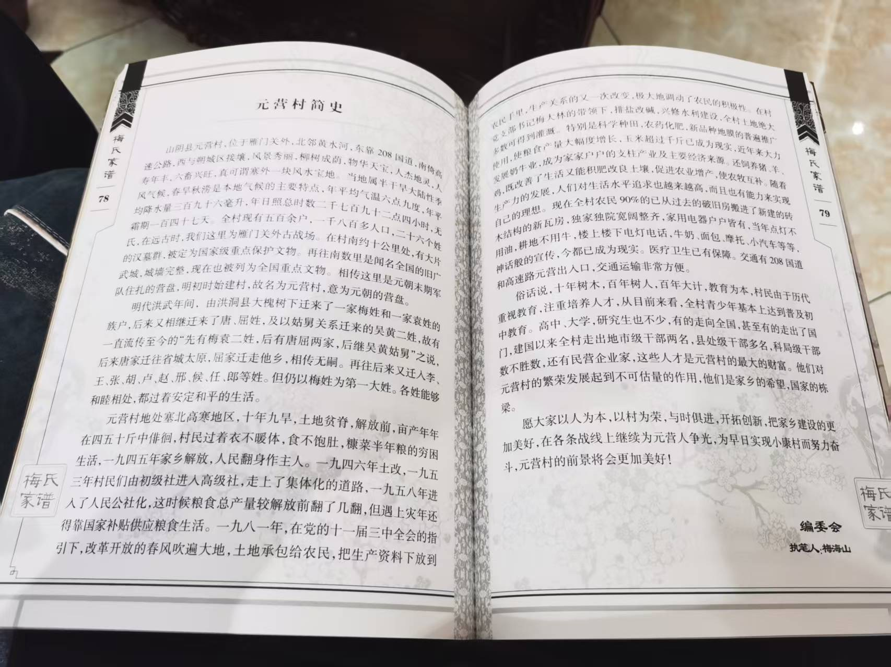<figcaption>元营村｜家藏照片</figcaption></figure>

<figure>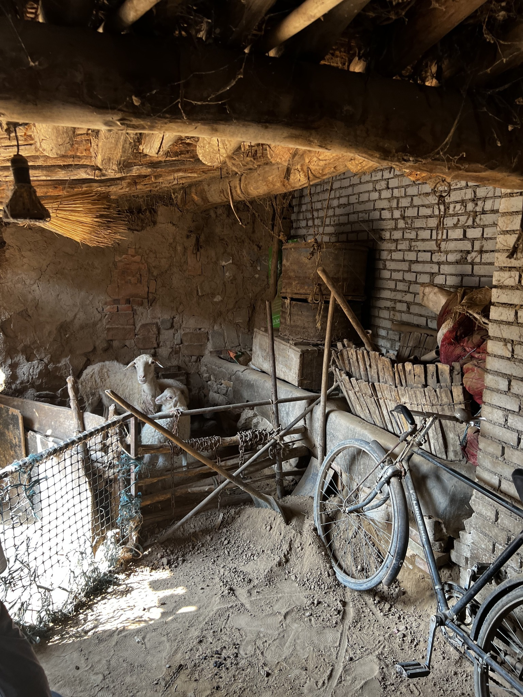<figcaption>元营老宅前院的羊</figcaption></figure>

<figure>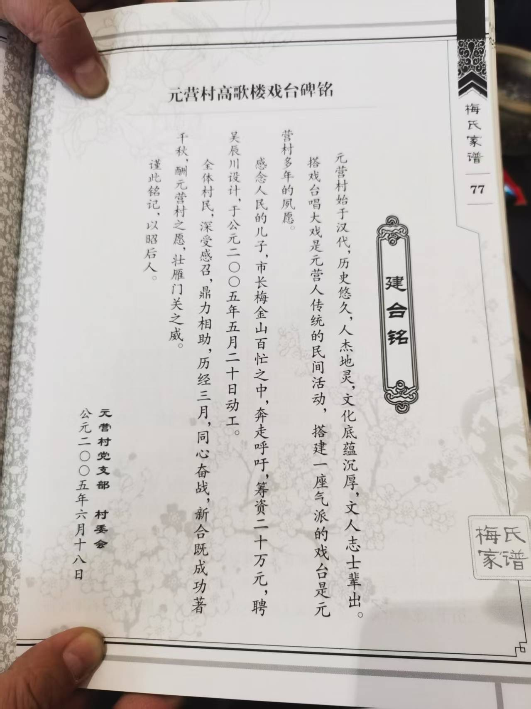<figcaption>元营戏台｜家藏照片</figcaption></figure>

黄水河从元营流过，是桑干河的一条支流。《山阴县志》写它从宁武的薛家洼发源，流过朔城区，到元营进了山阴。再往下是后所、黑圪塔和山阴城，到了应县才汇进桑干河。 <a class="reference" href="#note-1">〔1〕</a>

村子在不同时候归过不同的地方。我查旧地图，有时找不到村名，就先找图上的这条河。

关外冬天常刮西北风，到了开春风还大，雨又少。县志说，修志前后河床淤了，平常的清水断过。真有大水下来，两岸的人又得提防。 <a class="reference" href="#note-1">〔1〕</a>

后来我翻到县志讲牧地的几页，也就明白那里为什么适合放牲口。元营在原来的后所乡，南边沟多，有小泉，北面是盐碱的平川。山坡有针茅、蒿和花苜蓿，平川也有低湿草甸。1997年，元营村一千六百二十四人，养了四百二十只羊、四百九十头奶牛。我第一次见那满眼的玉米时，没想到其中不少是要喂牛的。我爷爷小时候跟母亲赶集，走的就是这一带。<a class="reference" href="#note-1">〔1〕</a>

<figure>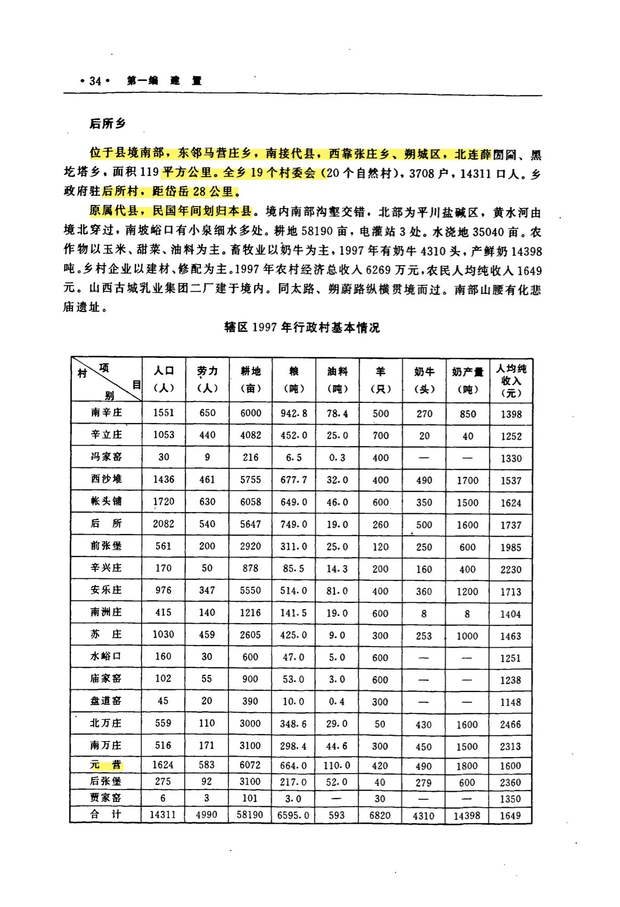<figcaption>《山阴县志》第34页 · 后所乡地形与1997年元营村一行</figcaption></figure>

<figure>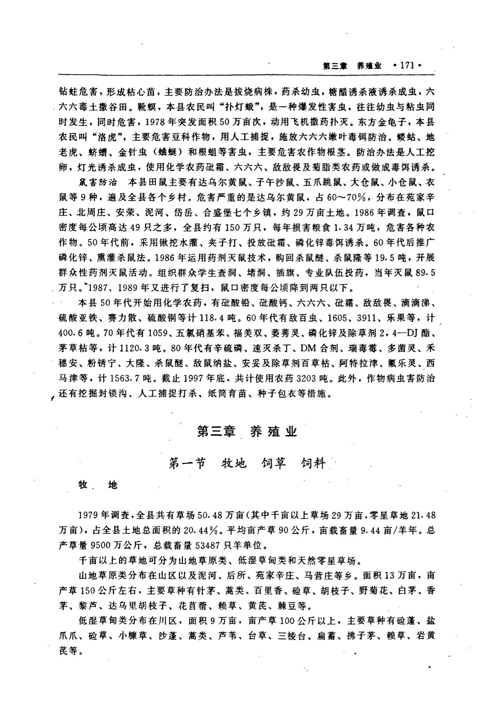<figcaption>《山阴县志》第171页 · 牧地与后所乡的山地草原</figcaption></figure>

## 三、家族追忆 {#family-memories}

### 爷爷小时候 {#grandfather-as-a-boy}

爷爷叫梅世开，1936年出生。说起爷爷，我总觉得自己知道得多。再往上一辈两辈，就得去问父亲梅亮。爷爷的曾祖父梅艳是屠户，开过肉铺。铺子是在元营，是在后所，还是在薛家圐圙，我现在也说不准。按家谱上的代次，他可能跟刘大鹏差不多是一个时代的人。我猜他的买卖做得不错，家里才有余力让几个儿子读书。

梅艳的三个儿子是梅林云、梅祯云和梅喜云。梅喜云最小，是我爷爷的祖父，教过书，家里的书也数他最多。父亲讲到梅喜云，记得家里叫他校长。我查《山阴县志》，后所清末确实办过一所义学，就是地方上为孩子们办的学堂。他具体在哪所学校教书，还要再找教员名册。

那时候小学分初小和高小，能把两段都念完的学校叫完小。1949年，山阴全县只有两所完小、八十二所初小。爷爷念完了初小，还能接着念高小。难怪他自己讲起来一直很骄傲。 <a class="reference" href="#note-1">〔1〕</a> <a class="reference" href="#note-16">〔16〕</a>

爷爷的父亲梅桐也是家里的小儿子。父亲跟我说，梅桐有佝偻病，日子过得不容易。分家时，他分到的就是很多书，是梅喜云以前买的。我有时想，那里面有没有一本他自己爱翻的。家里还记得从前的那一批书。书后来散到哪儿了，已经说不清。

梅桐的妻子是应县人。她会做很细的手工，也会一点家传的看病偏方，具体的方子父亲说不出来。她尤其会挑牲口。

元营北边有个薛家圐圙，附近的人在那里赶集。爷爷小时候跟母亲去，在集上挑牛羊，有时还得当天赶到别的集上卖。我想爷爷那时候得跟着走一天，回来肯定很累。到了我这里，连赶集的地方都知道，还说不上她姓什么。

翻开家谱，父亲提起的那几个人就能对上了。梅艳的儿子是梅喜云，梅喜云的三儿子是梅桐。梅桐有两个儿子，梅世福和梅世开。再翻到第十八页，就能看见我大爷、我爸、姐姐和我。

往前却有接不上的地方。第三页有一个「梅甲」，旁边印着「甲为虚拟」。这是一段暂时接不上的世系，修谱的人先留了一个位置。我很喜欢他们把这几个字留在谱上。后人再翻，也知道还能从这里往下找。

<figure>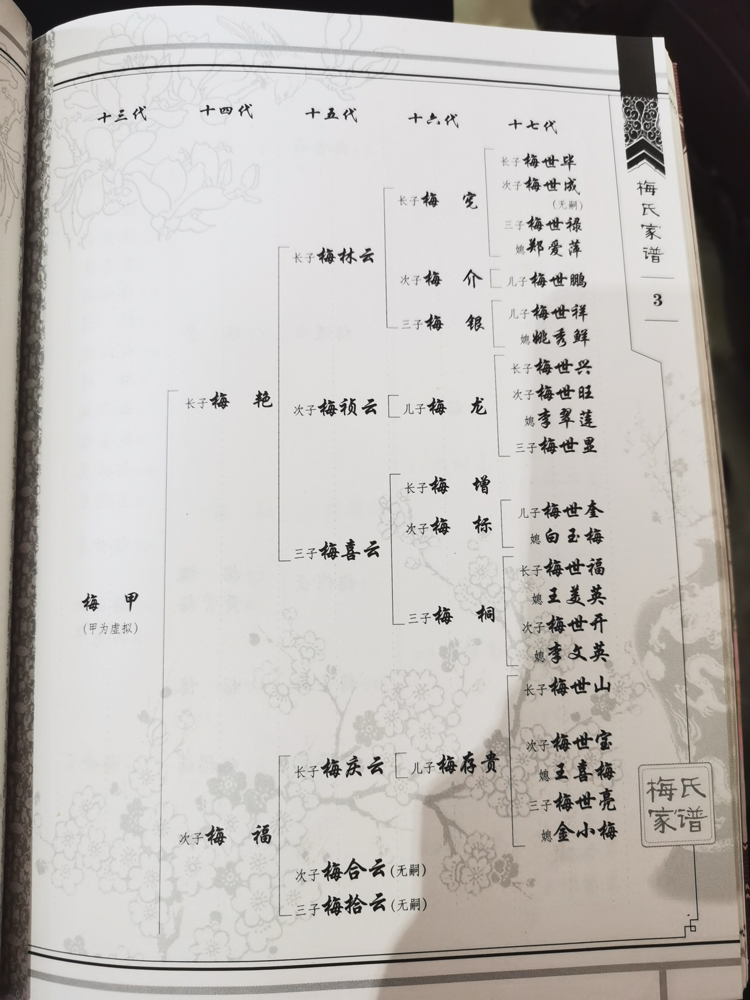<figcaption>《梅氏家谱》第3页 · 梅艳、梅喜云、梅桐与梅世开</figcaption></figure>

<figure>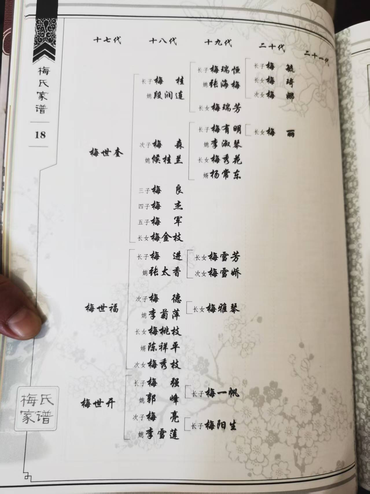<figcaption>《梅氏家谱》第18页 · 梅世开、梅强、梅亮两房</figcaption></figure>

<figure>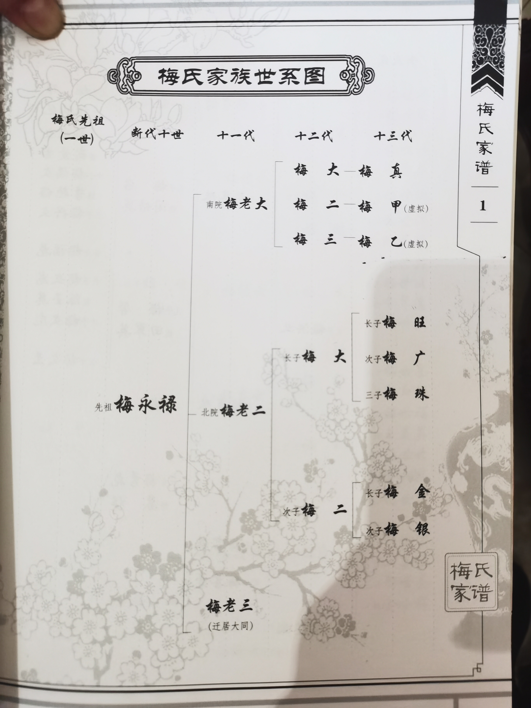<figcaption>《梅氏家谱》世系图首叶 · 元营村记得的梅永禄</figcaption></figure>

爷爷的大哥梅世福先去了太原。爷爷跟着哥哥南下，1952年进了太原重型机器厂。厂在太原汾河以西，1950年才开始建，家里一直叫它「太重」。 <a class="reference" href="#note-15">〔15〕</a>

爷爷走的时候，山阴还属察哈尔省，到了那年年底才随雁北专区划回山西。两兄弟进城以后，元营的老宅留给了梅桐二哥那一房。 <a class="reference" href="#note-1">〔1〕</a>

爷爷在太重参加过文艺活动，喜欢做手工，还买过一台很不错的胶片相机。我见过一张他和工友的合影。他长得高，搂着工友的肩膀。我看着那张照片，总觉得他大概挺能和工友玩到一块儿。

### 奶奶的代县和大青山 {#grandmother}

我奶奶李文英和爷爷同年，都是1936年出生。她家在雁门关内，代县的阳明堡南关。她父亲李成林是家里的大哥，做的是毛皮生意。代县东关有李家的铺子。家里讲到生意最好的时候，常说「半个东关」都是他们的铺面。

李家还在大青山设了个中转站，做北边的生意时，可以把货暂放在那里，再往别处运。奶奶就生在这个中转站，地方在今天呼和浩特以北的武川一带。她出生那年，武川还属绥远省。 <a class="reference" href="#note-2">〔2〕</a>

李成林和第一任妻子有两个女儿，奶奶是长女。他后来和第二任妻子生的两个孩子，都留在了大青山、呼和浩特一带。奶奶同父异母的弟弟那一房，后人到今天还和我们有来往。

奶奶小时候有个最疼她的姑姑。这位姑姑嫁到了周家。奶奶常到代县周家的院子里玩。

那是周玳1930年建的官邸，正房二楼是藏书楼。周玳是代县马站村人，1911年辛亥革命时回太原和阎锡山商议起义。后来他成了阎锡山很倚重的将领，1927年任炮兵司令，次年任第三集团军总参议。 <a class="reference" href="#note-2">〔2〕</a>

奶奶的三叔李成春是李成林的弟弟。家里送他到太原念书。读的是武备学堂还是师范学堂，家里有两种讲法。那时候在山西中北部，女孩多半留在家里帮忙。1918年，隔壁山阴全县七百五十五个小学生里，只有二十九个女生。李家供得起孩子去太原念书，起先也没想过把女孩送进学校。 <a class="reference" href="#note-1">〔1〕</a>

李成春参加了山西牺牲救国同盟会。那是抗战前夕山西组织起来的抗日救亡团体，简称「牺盟会」。1937年，他加入山西青年抗敌决死队，1941年入党。 <a class="reference" href="#note-3">〔3〕</a>

他从部队写信回来，说服大哥和家里人拿出家产，为革命出力。后来他回乡，也劝家里把女孩送去上学。奶奶进学校时年纪已经大了，最后念到高小。李家的几个女孩还接着念了下去，后来也有的去了广州。

后来，李成春成了家里拿主意的人。他到了广州，在广州军区空军负责高射炮防空，做过高炮指挥部司令员，又任军区空军副司令员。原来在代县的那一大家子，也跟着他搬去了广州。 <a class="reference" href="#note-3">〔3〕</a>

我和阿珂去代县找奶奶家的时候，也去了周玳的官邸。宅子在县城一条巷子里，现在是个不大起眼的景点。周玳的后人如今都住在北京。从他们那里才问到，奶奶小时候最亲的姑姑叫李金元，嫁给了周涛。

我们也登门拜访了李家的族人。他们还存着一张手画的世系图，纸上有几道很深的折痕。说起以前和李成春通过信，他们到现在还很骄傲。我和阿珂拍了一张全页，又凑近，把右边的字另外拍了一张。

<figure>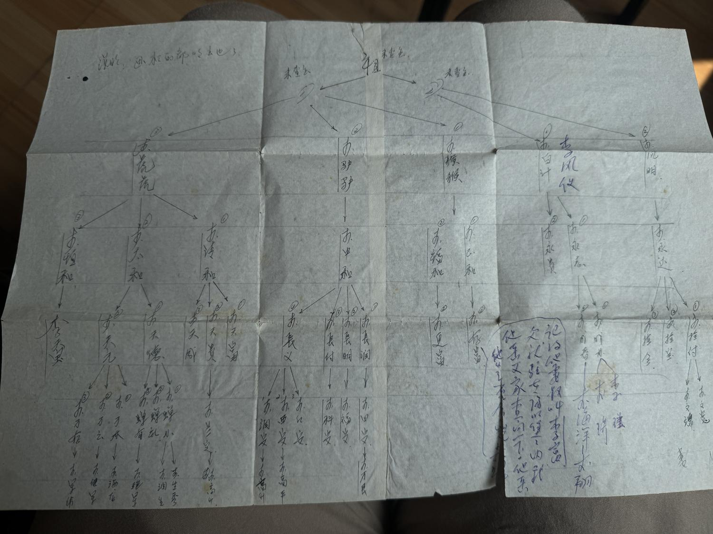<figcaption>代县李氏手绘世系图 · 我和阿珂登门访得，全幅</figcaption></figure>

<figure>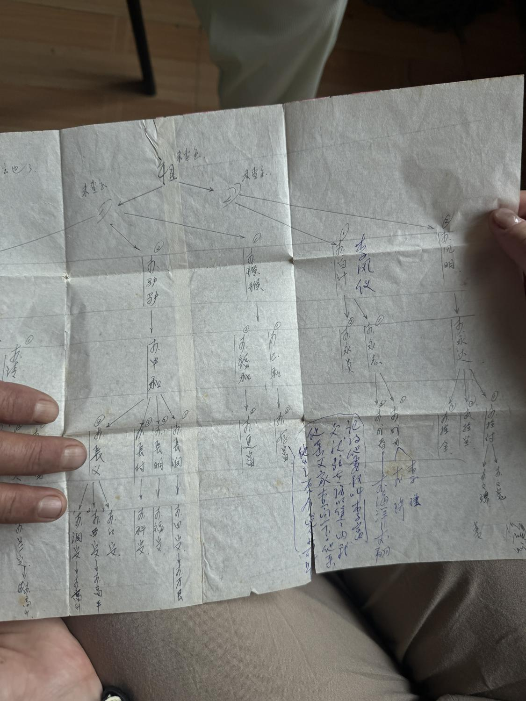<figcaption>代县李氏手绘世系图 · 右半近照，可见后添的蓝字</figcaption></figure>

### 爷爷奶奶后来到了太原 {#taiyuan-grandparents}

爷爷和奶奶是在太重认识的。他们各自结过婚，原来的家里都还有孩子。两个人后来在一起，留在太原河西，有了我大爷梅强和我爸梅亮。

我从前听家里讲起这一段，总是从他们在太重相识开始。长大一些才想到，那几个在前一个家里长大的孩子，如果也来讲这一段，会从哪里说起？

大爷小时候，李成春来过太原，省里有人接待。大爷跟着去，那也是他第一次进省里的招待所，可能是山西宾馆，也可能是迎泽宾馆。他到现在还记得里面的卫生纸，又好看又软。他小时候没见过那样的纸，过了好多年，跟我讲起那一趟，还是先说这个。

### 姥爷和姥姥 {#maternal-grandparents}

想起爷爷奶奶各自留在原来家里的孩子，我就会想到《喜福会》。电影里有个母亲，年轻时在战乱中和两个女儿分开。过了许多年，她在美国长大的女儿才见到两个姐姐。我小时候看这部电影，觉得那样的事离我很远。 <a class="reference" href="#note-16">〔16〕</a>

母亲看《喜福会》会流泪。那时我还小，后来才渐渐想到，她很早就失去了自己的母亲。

我姥爷李步禹1940年出生，老家在太原南边，清徐县的徐沟镇。我问起他的爷爷。姥爷记得名字，说老人家是种地的。他自己的乳名叫玉春，后来写字也用这个名字。

姥爷年轻时在太谷师范念书，那是在晋中太谷培养老师的学校。有位那时候的同学，到老了还告诉他，年轻时喜欢过他，不想带着遗憾走。我后来想，她记得的姥爷，还是我从来没见过的那个年轻人。 <a class="reference" href="#note-15">〔15〕</a>

姥爷从太谷师范去了部队，后来在甘肃武威做了空军地勤团的政委。地勤部队在地面保障飞行，他就在那儿认识了姥姥，是组织介绍的。

姥姥是山西祁县人，做过很多妇女工作，也做过街道工作。我妈李雪莲和她姐姐李雪梅在甘肃生活了很多年。在家里，我管母亲的姐姐叫姨妈妈。有时候我想听她们从小时候讲起，住的是哪条街，邻居是谁。她们记得的那些事里，也还有姥姥当时的样子。

姥姥走得早。姥爷有一阵很孤独，后来再婚，我和我哥都叫她郭姥姥。她也是清徐人，对我们两个都很好。她后来被病折磨得很厉害。想起她，我就想到一个人病到许多事都得请人帮忙，今天想吃点什么、想不想见人，这么小的事也得有人肯停下来问一问。

姥爷离开部队后，到了山西省煤炭地质局做局长助理。这个单位做煤炭资源的地质勘查，我们家一直叫它煤田地质局。姥爷讲起转业，总爱说一句，那时没人愿意要转业军官。 <a class="reference" href="#note-15">〔15〕</a>

后来我妈也在局里做了会计。我爸最早在局里办的天太夜店做工，又到金泉大酒店当大堂经理。那是单位办的服务业，家里管它叫「三产」。再后来，父亲也进了财务处。

2011年，我爸去了北京，在中煤地质工程总公司当财务处长。2017年他到中煤地质水文局做总会计师，后来任党委副书记。我妈2015年去了中煤总局，2025年到大地工程救援勘探做总会计师。

我小时候就住在山西煤田地质局家属区。局里许多职工和家里人住在这片院子里。小时候说放学回家，就是回这个大院。姥爷也住在那里。

姥爷一辈子早睡早起，到了晚年，肚子还是平平的。他十一点多就吃午饭。我和我哥那会儿总是饿，能跟着早点吃，两个人都高兴。午饭吃得早，下午饿得也早。

现在在经济系，我的同学都能准时十二点去吃饭。我十一点就饿得受不了，十一点多已经吃完了。

小时候我一个人在楼下打篮球，姥爷常在阳台上看我。有时候我一抬头，刚好跟他对上眼。那时候我总觉得害羞，没好意思喊他。我现在想起来，还是很后悔。

姥爷现在身体不太好了。要是换成今天的我，一抬头看见他在阳台上，我一定会高高兴兴地跟他打招呼，喊他看我投一个。

### 姥爷写的字 {#calligraphy}

我从小就看姥爷写字。他小时候，看先生在砖墙上写《土地法大纲》，就喜欢上了写字。那是1947年公布的土地改革文件。他后来在部队待了那么多年，心里一直还有写字这件事。 <a class="reference" href="#note-10">〔10〕</a>

他做过山西地质老年书画院的常务副院长，作品在首届「王铎杯」等比赛得过奖。他自己说起来，就是「兴时填纸涂鸦」。

<figure>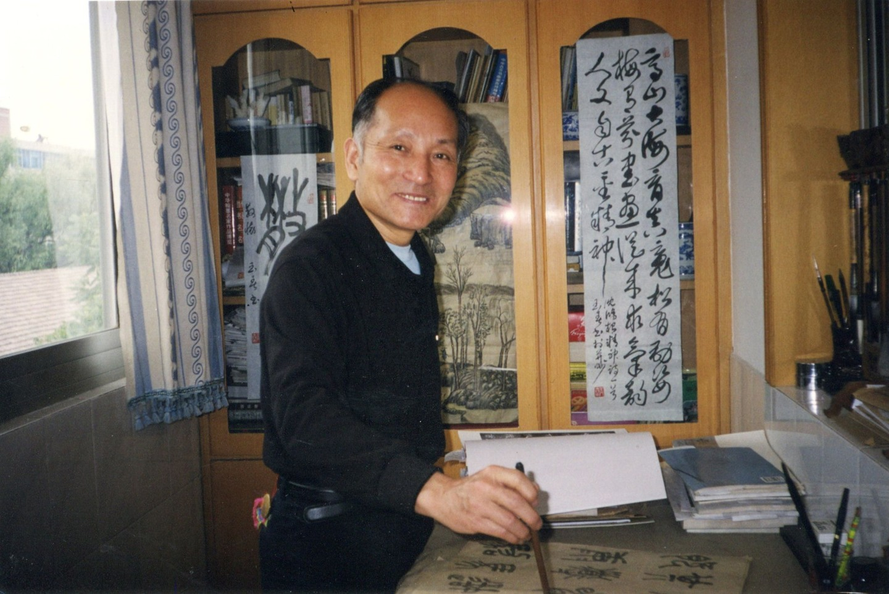<figcaption>姥爷在写字 · 家藏照片</figcaption></figure>

我高中当班长的时候，请姥爷给我们班写过字，挂在教室的墙上。我记得好像一幅写的是「天道酬勤」，另一幅是「梅花香自苦寒来」。我本来就喜欢梅，后一句尤其喜欢。

2019年秋天，我在学校的宿舍看姥爷送给我的曹植《杂诗》，不知怎么就想照着写。我拿了一支很便宜的沾水毛笔，写得很笨拙。一遍一遍地写，一次又一次地哭。

那年冬天，我回到太原，把姥爷从2000年起留下的字几乎全找了出来，铺满了客厅的地板。有些纸已经发黄了，我一张一张地翻。后来我躺在姥爷平时睡的那张床上，才发现自己已经很久没那么安静过了。

2021年1月，我在北京给姥爷的作品集《墨痕流韵·玉春书法》写前言，觉得自己好像在「为姥爷补写他本人的日记」。我不懂书法，就顺着他的笔画想，他的手当时是怎么走的。姥爷跟我说，写字是他一生中最执着的修行。 <a class="reference" href="#note-10">〔10〕</a>

姥爷写过《兵心依旧》，也抄过毛泽东的《七律·长征》。看见这些字，我会想到他在武威当兵的那些年。那时候，我妈和姨妈妈还小。

<figure>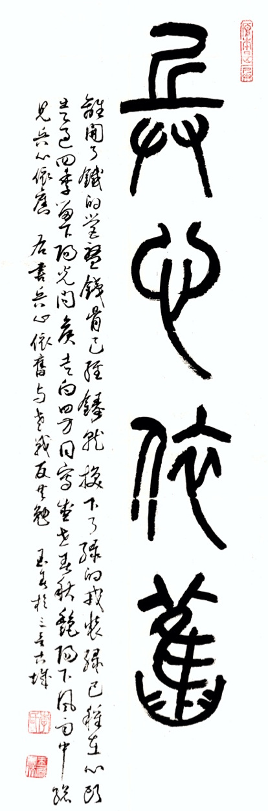<figcaption>姥爷书法 ·《兵心依旧》</figcaption></figure>

<figure>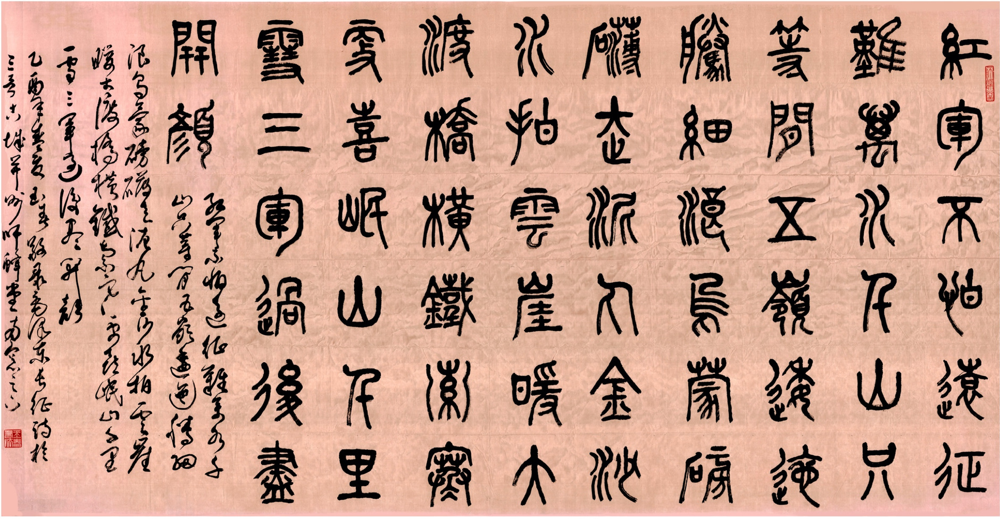<figcaption>姥爷书法 · 毛泽东《七律·长征》</figcaption></figure>

书里第一幅字是《德慧齐家》。这四个字对我们家很要紧。他也写过《童心不泯寿自长》。我熟悉的姥爷，是后来在太原给我们备晚饭的人。我和我哥打完球回去，就能在他那儿吃上饭。

<figure>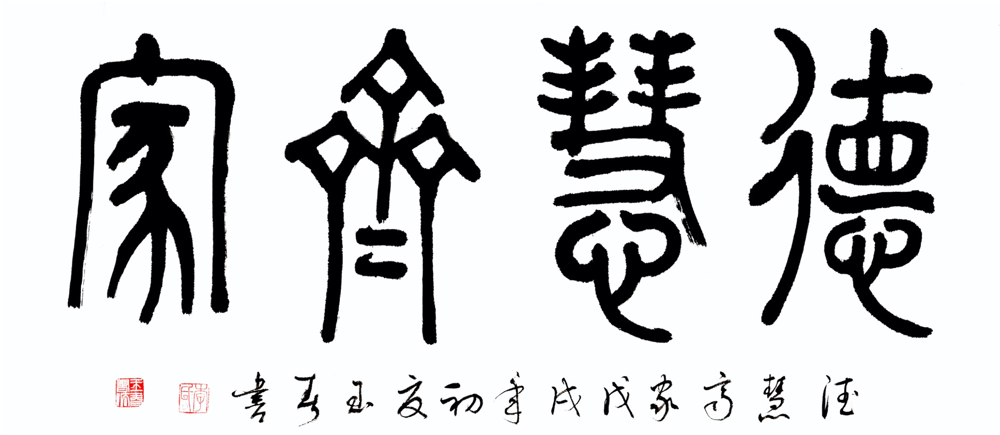<figcaption>姥爷书法 ·《德慧齐家》</figcaption></figure>

<figure>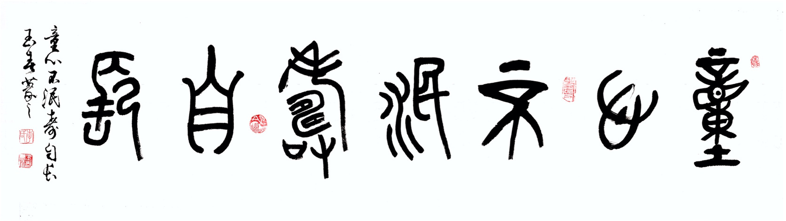<figcaption>姥爷书法 ·《童心不泯寿自长》</figcaption></figure>

我是在煤田地质局家属区长大的，我爸小时候住在太重，爷爷小时候住在元营。我回元营时，村里不少人和我同姓，有些人说话我还听不懂。爷爷家往上那几代人，是怎么在这个村里安下来的？我得先弄清楚，过去元营归哪里管。

## 四、从元营找到了梅枝 {#finding-mei-zhi}

我先照今天的地名去找元营。《山阴县志》在民国十一年（1922）以后的建置沿革里，列了陆续划入山阴的一批村子。元营就在里面。这批村子有的从平鲁来，有的从朔县、代县来，名单上看不出元营归过哪一处。 <a class="reference" href="#note-1">〔1〕</a>

我去翻崇祯年间的《山阴县志》，东沙滩、西沙滩、帐头铺一带都有痕迹。再往西找，《朔州志》里有下水，《马邑县志》里有霍家营。几个邻村都认得出，偏偏没有元营两个字。

黄水河还在流。我顺着旧图上的河道，用星号或箭头把今天元营所在的大概位置标出来。

《代县县志》给了我一点方向。代县城旧称代州。民国时县里第五区的公所设在关外的新广武，也就是当时这一片办事的地方。往北有庞家堡，东北有西盐池，都挨着我正在找的元营。 <a class="reference" href="#note-12">〔12〕</a> <a class="reference" href="#note-15">〔15〕</a>

我又去翻光绪《代州志》的北乡图。图上的里数，是各村离州城有多远。离州城九十里的地方有后所和万家庄，再往外五里，果然就是双寨和元营。乾隆那部《直隶代州志》列了北乡六十六个村，我在里面又见了一次元营。顺着这两本旧志，这个村就找回了代州。

奶奶家的阳明堡也在乾隆这部志里，就在州城西边。爷爷家在关外，奶奶家在关内。那时候从关里往北走，过了关，还是代州。 <a class="reference" href="#note-12">〔12〕</a>

<figure>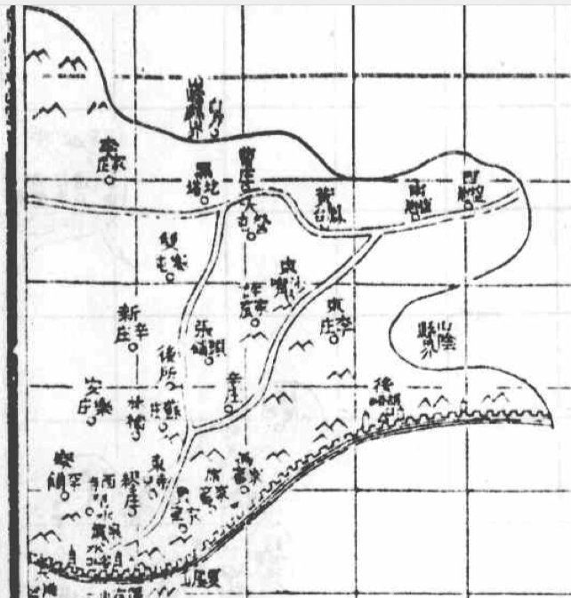<figcaption>光绪《代州志》北乡图 · 元营、双寨与后所</figcaption></figure>

<figure>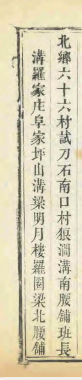<figcaption>乾隆《直隶代州志》北乡村名 · 其中列有元营村</figcaption></figure>

村名是什么时候有的？《山阴县志》的「大事记」把元营解释为元军屯兵的地方，写在蒙古太祖十四年（1219）那一条。要追到营址，还得有更早的军屯记录。我找到明确写着「元营」的最早一处，仍是乾隆年间这份村名表。 <a class="reference" href="#note-1">〔1〕</a>

既然旧时归代州，我就接着翻《直隶代州志》，看它记了哪些人。里面有一张振武卫的百户名录。明代在代州设振武卫驻军，百户是卫里带兵的武官。我往下看，前头是赵继祖、成纪，第三个叫梅枝。 <a class="reference" href="#note-4">〔4〕</a> <a class="reference" href="#note-12">〔12〕</a>

看到这个梅字，我想起村谱记的梅永禄。村里修谱时，老人还记得有一块碑刻着梅永禄的名字。后来碑没了，家谱仍奉他为始迁祖，也就是家里记得最早迁来元营的祖先。谱里把那次迁居推到了明初洪武年间。我想知道，梅枝跟村里记得的梅永禄有没有关系。

<figure>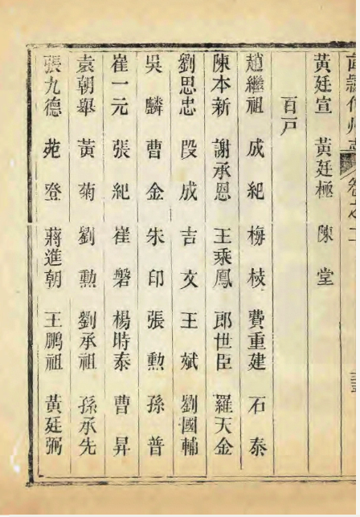<figcaption>《直隶代州志》振武卫百户名录 · 梅枝</figcaption></figure>

后来我去翻《中国明朝档案总汇》第71册。目录里有振武卫，往下有左所，就是卫下一个以方位命名的驻军单位。左所里真有一户梅永禄。第十一辈写的是梅枝，梅永禄的「嫡长男」，也就是他正妻所生的长子。我头一回看到这两个名字出现在同一户人家的档案里。

## 五、选簿里的十四个名字 {#appointment-register}

我原先只想弄清楚梅枝和梅永禄的关系，往下读才知道，这是一种叫「选簿」的册子。明代兵部查武官的履历、确定谁能接任，就要用到这种簿册。为了核一个百户该由谁来做，前任和更早的祖先也要一并查清楚。档案里写「内黄查有」「旧选簿查有」，就是查过早前留下的簿册。

振武卫在军制上归山西都司管，也就是明代山西的地方军事机构，上面是后军都督府。按明初定制，百户所编一百一十二名军士，百户为正六品，下有总旗和小旗领兵。继任的人要查出身、亲属，还要参加比试。 <a class="reference" href="#note-4">〔4〕</a>

下边这些名字，都抄自总汇第71册第46、47页，也就是扫描本第62、63页。我先看到的是梅永禄所在的一户，再顺着簿子一栏一栏往前找。

我按照档案上写的一辈到十四辈顺下来。最早我把它读成了十四代，细看才发现，兄弟和堂兄弟也可以接同一个职。要找家谱里的父子关系，还是得看每一栏写的是谁的儿子、谁的弟弟。

簿上说「实授」，是正式授了这个官。近亲在本房不能任职时先替着做，写的就是「借职」。梅永昌和梅永禄，就得顺着这两个字往下读。

<figure>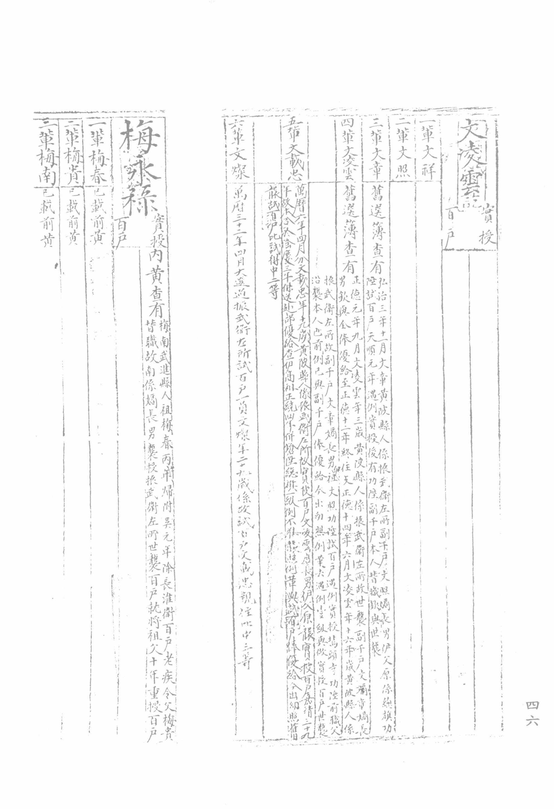<figcaption>《中国明朝档案总汇》第71册，第46页（PDF第62页） · 左栏为梅永禄题头、内黄和第一至第三辈</figcaption></figure>

<table>
<thead>
<tr>
<th>簿次与姓名</th>
<th>档案记载</th>
</tr>
</thead>
<tbody>
<tr>
<td>一辈 · <strong>梅春</strong></td>
<td>「已载前黄」。正文回查内黄，记梅南之祖梅春「丙申归附」，按纪年是1356年。下接「吴元年除长淮卫百户」，吴元年是1367年。</td>
</tr>
<tr>
<td>二辈 · <strong>梅贵</strong></td>
<td>「已载前黄」。按梅南条，从行文可读作梅春老疾，令梅南之父梅贵替职。梅贵是把前后两任接起来的人，此栏无独立年月。</td>
</tr>
<tr>
<td>三辈 · <strong>梅南</strong></td>
<td>「已载前黄」。梅南为武进县人，系嫡长男，袭授振武卫左所世袭百户。末尾见「十年重授百户」，所指年号仍待旁证。</td>
</tr>
<tr>
<td>四辈 · <strong>梅嵩</strong></td>
<td>洪熙元年十二月（1425）。振武卫左所，梅南亲弟。句中还见「失陷」，连在前任的官职叙述中，所指情形和事件待考。</td>
</tr>
<tr>
<td>五辈 · <strong>梅用</strong></td>
<td>正统二年五月（1437）。振武卫左所世袭百户，梅嵩嫡长男。</td>
</tr>
<tr>
<td>六辈 · <strong>梅滋</strong></td>
<td>景泰三年十月（1452）。武进县人，梅用嫡长男，承世袭百户职。原页此处写「振武卫前左所」。</td>
</tr>
<tr>
<td>七辈 · <strong>梅经</strong></td>
<td>成化十六年二月（1480）。武进县人，梅滋嫡长男，承振武卫左所世袭百户职。</td>
</tr>
<tr>
<td>八辈 · <strong>梅钦</strong></td>
<td>正德十六年四月（1521）。武进县人，是振武卫左所世袭百户梅经的嫡长男。「年老」在官职与前任名所在的句子里，按选簿惯用的写法，宜先理解为前任梅经年老。</td>
</tr>
<tr>
<td>九辈 · <strong>梅永昌</strong></td>
<td>嘉靖二十一年二月（1542）。武进县人，是振武卫左所世袭百户梅钦的嫡长男。「年老」同样以修饰前任为宜。隆庆元年另载永昌四十六岁，为实授百户。</td>
</tr>
</tbody>
</table>

<strong>从隆庆到天启，百户在家里几支之间转手</strong>

<table>
<thead>
<tr>
<th>簿次与姓名</th>
<th>档案记载</th>
</tr>
</thead>
<tbody>
<tr>
<td>十辈 · <strong>梅永禄</strong></td>
<td>隆庆元年四月（1567）。振武卫左所实授百户梅永昌，四十六岁，武进县人，当时患疾在所。「有伯叔亲弟梅永禄」，三十八岁，准借职。原页此处读作「左所」。「伯叔亲弟」留原文，关系可先理解为近支同辈，具体房次待核。按年龄倒推，梅永禄约生于1529至1530年。</td>
</tr>
<tr>
<td>十一辈 · <strong>梅枝</strong></td>
<td>万历九年八月（1581）。二十五岁，武进县人，振武卫左所，梅永禄嫡长男，比中三等。旧转录在官职附近辨作「患疾」，此处被印文压住，所指人物待核。</td>
</tr>
<tr>
<td>十二辈 · <strong>梅松</strong></td>
<td>万历十七年十月（1589）。二十八岁，武进县人，振武卫左所，是已故实授百户梅枝的亲弟。条内回叙梅枝曾借替亲伯梅永昌，记万历十四年（1586）「故绝」。当时永昌为僧，仍在本舍，梅松获准再借。若永昌回俗生有可承职的儿子，借职者应退还。末尾旧释「比中一等」，印迹下的字仍待校。</td>
</tr>
<tr>
<td>十三辈 · <strong>梅友竹</strong></td>
<td>万历四十年十月（1612）大选。二十七岁，振武卫左所实授百户，已故实授百户梅松的嫡长男。末尾原页可辨「比中一等」。</td>
</tr>
<tr>
<td>十四辈 · <strong>梅守竹</strong></td>
<td>天启二年正月（1622），补天启元年十二月大选条。三十岁，振武卫左所实授百户，已故梅友竹的堂弟，比中三等。簿里到这里暂时停住，梅守竹的父名还缺一笔。</td>
</tr>
</tbody>
</table>

<figure>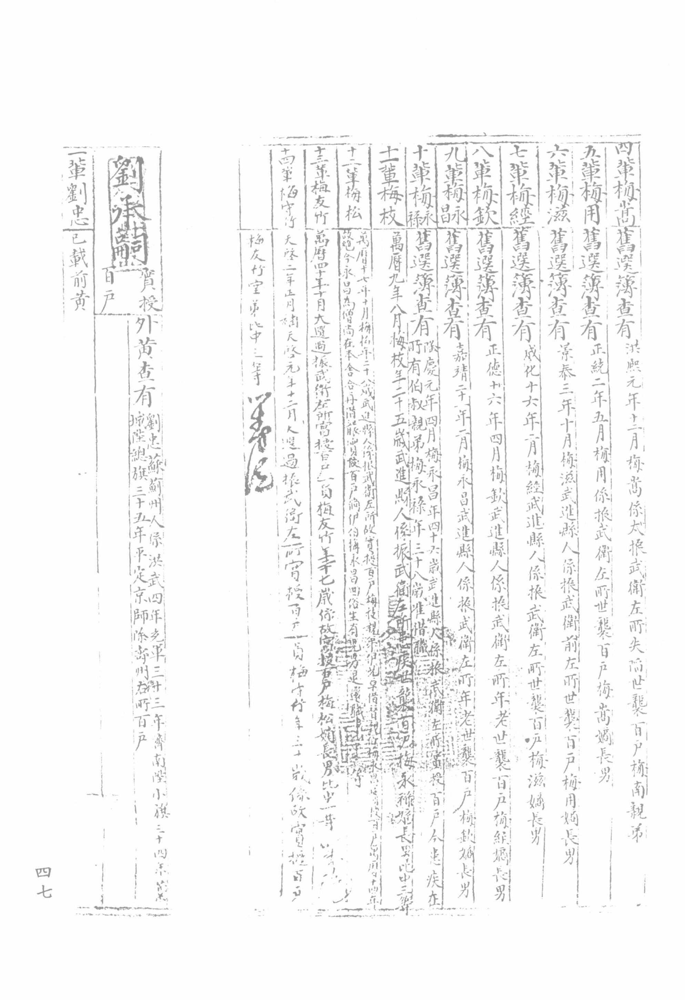<figcaption>《中国明朝档案总汇》第71册，第47页（PDF第63页） · 右至左为第四至第十四辈，部分小字叠有钤印</figcaption></figure>

<em>月份沿用簿上的旧历，括号内是年号对应的公历年份，跨年的地方以原纪年为准。「比中」记的是袭职比试的等第。不同官阶的人都可能比中三等。</em>

我最喜欢读的是永昌、永禄、梅枝和梅松这几栏。永昌患病，永禄来借这个职。到梅松那一栏，永昌已经做了和尚，还「在本舍」。如果他有一天还俗，生了能承职的儿子，梅松这边就得把百户还回去。给谁做，什么情形下要还，簿子写得那么细。翻别家的履历，常看见有人从小旗、总旗凭军功升上来。翻梅家这一户，往前一直翻到「丙申归附」，往后，一个做了和尚的人还有可能回来要这个职。

### 梅家是怎么从武进到元营的 {#from-wujin-to-yuanying}

顺着选簿往前读，最早的人叫梅春。选簿记他「丙申归附」。丙申是1356年，「归附」说的是在开国以前投到了朱元璋这一边。隔了这么久，我居然还能读到他在哪一年做过的一件事。有一瞬间，我从前那种生而为人的孤独，忽然轻了一些。

集庆就是今天的南京。那年春天，朱元璋在集庆一带接收过陈兆先所部降军，后来攻下集庆，把它改叫应天府。下半年，徐达开始围常州，城当时在张士诚手里，到1357年才破。 <a class="reference" href="#note-5">〔5〕</a>

我想知道，梅春是在这些人马里跟着谁来的？他可能原在元军或张士诚一边，也可能出自武进的地方武装。他也可能是在集庆附近投奔的。簿子上只有「丙申归附」四个字。要是能找到同一批归附的人、带队的将领，哪怕多知道一个月日，也能把这件事放回当年的战局里再看。 <a class="reference" href="#note-5">〔5〕</a>

簿上写这家人原籍武进，就是今天江苏常州一带。沿着簿子再往北看，武进和代州之间，还隔着淮河边的长淮卫。「吴元年除长淮卫百户」，说的是1367年授了百户这个官。

我翻《明史·地理志》和《南畿志》，两本都把长淮卫设立的时间记在洪武六年（1373），驻在凤阳的长淮关，就是今天蚌埠东边。两处纪年差了六年。也许先授百户，后来才属长淮卫，抄旧履历时把两件事合到了一条里。也可能旧簿的日期有缺。 <a class="reference" href="#note-6">〔6〕</a>

到梅南，原籍仍写武进，当差的地方已经是代州振武卫左所。洪熙元年（1425）梅嵩的记录也写着左所。想知道梅家哪年北上，还得弄明白梅南条里「十年重授」用的是哪个年号。 <a class="reference" href="#note-4">〔4〕</a> <a class="reference" href="#note-6">〔6〕</a>

到了关外，又是哪一代在元营安了家？我先想到广武。广武在雁门关北面山脚下，是从代州向北出关要经过的地方。梅永禄还年轻的时候，那里的驻军就调动过。 <a class="reference" href="#note-15">〔15〕</a>

《山阴县志》把代州守备移广武记在1540年，乾隆《直隶代州志》说雁门关守备在1544年移驻广武城。「守备」是负责一处驻防的武官。两处称谓不同，可能各说一次调动。 <a class="reference" href="#note-1">〔1〕</a> <a class="reference" href="#note-6">〔6〕</a>

《明世宗实录》还记了一件事。1543年，广武原来接递文书、供应人马的驿站改作军站，归代州振武卫管。前一年，梅永昌已经列在左所。倒推回去，改军站那年他二十出头，梅永禄才十三四岁。此后1552年、1569年，山阴一带也都记有边患。 <a class="reference" href="#note-1">〔1〕</a> <a class="reference" href="#note-6">〔6〕</a>

我猜梅家早就有了振武卫的军籍，其中一房也许是随嘉靖、隆庆年间的调防到了关外，到梅永禄时才搬进元营。元营离后所很近，旧志里的里程只隔一档。我原来也猜过，后所留了个「所」字，元营会不会就是左所。后来翻《山阴县志》，后所村的来历记在朔州卫下面。左所的人或许在元营住过、屯过田，官署究竟在哪里，还得有别的记载。 <a class="reference" href="#note-1">〔1〕</a>

村里记的梅永禄和选簿上的梅永禄，很可能就是同一个人。族谱把他放在洪武年间大槐树移民的时候。选簿写他隆庆元年三十八岁，梅永昌患病，他来借职。我看到那个岁数，又翻回村谱。碑已经没了，老人还是把名字留给了修谱的人。四百多年前，查百户袭职的人也把这个名字写了下来。到了我手里，两处都还读得到。

我想到《梦醒子》的尾声。赤桥村的人说起自己的村子，总觉得那是个世代种地的地方。沈艾娣向村里老人打听日记里提到的人，最先听到的常是农民、地主这些称呼。问得再细一些，才知道有人是村里的鞋匠，有人没有地，靠做纸过活，还有人开过好几座煤矿。 <a class="reference" href="#note-11">〔11〕</a>

元营的族人讲起自家来历，常说我们是从洪洞大槐树迁来的。在晋南的洪洞县，大槐树这个地名一直和明初的迁民连在一起。北方很多人说祖上是从那里来的。 <a class="reference" href="#note-15">〔15〕</a>

照选簿上梅永禄的岁数倒推，他出生时，洪武年间那趟迁民早已过去一百多年。簿子里这支梅家的来路，写着武进、长淮卫和代州。族人还记得梅永禄的名字，我问过的人里，谁也没听说祖上做过世袭武官。

我在选簿里最后读到梅守竹，是天启二年。二十二年后，清军入关。《山阴县志》记着，顺治八年山阴设了守备府，五年后又改为山阴路防御都司。雁门一带仍有驻军，地方志里已经写下了新朝的官职。 <a class="reference" href="#note-1">〔1〕</a>

原先谁病了，谁来借职，哪一房有了儿子，这个百户又该还给谁，明朝的簿子都记得很细。一个百户，对一家人是多大的一件事。到了清代，梅守竹以后的人叫什么，我就接不上了。后来谁还在关上当差，谁开始靠种地过日子，隔着清代这么多年，村里也没人说得清。

### 武进以前还知道什么 {#before-wujin}

再往前，梅春以前，武进这支梅家又是哪里来的？常州方志馆的家谱目录里，也有一部从安徽宣城讲起的谱。毗陵是常州的旧称。《毗陵横山梅氏宗谱》说，梅昆原出宣城，元代迁江阴良信乡。他的孙子梅实在明初迁武进横山奚巷。《坊前梅氏宗谱》的书目里，梅昆的迁处又简录成武进。 <a class="reference" href="#note-7">〔7〕</a>

我们这支梅春1356年已经有活动，梅南一辈已经和北面的卫所有关。真要知道同不同宗，得看两部原谱里有没有能扣在一起的名字和年份。宣城和武进都在长江南边，走陆路也有一段距离。我以前想过，有没有人在元末躲乱过来。这个想法要从哪一房、哪一年搬家说起。往上再说商代梅伯，手上的世系离得还太远。

## 六、父亲、姥爷和我的DNA {#dna}

选簿把梅家的来路指到了武进。再往前，我也看了父亲和姥爷做的Y染色体检测。Y通常由父亲传给儿子。沿着上面的标记往回看，父亲的父亲和更早的父辈，会一代一代排成一条线。姥爷那份报告排的是他自己那边的父系。 <a class="reference" href="#note-8">〔8〕</a>

下表是两份报告列出来的标记。沿着每一行往右读，每一步都是从一个大分支走到它下面一个小一点的分支。有时报告上紧挨着两个名字，完整的遗传树里还隔着几个没列出来的分支。

<table>
<thead>
<tr>
<th>路径</th>
<th>报告显示的标记</th>
</tr>
</thead>
<tbody>
<tr>
<td><strong>两人报告共有的上游</strong></td>
<td>A-P305 → CT-M168 → F-M89 → K2 → O-F175</td>
</tr>
<tr>
<td><strong>父亲 · O1之后</strong></td>
<td>O-F265 → O-M268 → O-PK4 → O-M95 → O-F1803 → O-F1252 → O-F4229 → O-F809 → O-Z23795 → <strong>O-MV378661</strong></td>
</tr>
<tr>
<td><strong>姥爷 · O2之后</strong></td>
<td>O-M122 → O-P201 → O-P164 → O-M134 → O-M117 → O-F8 → O-F438 → <strong>O-MV402380</strong></td>
</tr>
</tbody>
</table>

父亲和姥爷的结果都在名叫O的大分支里。走到下一层，父亲在O1，姥爷在O2。光是都在O，还隔得太远，两个人各自的小支要再往下找。

两份报告在最后一层分别写了「约1420年内」和「约2830年内」。我读到这种说法，也想知道公司是怎么算的。它依赖平台用的树和已有的样本。要把数字用来断一房祖先的年代，还得知道区间怎么算、测到了哪些近支，以及报告是按哪些变异判定的。

父亲的AI说明页另列了一串更细的标记。<strong>O-MF61630 → O-MF63562 → O-MF59345 → O-MF194665 → O-MF260683 → O-MV348868 → O-MV378661</strong>。这串的前端怎么接到正式标记页的O-Z23795，得回到分支树或原始资料看看。AI页又把同一个末端写成「约50年」，正式页写的是「约1420年内」，两处数字各自代表什么也没说清楚。我现在能用来给武进、广武或徐沟定时间的，还是档案和家里的记忆。

### 梅家的父系和江南 {#mei-paternal-line}

父亲这支里，我比较在意的是M95和它下面的F1252。中国西南和东南亚大陆的人群研究都见到过这些标记。论文把M95叫「O2a-M95」，跟今天报告里「O2-M122」的命名版本不同。读的时候记M95、M122，比较不容易弄混。再往下，平台查到的F809、Z23795有不少现代样本在广西、贵州、湖南、云南一带，Z23795也见于海南、浙江。样本今天在什么地方，还要看哪里有人测、哪些旁支后来人多。<a class="reference" href="#note-8">〔8〕</a>

我一开始想，会不会有一支很早生活在南方，后来慢慢到了长江下游，元代已有一房住在武进附近。也可能这条父系很早就在长江流域及其邻近区域有分布，后来各地的分支才有了今天的样子。「荆蛮」和「百越」我都想过。父亲报告里那些标记，能往上追的时间比这些称谓早很多。要给那时的人一个具体的名字，还差年代相近、地方也能对上的材料。

选簿说梅南是武进人，记着长淮卫和振武卫的履历。父亲的结果和江南这个来处相容。若能找到元营谱里几房各自的父系，看看有没有共同的近支突变，还可以往梅永禄以后的世系多问一步。将来武进或宣城若找到较近的匹配，也能把两地的家谱摆在一起读。我原先也猜过元营这房会不会是清代改姓。假如村谱和选簿里的梅永禄确是一个人，明代档案里已经记着他姓梅了。

### 徐沟李家会不会从更西边来 {#xugou}

姥爷家能说清的是清徐徐沟。他的爷爷是种地的。我想过这房人也许在晋中已经住了很久，也想过他们会不会曾在晋、陕、陇，也就是今天山西、陕西和甘肃之间来往，后来才在徐沟住下来。

甘肃临潭有个磨沟墓地，埋的是青铜时代齐家文化的人。研究者在编号为M80的一座墓里，查到4、5、7号三位男性有O-F8。姥爷的遗传树往上走，也经过F8。磨沟的论文还在M117和F8之间列出O-F5。那座墓说明，青铜时代的甘肃已经有人带有这条父系分支。 <a class="reference" href="#note-8">〔8〕</a>

要和徐沟这房人连起来，还得再找离姥爷更近的遗传分支，比如F438、MV402380，或者家里什么时候从哪里搬过来的记录。说到甘肃，家里真正记得的一趟路，是姥爷去武威当兵。更早有没有从那边到山西的人，我还不知道。

我以前也想过鲜卑、沙陀。已经做过古DNA研究的人里，有出自鲜卑宇文氏的北周武帝宇文邕，也有唐末的沙陀将领李克用。前一位的父系是C2，后一位在R1a-Z93下面。姥爷的O系如果判得准，就和这两位具体人物的直系父子相承对不上。一个历史上的人群有许多家人和不同来路，现有的古样本只说得上其中几个人。我还是想先看看徐沟这房人什么时候就在那里种地了。 <a class="reference" href="#note-8">〔8〕</a>

### 我自己的常染色体 {#autosomal-dna}

我也在MyHeritage做过检测，留下来的文件上写着低深度全基因组测序。参考版本build 37指的是用来比对的那一版人类参考基因组，文件里逐处列着我测到的基因型。

我留下过三张常染色体图。常染色体是性染色体以外的染色体，我从父母两边都继承了一部分。图用的是主成分分析，简称PCA，把许多位置上的基因差异变成图上的几个坐标，好把我和用来比较的人放在同一张图上看。 <a class="reference" href="#note-8">〔8〕</a>

把东亚那张图放大，我的点在汉族和满族参考范围重合的地方，也靠近韩国参考样本所在的一边。换成草原和中亚那张图，我的点在图中蒙古、布里亚特和中亚的点群之外。用了哪些参考样本，会影响这张图画出来的样子。

我手上少了足够复算的数据和方法。早先还看过「与黄河流域某墓相似」的结果，也没留该墓的样本号。所以我现在看到的，是我在当时选用的几张图里站在哪里。祖源比例和具体哪一房人，还得再有别的材料。

<figure>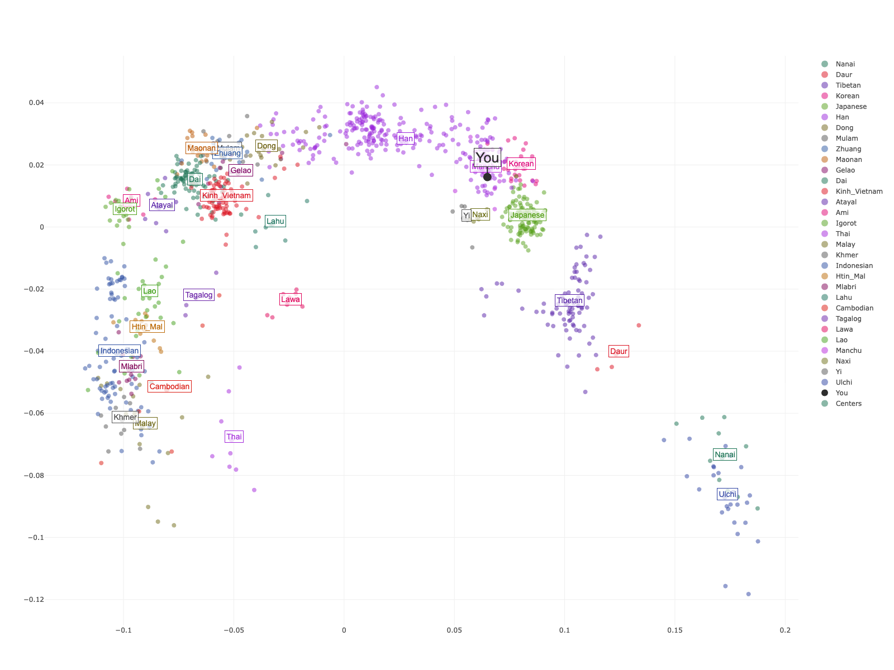<figcaption>常染色体 PCA · 东亚参考样本全图</figcaption></figure>

<figure>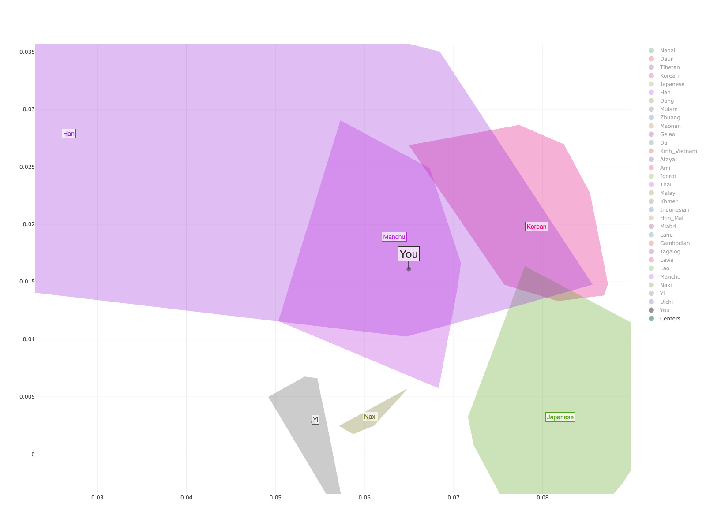<figcaption>常染色体 PCA · 东亚局部放大，汉族与满族参考范围重叠处</figcaption></figure>

<figure>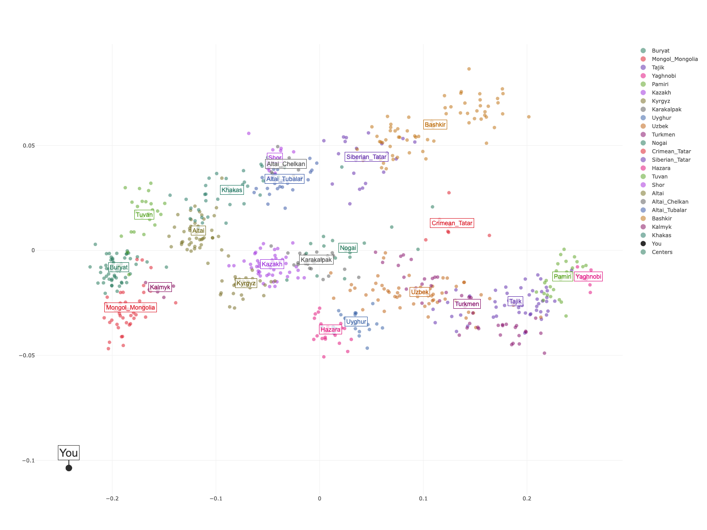<figcaption>常染色体 PCA · 草原及中亚参考样本</figcaption></figure>

我从父亲那里继承了一条Y，也经由母亲继承了姥爷的一部分常染色体。奶奶在大青山出生，姥姥是祁县人，曾祖母带爷爷往薛家圐圙赶集。这些地方，是家里人一点一点讲给我听的。

头一回跟一位挚友说起想写家族记忆，已经快三年了。我做得断断续续。有时候放下很久，读到一页旧志，或者听家里人多讲一句，又想接着做一点。

中间也有了AI工具帮忙。找书、找卷次，纸上有几个字看不清，可以先拿去问。真要把人和年月对上，我还是一页一页翻回去，看看两头的记载能不能接起来。

村里当年编家谱的委员会留住了梅永禄这个名字。我原先只想多知道一点他的事，没想到顺着这个名字，在选簿里又找到了好几辈的人，比当年编谱的人多往前查了一段。读到梅春「丙申归附」的时候，我眼前一下子就有了一个年份。1356年，快七百年前。

也许以后有人想查家里的事，AI一小会儿就能帮他把几份隔了几百年的记载找来。想到有一天，许多人也能找到自己从没见过的那些家人，知道他们在哪儿、在哪一年做过一件什么事，我会想，人会不会就没有那么孤单了？

我还想写一写自己认识的人。他们留给我的有些事，连我自己也已经快忘了。

## 七、后来，我也有了一个老家 {#hometown}

小学老师有一次让我们写老家。我想起来的是乡下的一条小路。我和我哥在车里喝酸奶，窗外的牛粪味怎么也挡不住。车是往清徐开的，去姥爷的老家。我那时很羡慕他，因为他有一个老家。我就把路过的那个村子当作自己的老家，写进了作文。

老师说，故乡就该让人想赞美，让我挑些好的来写。那天我在日记里很认真地写了一句，老家是一个从心里赞美的地方。写下来觉得自己离世界的真理又近了一步。过了很久，真要我说老家在哪里，我还是答不上来。

小时候，太原有两个地方我特别熟。一个是每天放学回去的煤田地质局家属区，一个是爷爷奶奶住的地方。从我家过去得过汾河，他们那一带在汾河西边，我们叫河西。有时得坐39路公交车，我在车上只盼着早一点到。到了就能下楼去玩。

爷爷去世以后，我才渐渐想到，那些我从小就认得的大院和街道，他小时候一个也不知道。他要先从元营出来，走很远，才到了我们每年过节去看他的地方。

### 河西的书柜 {#bookcase}

爷爷家的书柜里放着我大爷梅强和我爸梅亮小时候的照片。大爷前几年跟我讲，我爸小时候长得好看，有外国人到太重参观，还会找他照相。

听他说起那张照片，我想起和阿珂去墨西哥玩的一次。我们在普埃布拉附近的乔卢拉（Cholula），有个小女孩跑过来，要跟阿珂照相。大爷说的那张照片，我现在倒不记得在书柜里见过没有。 <a class="reference" href="#note-15">〔15〕</a>

我很喜欢奥尔罕·帕慕克的《伊斯坦布尔：一座城市的记忆》。他小时候在祖母的客厅里玩，玩累了，就去看桌上和墙上的照片。他也写到，有些童年的事是家里人讲给我们听的，听久了，自己也像是记得。想起太原，有时我也先想起爷爷家的一间屋子。 <a class="reference" href="#note-17">〔17〕</a>

过年的时候，也是在爷爷家里，等人都聚齐了，我们会靠在阳台上看外头放烟花。烟花大多是大爷买的。我爸是弟弟，很少买。我小时候只顾看。现在想起来，大爷大概觉得，到了过年，这是他该做的事。

我现在遇到冷天，还是喜欢在窗边站一会儿。有时站着站着，就想起那些年跟家里人一起靠在阳台上的样子。

想起那间屋子，客厅的沙发上总有奶奶。到了晚年，她已经说不了话了。我记得有一次她在看《血色浪漫》，那是一部从六十年代的北京讲起的电视剧。我小时候光听片名就觉得吓人。电视上有两个人走在铁轨上，她看到那儿就哭了。 <a class="reference" href="#note-16">〔16〕</a>

后来我也看过那部剧。它没怎么打动我。我很不喜欢把社会写成江湖的那种叙事，好像人跟人之间的事，讲一讲义气就能说清楚。奶奶那天想到了什么，我到现在也不知道。

奶奶过世以后，爷爷还会坐下来给她写日记。我不知道他都写了什么，只记得有这么一件事。人已经走了，他还有话愿意写给她。

### 后院那堵矮墙 {#low-wall}

小时候在爷爷家，常跟我玩的是我堂姐梅一凡，大爷的女儿。我一直叫她姐姐。她最喜欢的小狗叫丑丑，是一只小博美。丑丑活了很久，后来也走了。

爷爷家还没拆迁的时候，前头没有公园，后院有一堵矮墙。我看姐姐往上爬，也学她的样子。那堵墙其实不高。我自己下得来，上去的时候，每次都得姐姐牵着我的手拉一把。

玩累了我们就回屋下飞行棋。那盒棋是个便宜的赠品，我到现在还记得。我们能坐在那里下很久。有一回又在矮墙上玩得很晚，直到我爸来喊「快点，要走了」，我就自己下了墙，低着头跟他走。

后来姐姐忙着上学。我趁她不在，学会了自己爬上去。等她回来，我很高兴地跟她讲。

「我已经可以自己爬上去了！我们下去玩吧！」

「哪个啊？哦，那个。不去了。」

后来我还是会自己爬上去。从那里能看见爷爷家前头的公园一点一点修起来。那座公园无论多好，也永远不会属于我。这一点，我很小就认定了。

从前爬那堵矮墙还要姐姐拉一把的弟弟，后来也到了上大学的年纪。去学校的第一天，我穿的是姐姐送给我的一件T恤。

我们最后一次见面时，爷爷奶奶已经不在了。那回我和姐姐又坐在家里下棋，下的是五子棋。可能一共也就下了几盘。我既不想输给她，也不想让她输。等她轻轻松松把我赢了，我才开始好好和她下，觉得以前坐在一起下棋的日子，又回来了一会儿。

上一次跟她在一块儿这么高兴，还是她过生日。我记得那天吃了不少给客人准备的巧克力。

2021年春节，姐姐在日本武藏野美术大学读油画，快毕业了。她给我发过一条消息。

「老弟过年好！牛年天天开心 做自己想做的事」

她就是那一年去世的。我听到消息那天，北京是个大晴天。我站在房间门口，看见父亲在厅里抽烟，母亲陪着他。我还望了望他们身后的窗户。

回了自己的房间，我又看了看窗外，还是一样的晴天。电脑里的游戏还在跑，我忘了按暂停。

后来有一年，我也到了她那时的年纪。现在再读到那条消息里的「老弟」两个字，我还是认得她当时的口气。今夕是何年？对我来说，总还是牛年。 <a class="reference" href="#note-9">〔9〕</a>

### 姨妈妈回来的周末 {#weekends}

小时候有些周末我就留在自己住的大院。姥爷也住在煤田地质局家属区，每周母亲和姨妈妈都回来看他。我哥是姨妈妈的儿子。他一来，我们通常先拿上球下楼。

先在院里练运球，琢磨怎么过人。觉得差不多了，再走去坞城路的山西大学。我们叫它山大。到了山大的球场，我们就找别人打，看看在院里练了半天的招是不是真能用。 <a class="reference" href="#note-14">〔14〕</a>

另一个我们常去的地方在长风街一带。那里有座图书大厦，叫得一文化广场，当年做的是图书批发和零售。我们都叫它「得一」，想去买几本书，有时坐公交，有时从大院一路走过去。 <a class="reference" href="#note-14">〔14〕</a>

得一里头有个卖漫画的地方，在当时算很先锋。我和我哥除了去得一，也去山大图书馆附近卖旧书的地方。我在那里买过很多《米老鼠》，如今连一个故事都想不起来了。

打完球往大院走，通常已经是傍晚。到了家，姥爷给我们准备了晚饭。他熬的小米稀饭里会放红枣。我小时候再饿，也不喜欢那碗稀饭里的枣。

要说我们俩都爱吃的东西，那就有六味斋的熟牛肉和蛋卷。六味斋是太原做酱肉、卖熟食的老字号。 <a class="reference" href="#note-14">〔14〕</a>

到了过年，姨父也做菜。他爱做带鱼。我最喜欢他做的虎皮尖椒，他也特别喜欢给我做。

姨父的老家在忻州乡下。我哥过十二岁生日那回，我还跟着去他老家的村里玩过。在村里的黑网吧丢了五十块钱，这件事我到现在还记得。

在大院里吃完饭，我通常跑着上楼，好多打会儿游戏。有时候我和我哥也在家里玩。书房里有一顶我们俩支过的帐篷。

那时候大院的锅炉房还烧煤。院里有人走街串巷给人磨菜刀，我们叫「锵菜刀」。也有卖面的面包车，车上的喇叭喊「二厂送面了」。我很久都以为面是送的。问了我妈，才知道还得花钱买。

我哥的孩子也慢慢长大了。我有时想起我哥，先想起的还是我们俩拿着球一起出门往山大去的时候。

离家以后，有时我在阳台上闻到中国菜的香味，就想起那条从球场往家走的路。天快黑了，我们刚打完球，正往大院走。我把那个味道写在给母亲的信里。我跟她说，你也知道，我已经很久不打篮球了。

### 十三岁以后 {#after-thirteen}

我十三岁去寄宿学校。那以后，住在家里的日子就少了。再后来我去了北京，又去了美国。有时候我觉得，自己跟父母、跟家里的缘分好像是浅的。

我以前和父亲聊过，到底什么才算福报。儿孙都在身边，隔几天就能一起吃顿饭，是福报吗？儿孙走得远，在外头过得好，很久才能见上一面，又是不是福报？我自己到现在也没想明白。

回想从前一家人还住在一起的时候，我常想到我家那个很小的餐厅。暖气旁边的地上，放着一箱巧克力奶。我想喝的时候，就像小猫一样，从箱子里拿一袋。家里别的人不喝奶。

那一箱一箱，都是母亲拎上楼给我喝的。我小时候只知道，想喝的时候，那里总有。

### 今天吃大胖面吗 {#big-fat-noodles}

我还记得家里几个人做的饭。爷爷做得最好吃的是葱爆羊肉。我爸也很爱做羊肉，我总觉得他做不出爷爷那个味道。

我小时候很讨厌胡萝卜。有一次我爸把胡萝卜切成丝，放进羊肉汤里，还放了些粉丝。我低头大口吃起来，粉丝和胡萝卜丝都吃进去了。那是我第一次觉得，原来胡萝卜也能这么好吃。

我妈做的饭里，我最常惦记的是剔尖。那是一种山西面食，把和软的面放在盘里，用筷子沿盘边一根一根剔进开水。剔出来的面两头尖，中间胖。我们家管它叫大胖面。 <a class="reference" href="#note-14">〔14〕</a>

我妈很喜欢听我这么叫。我小时候从太原九一小学放学回家，刚进门，常常就问她一句。

「今天吃大胖面吗？」

也不知道是什么时候，它成了我最喜欢吃的面。后来在北京，我的一个挚友也喜欢上了剔尖。阿珂也喜欢。我到现在说起来，还是叫大胖面。

## 尾声 {#epilogue}

我叫阳生。我大爷、大娘和爷爷叫我的时候，常把这两个字念成「yangserr」。阿珂觉得这一声特别好听。

爷爷叫我的声音是什么样子，我已经记不清了。

要是有一天能在梦里见到爷爷，他再叫一声我的名字，我想我还是会答应的。

醒来以后，也只是空对西风数去鸦吧。

::: {.source-notes}

## 图版与出处 {#illustrations-and-sources}

<strong>【1】元营与关外。</strong> 李志斌、黄冀主编《山阴县志》，中国华侨出版社，1999年。建置及雁北区划见第7–9、34页，地形、黄水河、气候见第44–45、48–54页，入学人数见第87页，牧地、草种与饲草见第171–172页，义学和小学见第283–284页，后所村与广武守防见第400页，元营地名说及明代大事见第609–610页。文中村级统计取第34页1997年表。<a href="https://ci.nii.ac.jp/ncid/BA75342713">馆藏目录</a>

<strong>【2】大青山与周玳官邸。</strong> 大青山中转站及武川一带的地点，见家族口述和家藏《梅氏先祖》。武川县民国时期的所属见<a href="https://www.nmgqq.com.cn/quqinggailan/jianzhiyange/huhehaote/2021-04-26/21676.html">方志资料〈呼和浩特市武川县（一）〉</a>。周玳籍贯、任职及官邸见<a href="https://www.xzrbw.com/info/3078/412397.htm">《忻州日报》〈周玳官邸〉</a>，晋系炮兵任职另见<a href="https://m.fx361.com/news/2017/0714/2041497.html">〈胸中有沟壑 爱意充盈之〉</a>。李金元与周涛的婚姻，是我和阿珂向周家后人问来的。奶奶童年的细节来自家族回忆，手绘世系图由代县李氏族人出示。 <a href="https://www.wuchuan.gov.cn/sywc/qywc/lsyg/">武川县人民政府〈历史沿革〉</a>

<strong>【3】李成春。</strong> <a href="https://m1.rw.ttdm.cn/history/9/lichengchun.html">〈李成春〉人物资料</a>。牺盟会、决死队的背景见<a href="https://dangshi.people.com.cn/n/2015/0114/c85037-26383785.html">人民网党史频道〈革命圣地山西国师纪念馆〉</a>。牺盟会成员经历、劝家中献产与送女孩上学、成为家主及全家迁广州等细节，来自家族记忆。太原所读学校尚待核定。 <a href="https://cn.govopendata.com/renminribao/1985/09/16/5/">《人民日报》关于牺盟会和山西决死队的回顾</a>

<strong>【4】梅永禄条。</strong> 中国第一历史档案馆、辽宁省档案馆编《中国明朝档案总汇》第71册，广西师范大学出版社，2001年，印刷页46–47（此扫描本PDF第62–63页）。释读时参照我在《梅氏先祖》《从江南到雁北元营梅氏》里转录的选簿。百户编制见<a href="https://m.cidianwang.com/wenxue/guoxue/shibu/182777.htm">《明史》卷七十六《职官志》</a>，武职审查、比试与选簿制度见<a href="https://www11.ihp.sinica.edu.tw/storage/w2_file/3157ztxEQpA.pdf">于志嘉〈明武职选簿与卫所武官定制的研究〉</a>。家藏《梅氏家谱》另见第1、3、18页世系图及〈祖茔考略〉、〈始迁先祖梅永禄考略〉等资料。家谱与官册各自使用的代数，按原文保留。

<strong>【5】丙申归附背景。</strong> <a href="https://zh.wikisource.org/zh-hans/%E6%98%8E%E5%8F%B2/%E5%8D%B7125">《明史》卷一百二十五〈徐达传〉</a>，<a href="https://www.shidianguji.com/book/HY2451/chapter/1kp9f2kvaiejf">《明名臣言行录》卷二</a>，以及<a href="https://zh.wikisource.org/zh-hans/%E5%A4%A7%E6%98%8E%E5%A4%AA%E7%A5%96%E9%AB%98%E7%9A%87%E5%B8%9D%E5%AE%9E%E5%BD%95/%E5%8D%B7046">《明太祖实录》卷四十六</a>。 <a href="https://dfz.nanjing.gov.cn/gzdt/202403/t20240326_4195220.html">南京市地方志办〈明代开国功臣之首——徐达〉</a>

<strong>【6】长淮卫与广武。</strong> 长淮卫参见<a href="https://zh.wikisource.org/zh-hans/%E6%98%8E%E5%8F%B2_(%E5%9B%9B%E5%BA%93%E5%85%A8%E4%B9%A6%E6%9C%AC)/%E5%8D%B7040">《明史》卷四十《地理志》</a>及<a href="https://www.shidianguji.com/book/CADAL02037188/chapter/1l7m65ewv9nvm">《南畿志》卷九</a>，广武军站见<a href="https://ctext.org/wiki.pl?chapter=453441&amp;if=en&amp;remap=gb">《明世宗实录》卷二百七十六</a>，守备移驻另见<a href="https://www.shidianguji.com/book/NLG312001067645/chapter/1la712ido2qt0">乾隆《直隶代州志》</a>。图里的星号和箭头是我标的，用来比对元营的位置。

<strong>【7】武进梅氏。</strong> <a href="https://fzg.changzhou.gov.cn/html/fzg/2014/KHPNMFLI_0823/204.html">常州方志馆〈家族谱牒〉，所录《毗陵横山梅氏宗谱》</a>及<a href="https://www.guoxuedashi.com/shumu/1997992lt.html">《坊前梅氏宗谱》书目</a>。两份为目录提要。 <a href="https://www.changzhou.gov.cn/ns_class/zjcz_01_01">常州市政府〈历史名城〉</a>

<strong>【8】父系与人群对照。</strong> 家藏两份23魔方遗传标记历史截图，父亲另有平台AI说明页。M95、F1252见<a href="https://doi.org/10.1371/journal.pone.0101020">Zhang等，2014</a>，临潭磨沟O-F8样本见<a href="https://doi.org/10.15184/aqy.2022.157">Ren等，2023</a>。北周武帝和李克用古DNA分别见<a href="https://pubmed.ncbi.nlm.nih.gov/38552628/">Du等，2024</a>与<a href="https://www.sciencedirect.com/science/article/pii/S1673852726001475">Yu等，2026</a>。常染色体部分据家藏MyHeritage位点表的文件头和三张旧PCA图。 <a href="https://www.genome.gov/about-genomics/fact-sheets/Y-Chromosome-facts">美国国家人类基因组研究所Y染色体简介</a> · <a href="https://pmc.ncbi.nlm.nih.gov/articles/PMC6007879/">遗传研究中的主成分分析</a>

<strong>【9】家里的声音与文字。</strong> 生活细节来自我和父亲梅亮、大爷及其他家人的交谈，也见于我以前的日记、文章和信。刘大鹏生平与日记可见<a href="https://rccsh.sxu.edu.cn/zxdt/7a2c48fb097e4184bb0ab3853ef38254.htm">山西大学中国社会史研究中心</a>。

<strong>【10】姥爷的书法。</strong> 据家藏《墨痕流韵·玉春书法》。姥爷生平见卷首简介，2019年临字与整理旧作的经过见我写的〈前言〉（2021年1月，北京）。《德慧齐家》见正文第2–3页，毛泽东《七律·长征》见第40–41页，《兵心依旧》见第44页，《童心不泯寿自长》见第46–47页。照片取自家藏的书法资料。 <a href="https://www.chnmuseum.cn/zp/zpml/gmww/202112/t20211214_253215.shtml">中国国家博物馆藏《中国土地法大纲》</a>

<strong>【11】赤桥村的旧事。</strong> 沈艾娣《梦醒子》，赵妍杰译，北京大学出版社，2013年，尾声。英文原版见 Henrietta Harrison, <em>The Man Awakened from Dreams</em>, Stanford University Press, 2005, pp. 165–167。<a href="https://books.google.com/books/about/The_Man_Awakened_from_Dreams.html?id=Mgr_cD_Y9zcC">英文版书目信息</a>

<strong>【12】雁门关内外。</strong> 元好问《雁门关外》全文。乾隆《直隶代州志》记阳明堡在州治以西，列元营为北乡村。<a href="https://www.gushiwen.cn/shiwenv_2e90c6e5d2aa.aspx">《雁门关外》原文</a> · <a href="https://www.shidianguji.com/book/NLG312001067645/chapter/1la712ido2qt0">《直隶代州志》</a> <a href="https://sjfw.mct.gov.cn/site/dataservice/culdetails?curId=10&amp;id=34809">文化和旅游部雁门关资料</a> · <a href="https://sx.people.com.cn/n2/2024/0805/c189134-40933864.html">人民日报关于代州与振武卫的介绍</a>

<strong>【13】梅姓的旧说与谱牒。</strong> <a href="https://fzg.changzhou.gov.cn/html/fzg/2014/OQHCOHAJ_1027/253.html">常州史志〈姓氏源流〉所引《通志·氏族略》</a> · <a href="https://www.guoxuedashi.com/jiapu/58397yddo.html">安徽宣城《梅氏宗谱》书目</a> · <a href="https://fzg.changzhou.gov.cn/html/fzg/2014/KHPNMFLI_0823/204.html">常州方志馆〈家族谱牒〉</a>。

<strong>【14】太原的家常去处和吃食。</strong> <a href="https://finance.people.com.cn/n/2014/0421/c1004-24920187.html">2014年关于得一文化广场的报道</a> · <a href="https://goldcorn.cn/html/gouwuchangsuo/201301/22-50003.html">2013年书店地址汇编中的长风街书市</a> · <a href="https://jjc.sxu.edu.cn/xyjs/wcxq/xqgk1/index.htm">山西大学坞城校区概况</a> · <a href="https://www.ihchina.cn/art/detail/id/14666.html">中国非遗网〈六味斋酱肉传统制作技艺〉</a> · <a href="https://www.tygxc.com/site/tygxc_cn/wzgc/mstj/detail2021-10-26-101.html">太原古县城〈老太原酱肉剔尖面〉</a>

<strong>【15】地名、工厂和学校。</strong> <a href="https://www.ndrc.gov.cn/fggz/cxhgjsfz/dfjz/200611/t20061106_1155404.html">国家发改委〈太原重型机械集团有限公司〉</a> · <a href="https://cn.govopendata.com/renminribao/1959/09/22/12/">1959年《人民日报》关于汾河西岸重型机器厂的报道</a> · <a href="https://www.mtdzfh.com/Home/Index/show_news/nid/356/cid/16.html">煤炭工业协会煤炭地质分会关于山西省煤炭地质局的资料</a> · <a href="https://www.moe.gov.cn/srcsite/A03/s181/201004/t20100408_91742.html">教育部关于太谷师范学校的资料</a> · <a href="https://www.mva.gov.cn/xinwen/dfdt/202409/t20240929_446119.html">退役军人事务部网站关于广武镇的介绍</a> · <a href="https://www.zhoukou.gov.cn/page_pc/zjzk/zkyx/zkwh/article41fb42f6948c400290bdfeda55907067.html">地方志资料〈老家洪洞〉</a> · <a href="https://lugares.inah.gob.mx/es/node/4336">墨西哥国家人类学与历史研究所的乔卢拉介绍</a>

<strong>【16】读书、学制与影视。</strong> <a href="https://www.cambridge.org/core/journals/annales-histoire-sciences-sociales">《年鉴》期刊介绍</a> · <a href="https://www.gdwsw.gov.cn/shsy/content/post_21971.html">文史广东〈民国时期的小学和幼稚园〉</a> · <a href="https://catalog.afi.com/Catalog/moviedetails/59573">美国电影学会《喜福会》资料</a> · <a href="https://www.iqiyi.com/a_12z3ly177jt.html">《血色浪漫》剧情简介</a>

<strong>【17】帕慕克的家族记忆。</strong> 奥尔罕·帕慕克《伊斯坦布尔：一座城市的记忆》，<a href="https://www.ecampus.com/istanbul-memories-city-reprint-orhan-pamuk/bk/9781400033881">英文版第一、二章节选</a> · <a href="https://www.penguinrandomhouse.com/books/126387/istanbul-by-orhan-pamuk/9781400033881/readers-guide">出版社阅读指南</a>

### 寻村时翻过的几部方志 {#gazetteer-plates}

<figure>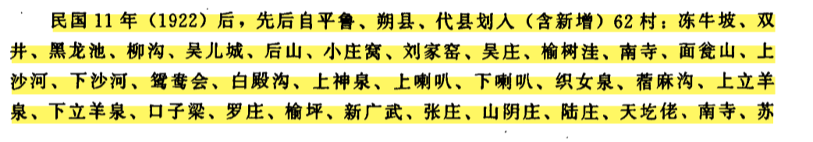<figcaption>《山阴县志》｜建置沿革</figcaption></figure>

<figure>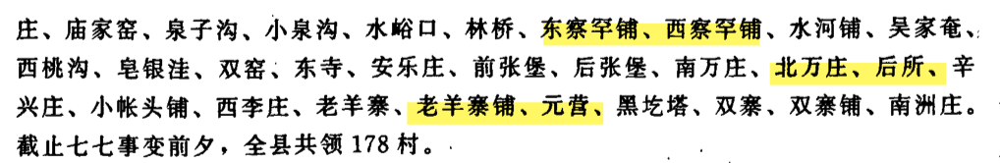<figcaption>《山阴县志》｜建置沿革</figcaption></figure>

<figure>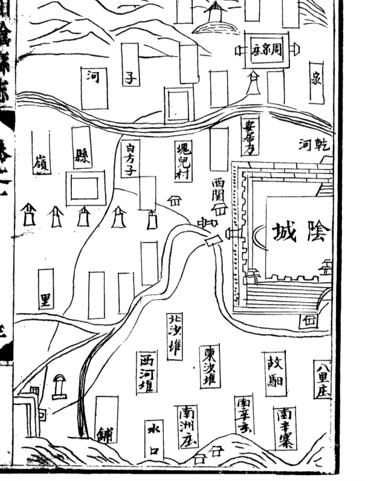<figcaption>崇祯《山阴县志》｜查找元营的邻村线索</figcaption></figure>

<figure>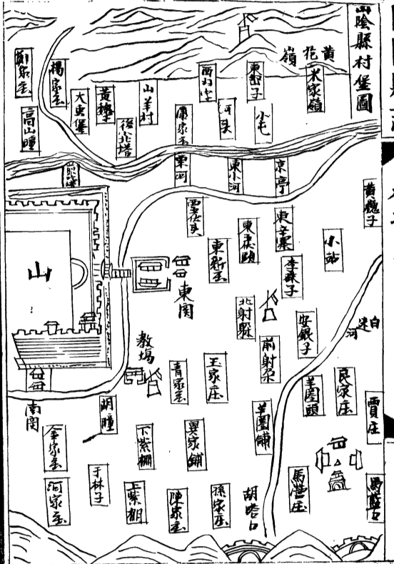<figcaption>崇祯《山阴县志》｜查找元营的邻村线索</figcaption></figure>

<figure>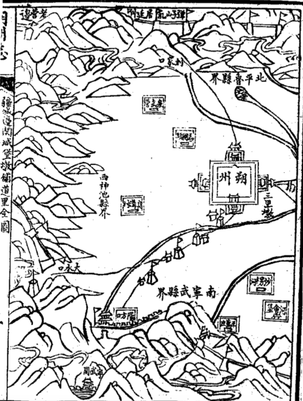<figcaption>雍正《朔州志》｜查找元营的邻村线索</figcaption></figure>

<figure>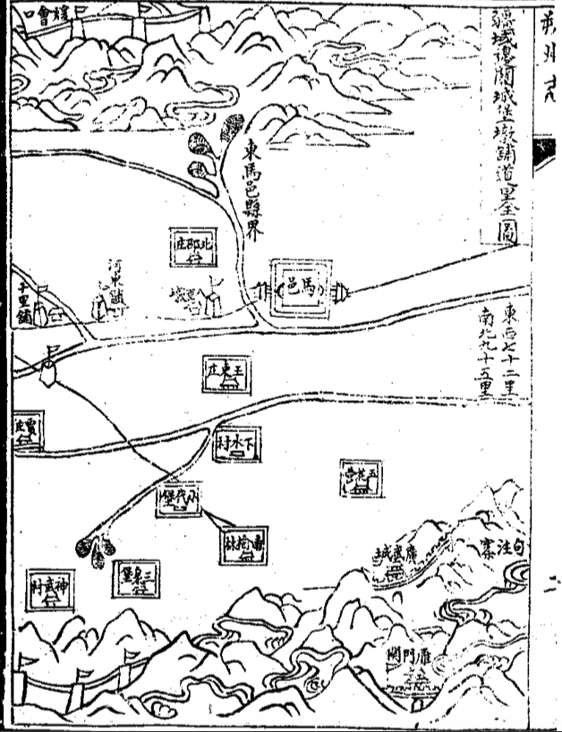<figcaption>雍正《朔州志》｜查找元营的邻村线索</figcaption></figure>

<figure>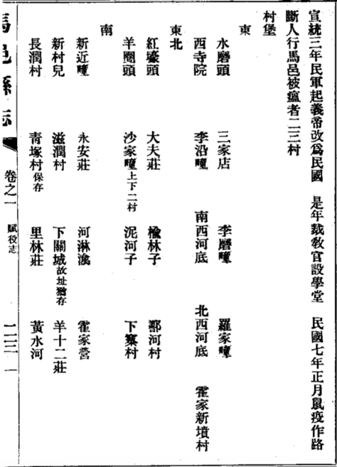<figcaption>《马邑县志》｜邻近村庄</figcaption></figure>

<figure>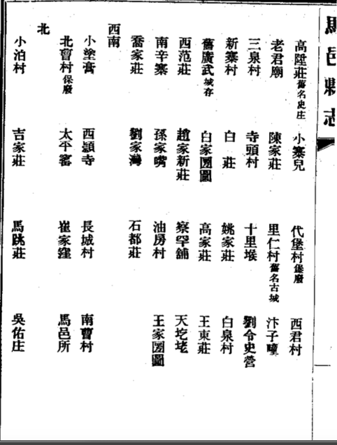<figcaption>《马邑县志》｜邻近村庄</figcaption></figure>

<figure>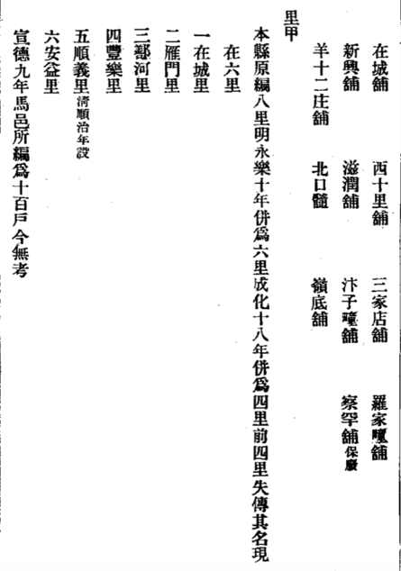<figcaption>《马邑县志》｜邻近村庄</figcaption></figure>

<figure>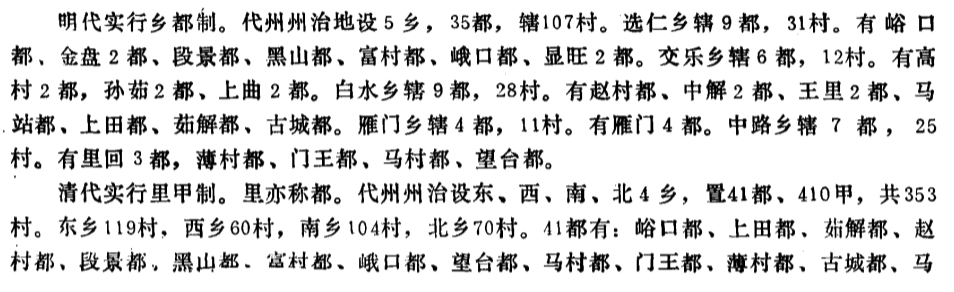<figcaption>《代县县志》｜北乡与民国第五区</figcaption></figure>

<figure>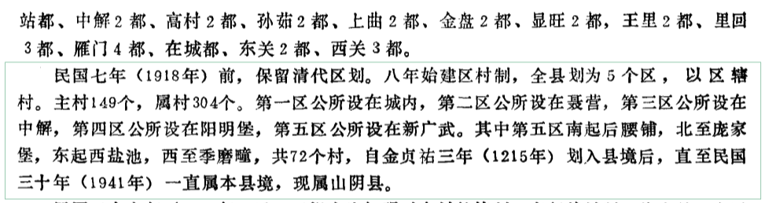<figcaption>《代县县志》｜北乡与民国第五区</figcaption></figure>

<figure>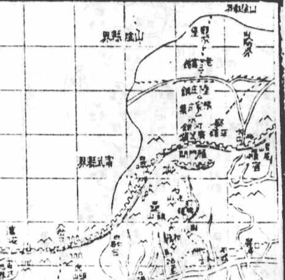<figcaption>光绪《代州志》｜疆域线索</figcaption></figure>

<figure>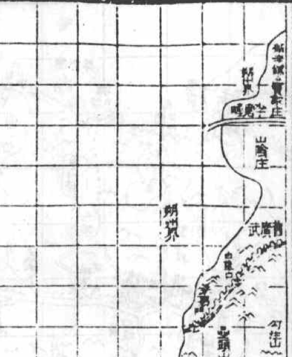<figcaption>光绪《代州志》｜疆域线索</figcaption></figure>

<figure>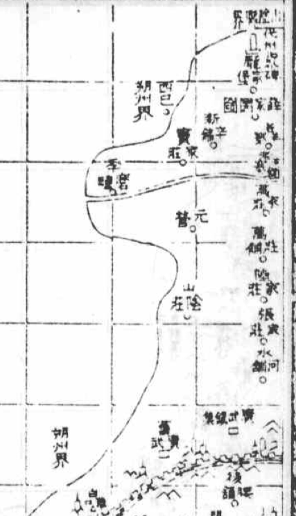<figcaption>光绪《代州志》｜北乡图与里程</figcaption></figure>

<figure>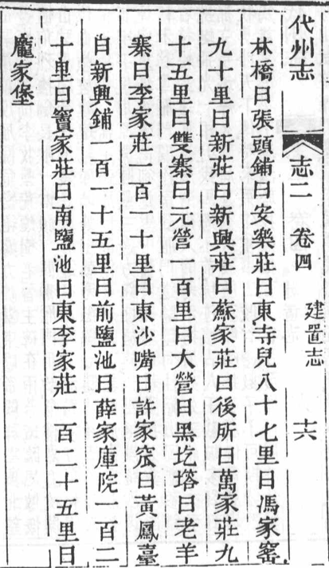<figcaption>光绪《代州志》｜北乡图与里程</figcaption></figure>

<figure>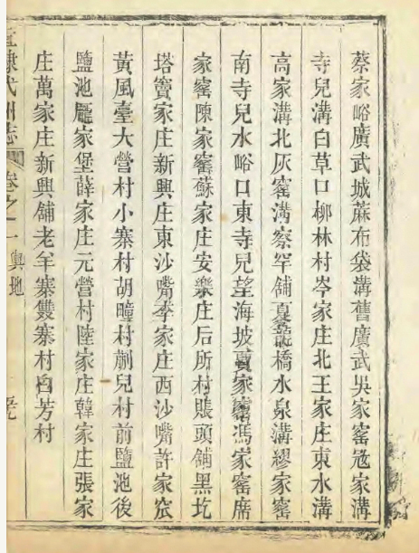<figcaption>乾隆《直隶代州志》｜北乡村名</figcaption></figure>

### 选簿节图与家谱图版 {#register-plates}

<figure>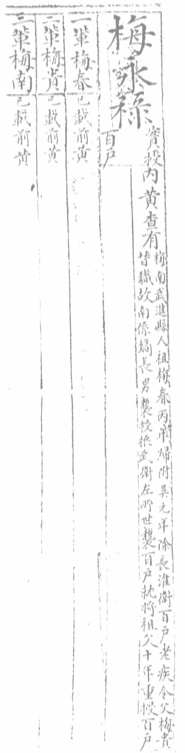<figcaption>梅永禄条节图 · 内黄与一至三辈</figcaption></figure>

<figure>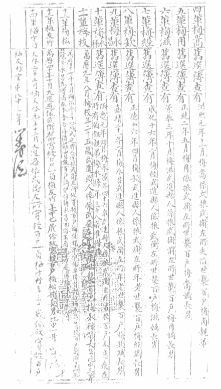<figcaption>梅永禄条节图 · 四至十四辈</figcaption></figure>

<figure>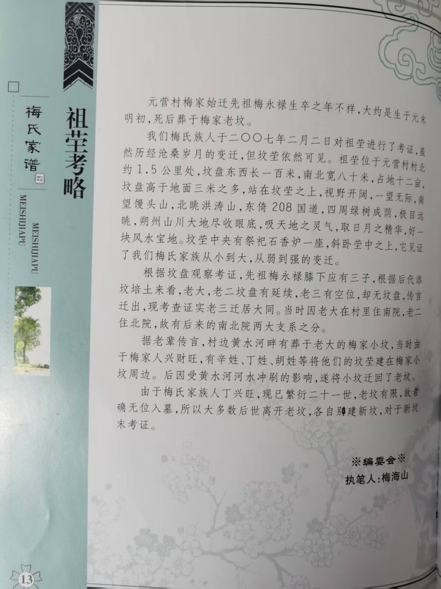<figcaption>《梅氏家谱》〈祖茔考略〉</figcaption></figure>

<figure>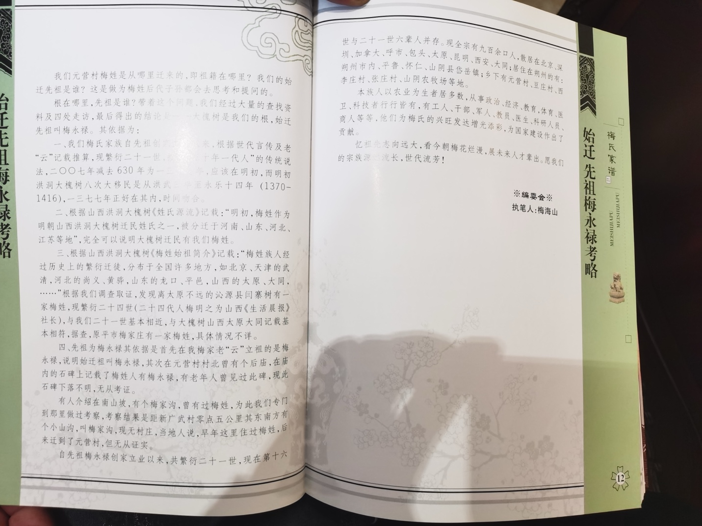<figcaption>《梅氏家谱》考略跨页</figcaption></figure>

<figure>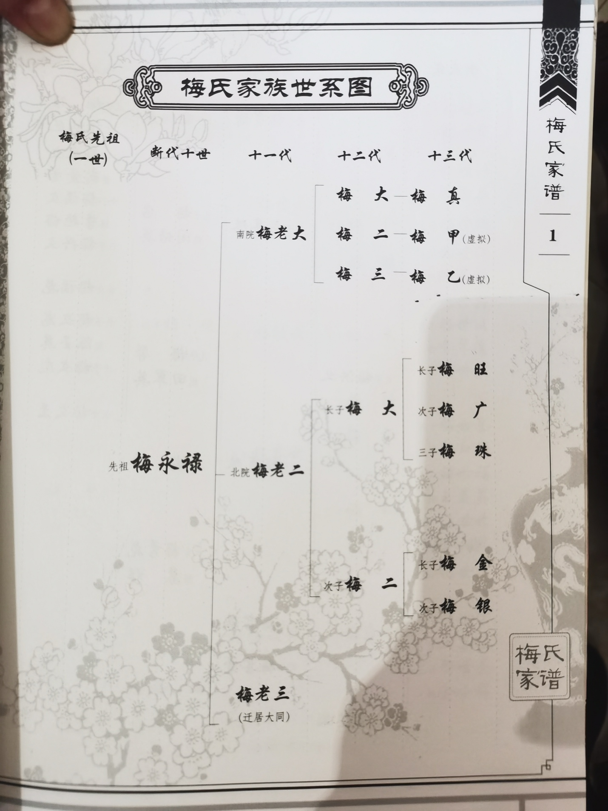<figcaption>《梅氏家谱》世系图首叶 · 家藏照片</figcaption></figure>

:::

::::
