:::: {.family-history}

::: {.article-links}
[Beyond Economics](personal.qmd) · [阅读中文原文](family-history-zh.qmd){lang=zh-CN hreflang=zh-CN}
:::

<blockquote style="margin:20px 0;padding:4px 0 4px 14px;border-left:2px solid #b79078;color:#4d3227">

All within the four seas are one household now. Where do people not grow mulberry and hemp? The lonely pass stands on a ridge a thousand fathoms high. Even in deepest summer, six-petaled snow still flies. Dark clouds over white poplars reach to Mayi. The sky rims the Green Mound. Far off lie the northern sands. From this height I mourn the past, and the feeling has no end. Alone in the west wind, counting the departing crows.

—Yuan Haowen, “Beyond Yanmen Pass” <a class="reference" href="#note-12">[12]</a>

</blockquote>

Contents

<ul>
<li><a href="#why-family-history">I. Why I Wanted to Write a Family History</a></li>
<li><a href="#yuanying">II. Yuanying Beyond Yanmen Pass</a></li>
<li><a href="#family-memories">III. The Family I Remember</a></li>
<li><a href="#finding-mei-zhi">IV. How Yuanying Led Me to Mei Zhi</a></li>
<li><a href="#appointment-register">V. Fourteen Names in the Appointment Register</a></li>
<li><a href="#dna">VI. My Father’s DNA, My Grandfather’s, and Mine</a></li>
<li><a href="#hometown">VII. In Time, I Too Had a Place to Call Home</a></li>
<li><a href="#epilogue">Epilogue</a></li>
<li><a href="#illustrations-and-sources">Illustrations and Sources</a></li>
</ul>

## I. Why I Wanted to Write a Family History {#why-family-history}

After I left home, I came to treasure the freedom to think things through and make up my own mind. I went from Taiyuan to Beijing and then to the United States. Sometimes, when I speak the Taiyuan dialect again, it sounds a little unfamiliar even to me. As a child, I never had to think about what home meant. Later, when someone asked where I came from, I could give them a place name. When I asked myself, there was still so much I could not say. How had the people in my family wanted to live when they were young? How many of their choices were still with me?

I started out reading military history. At the mention of Yanmen Pass, I would look up the year of a battle, who attacked, and who held the pass. Reading historians of the French Annales school, I began to see how much the land, the harvest, and the ways people made a living could tell me about how a place changed over decades or centuries.

When I came to microhistory, I liked following one person or one household through time. A town changes hands. What do the people who live there do the next morning? A family wants to put a child through school. Who will go out and earn the money? The more I read, the more I wanted to know what someone could see from where they stood and how much room they had to decide how to live. <a class="reference" href="#note-16">[16]</a>

Liu Dapeng was a scholar from Chiqiao, a village in the old county of Taiyuan. He lived through the end of the Qing and into the Republic and kept a diary from 1891 to 1942. His diaries were later collected as <em>The Diaries of the Retreat for Reflection</em> (<em>Tuixiangzhai riji</em>). In <em>The Man Awakened from Dreams</em>, Henrietta Harrison follows the words he left to tell the story of his life in the village. <a class="reference" href="#note-9">[9]</a> <a class="reference" href="#note-11">[11]</a>

By the time we read him, we already know that the imperial examinations, the path to a literary degree, would be abolished. On his side of the page, there were still lessons to teach that day and bills the family had to find a way to pay. I like to read him a day at a time. Reading slowly, I can see what choices a person actually had.

What I like about Zeng Guofan’s diary is how awkward he can be. He knows when he has done something wrong and is willing to write it down. Turn over a few days and he may have made the same mess again. I want to write down the things my relatives did not manage to do, too, and think about why they acted as they did. Then I can turn the question on myself. Where did I get these ideas about my family? What did I hear so often growing up that I never thought to ask about it again?

I love something Zengzi says in the <em>Analects</em>: “Attend carefully to the dead and remember those long gone, and the people’s virtue will grow deeper.” I always pause at the word for seeking out the past. Once someone is gone, there can still be someone willing to sit and wonder what kind of person they were. Whom did they look after when they were young? How did they get through a hard time? After a while, knowing even a little more takes somebody who will go and ask and sit long enough to hear the story.

At bottom, this answers a religious need of my own. I want to know what relationship I can have, in this life, with people who are gone, and what I might leave for people I may never meet. I can read and ask, try to put myself in someone else’s place, and write down what I have some grounds for believing. I can record what is uncertain as it is, so I can come back to it later. This is what I mean by telling a family’s story.

The family I have in mind is a very small community. People can live their lives far apart and still hold in mind someone they never met. When several people remember an old story differently, all their accounts can stay. If somebody in a later generation whom I never get to meet comes across this, they can ask again, correct what I have got wrong, and put in the people I left out. If they leave home one day and want to know where they came from, there will be a few people and a few things to get to know.

## II. Yuanying Beyond Yanmen Pass {#yuanying}

My surname is Mei, the same character as the plum blossom. In the Song dynasty, Zheng Qiao wrote about the Shang-era Lord of Mei in his <em>Comprehensive Treatise</em>, listing Mei among surnames taken from a state. In the catalogues of family genealogies from south of the Yangtze, there are Mei genealogies in Xuancheng, Anhui, and in Changzhou, Jiangsu. <a class="reference" href="#note-13">[13]</a>

I know very few people named Mei. My grandfather was Mei Shikai and my father is Mei Liang. My father’s elder brother, Mei Qiang, is my <em>daye</em>, or eldest uncle. His daughter Mei Yifan is the person I call my sister.

After I left Shanxi Modern Bilingual School, a new homeroom teacher named Hao took over my old class. Once she asked where I was from. She said she did not often meet a Mei in Shanxi. I said Shanyin. She was from Shanyin, too. Across a river from her, she said, there was a formidable branch of the Mei family. I knew right away she meant Yuanying.

Ms. Hao never taught me, but I have always remembered what she said. I had never heard anybody outside the family talk that way about the Meis of Yuanying. Only then did it occur to me that my family might have been a prominent one in that northern countryside. It was from that village that my grandfather came to Taiyuan.

Yuanying is in Shanyin County, in northern Shanxi. Today it is part of Shuozhou. Yanmen is a pass on the Great Wall, north of the county seat of Dai. Keep going north after you cross the pass from the town, and you come to the part of the country where my grandfather grew up. <a class="reference" href="#note-1">[1]</a> <a class="reference" href="#note-12">[12]</a>

People on the expressway to Shuozhou or Datong usually have no reason to turn off for Yuanying. The time I went back, tall corn stood almost all the way around the village, with only a few households still growing buckwheat. The old house was small and worn. There were sheep in the front yard and an old bicycle propped beside the pen. The house was right in the middle of the village, next to the committee office and the opera stage. As a boy, my grandfather could step out of the house and be where the village gathered to see a show in a few strides.

<figure>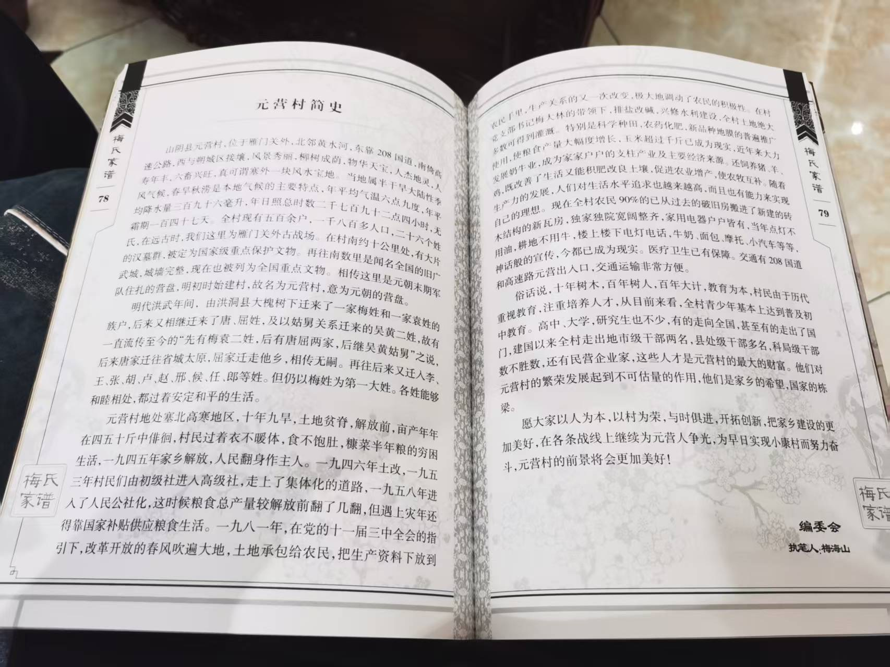<figcaption>Yuanying village | Family photograph</figcaption></figure>

<figure>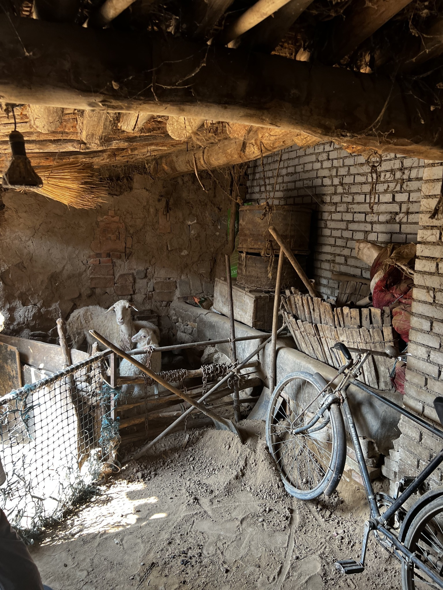<figcaption>Sheep in the front yard of the old house in Yuanying</figcaption></figure>

<figure>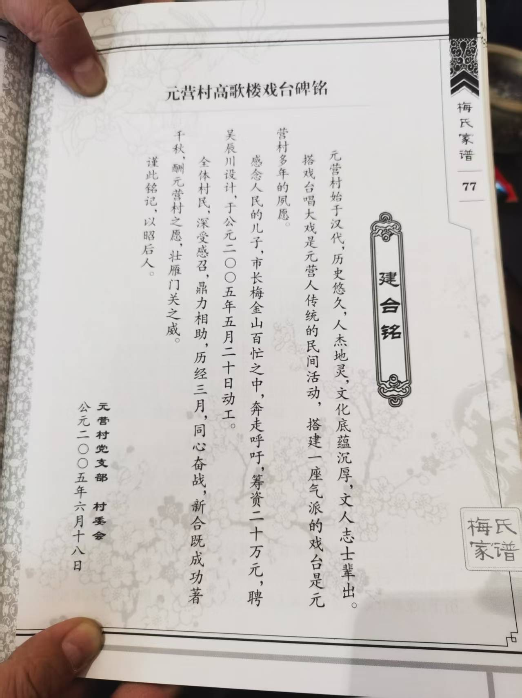<figcaption>The opera stage in Yuanying | Family photograph</figcaption></figure>

The Huangshui flows through Yuanying and into the Sanggan River. The <em>Shanyin County Gazetteer</em> gives its source as Xuejiawa in Ningwu. It crosses Shuocheng District and enters Shanyin at Yuanying, then goes on past Housuo, Hegeta, and Shanyin town before joining the Sanggan in Ying County. <a class="reference" href="#note-1">[1]</a>

The village has belonged to different jurisdictions at different times. When I could not find its name on an old map, I would look for the river first.

Beyond the pass, the wind often comes out of the northwest in winter. It is still strong in early spring, when there is little rain. The gazetteer says that around the time it was compiled, the riverbed had silted up and the ordinary flow of clear water had stopped at times. When a flood did come down, people on both banks had to watch for it. <a class="reference" href="#note-1">[1]</a>

A few pages on pasture in the gazetteer helped me see why this was good country for animals. Yuanying was in the old Housuo Township, with gullies and small springs to the south and an expanse of saline flats to the north. Needlegrass, wormwood, and flowering alfalfa grew on the slopes, and low, wet grass lay on the plains. In 1997 the village had 1,624 people, 420 sheep, and 490 dairy cows. When I first saw all that corn, I had no idea how much of it was for cattle. This was the country my grandfather walked through on market days with his mother. <a class="reference" href="#note-1">[1]</a>

<figure>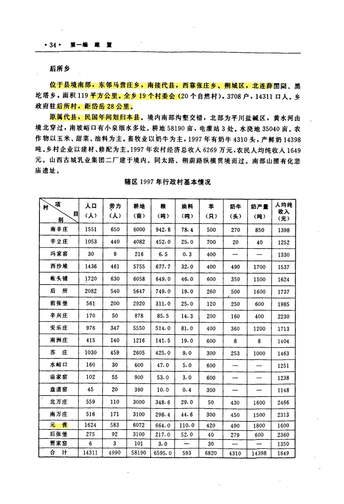<figcaption><em>Shanyin County Gazetteer</em>, p. 34 | The terrain of Housuo Township and the entry for Yuanying in 1997</figcaption></figure>

<figure>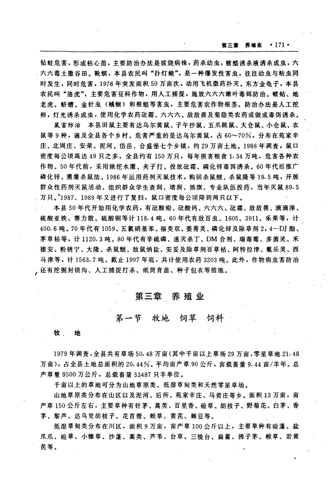<figcaption><em>Shanyin County Gazetteer</em>, p. 171 | Pasture and the upland grasslands of Housuo Township</figcaption></figure>

## III. The Family I Remember {#family-memories}

### My Grandfather as a Boy {#grandfather-as-a-boy}

My grandfather, Mei Shikai, was born in 1936. I always feel I know plenty about him. To go back another generation or two, I have to ask my father, Mei Liang. My grandfather’s great-grandfather, Mei Yan, was a butcher who had a shop. I still could not say whether it was in Yuanying, Housuo, or Xuejiakulüe. Judging by the generations in the genealogy, he may have lived at about the same time as Liu Dapeng. I imagine the shop did well enough for the family to send several sons to school.

Mei Yan’s three sons were Mei Linyun, Mei Zhenyun, and Mei Xiyun. The youngest, Mei Xiyun, was my grandfather’s grandfather. He taught and had more books than anyone else in the family. My father remembers the family calling him the principal. The county gazetteer says that Housuo had a community school for local children at the end of the Qing. I still need a list of teachers to know which school he taught at.

Primary school then had a lower and an upper stage. A school that offered both was called a complete primary school. In 1949, Shanyin had only two complete primary schools and eighty-two lower primary schools. My grandfather finished the lower level and was able to go on to the upper one. No wonder he always sounded proud when he spoke of it. <a class="reference" href="#note-1">[1]</a> <a class="reference" href="#note-16">[16]</a>

My grandfather’s father, Mei Tong, was also the youngest son in his family. My father told me he had rickets and did not have an easy life. When the family divided up the household property, his share was a great many books Mei Xiyun had bought years before. Sometimes I wonder if there was one he especially liked to open. People in the family still remember those books. Nobody can say where they all went.

Mei Tong’s wife was from Ying County. She was good at delicate handwork and knew a few home remedies passed down in her family, though my father could not tell me the recipes. What she was especially good at was picking out livestock.

People around Yuanying went to market in Xuejiakulüe, north of the village. As a boy my grandfather went with his mother as she picked out cattle and sheep. Sometimes they would have to get to a second market the same day to sell them. I imagine him walking after her all day, worn out by the time they got home. I know where she went to market, and still cannot say what her surname was.

In the genealogy, I can match the people my father named. Mei Yan was the father of Mei Xiyun, and Mei Tong was Mei Xiyun’s third son. Mei Tong had two sons, Mei Shifu and Mei Shikai. By page eighteen, there is my uncle, my father, my sister, and me.

Further back, there is a break. On page three, next to someone called “Mei Jia,” the note says that Jia is a placeholder. The people compiling the genealogy left a place for a connection they could not make. I am glad they left those words in print. The next reader will know where to keep looking.

<figure>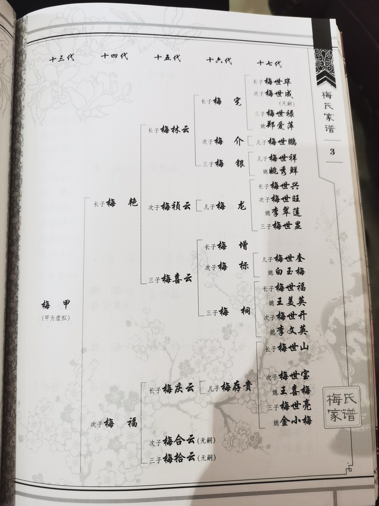<figcaption>Mei family genealogy, p. 3 | Mei Yan, Mei Xiyun, Mei Tong, and Mei Shikai</figcaption></figure>

<figure>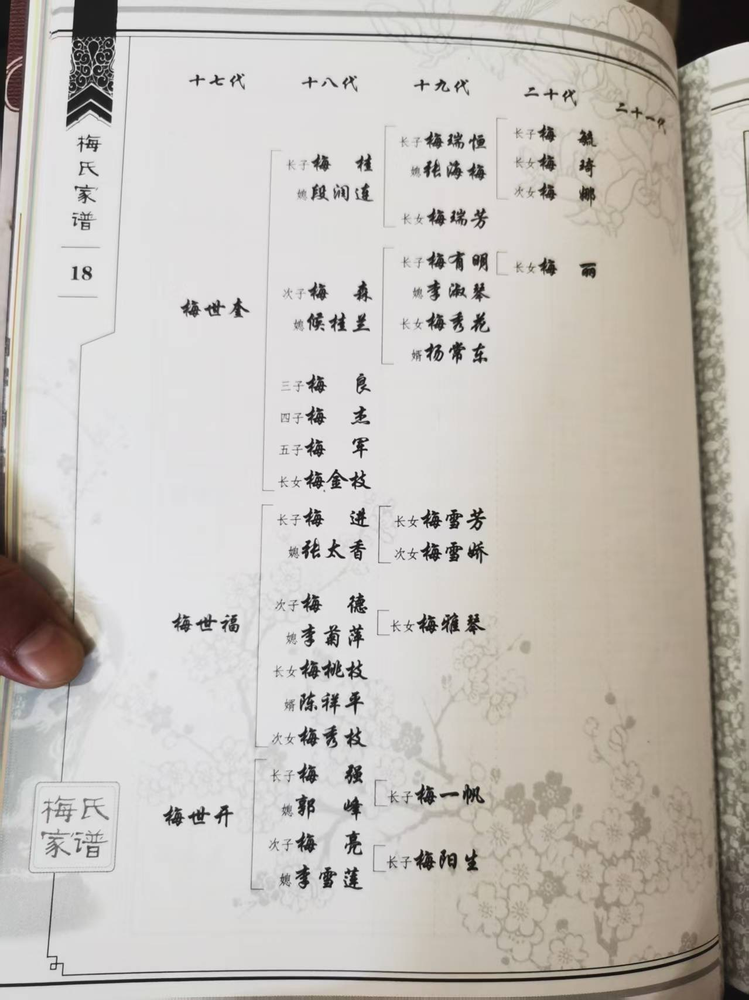<figcaption>Mei family genealogy, p. 18 | Mei Shikai and the branches of Mei Qiang and Mei Liang</figcaption></figure>

<figure>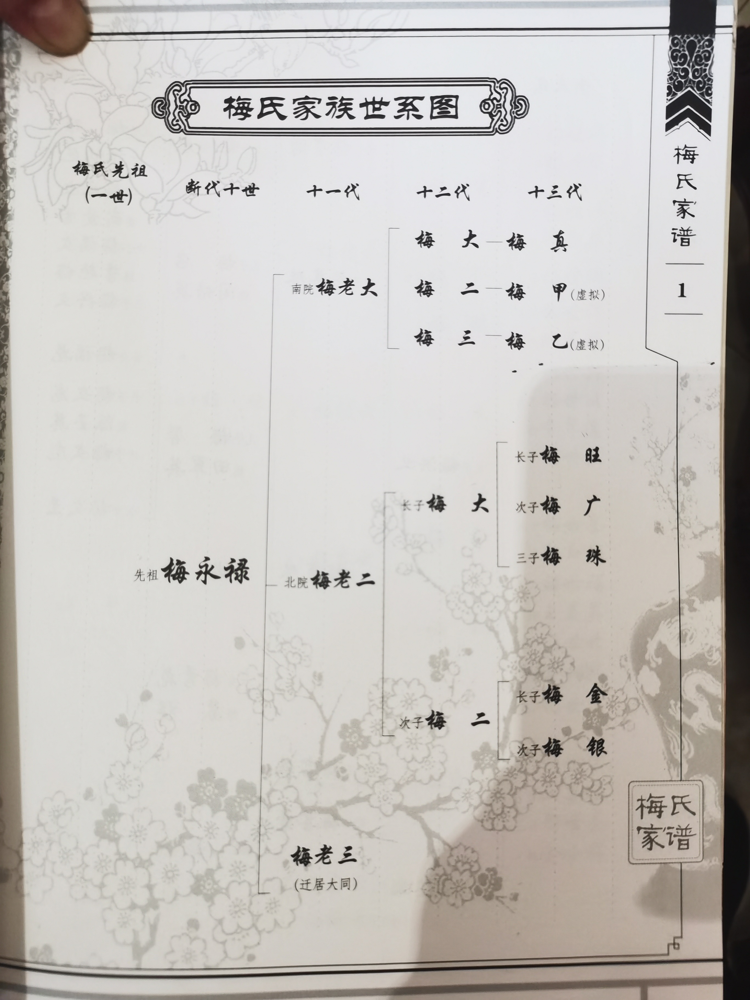<figcaption>First page of the Mei family tree | Mei Yonglu, whom the village remembered</figcaption></figure>

My grandfather’s elder brother Mei Shifu went to Taiyuan first. My grandfather followed him south and entered the Taiyuan Heavy Machinery Plant in 1952. Construction of the factory west of the Fen River had only begun in 1950. At home we always called it Taizhong. <a class="reference" href="#note-15">[15]</a>

When my grandfather left, Shanyin was still in Chahar Province. At the end of that year it returned to Shanxi along with the Yanbei Special District. Once the brothers had moved to the city, the old house in Yuanying went to the branch of Mei Tong’s second elder brother. <a class="reference" href="#note-1">[1]</a>

My grandfather took part in cultural activities at the factory, liked making things by hand, and bought a good film camera. I have seen a group picture of him with his workmates. He was tall, with an arm over a colleague’s shoulders. I look at that photograph and think he must have been good company.

### My Grandmother in Dai County and the Daqing Mountains {#grandmother}

My grandmother, Li Wenying, was born in 1936, the same year as my grandfather. Her family lived inside Yanmen Pass, in Nanguan, Yangmingbao, in Dai County. Her father, Li Chenglin, was the eldest brother and worked in the fur trade. The Lis had shops at the East Gate of the county town. When the family talk about the good years, they say the Lis had “half the East Gate.”

The Lis kept a depot in the Daqing Mountains where they could store goods for the northern trade until it was time to move them on. My grandmother was born at that depot, near what is now Wuchuan, north of Hohhot. The year she was born, Wuchuan still belonged to Suiyuan Province. <a class="reference" href="#note-2">[2]</a>

Li Chenglin had two daughters with his first wife. My grandmother was the elder. The two children he later had with his second wife stayed in the Daqing Mountains and Hohhot area. We are still in touch with the descendants of my grandmother’s younger half-brother.

As a girl my grandmother had a favorite aunt, the one who doted on her. The aunt had married into the Zhou family. My grandmother often went to play in their courtyard in Dai County.

It was Zhou Dai’s official residence, built in 1930, with a library on the upper floor of the main building. Zhou Dai was from Mazhan village in Dai County. In the revolution of 1911, he returned to Taiyuan to discuss the rising with Yan Xishan. He became one of Yan’s most trusted officers, serving as artillery commander in 1927 and chief adviser to the Third Group Army the following year. <a class="reference" href="#note-2">[2]</a>

My grandmother’s third uncle, Li Chengchun, was Li Chenglin’s younger brother. The family sent him to study in Taiyuan. Some remember a military academy and others a teachers’ college. In central and northern Shanxi at that time, girls mostly stayed home to help. In neighboring Shanyin in 1918, only twenty-nine of the county’s 755 primary school students were girls. The Lis could afford to send a child to school in Taiyuan. Sending the girls took longer to occur to them. <a class="reference" href="#note-1">[1]</a>

Li Chengchun joined the Shanxi League for National Salvation through Sacrifice, an organization formed to resist Japan on the eve of the war and known as the Ximenghui. In 1937 he joined the Shanxi Youth Dare-to-Die Corps, and in 1941 he joined the Communist Party. <a class="reference" href="#note-3">[3]</a>

He wrote home from the army and persuaded his brother and the family to contribute property to the revolution. When he came home, he also urged them to send the girls to school. My grandmother was already older than most beginners when she started. She made it through upper primary school. Several girls in the Li family studied further, and some of them later went to Guangzhou.

Li Chengchun eventually became the person who made decisions for the household. In Guangzhou, he was responsible for anti-aircraft defense with the military region’s air force. He commanded its anti-aircraft artillery headquarters and later became a deputy commander of the regional air force. The large household that had lived in Dai County moved to Guangzhou with him. <a class="reference" href="#note-3">[3]</a>

When Ake and I went to Dai County looking for my grandmother’s family, we also visited Zhou Dai’s residence. It stands down a lane in the county town and is now an easily missed historic site. Zhou Dai’s descendants now live in Beijing. It was from them that we learned the name of the aunt closest to my grandmother, Li Jinyuan, and the name of the man she married, Zhou Tao.

We also called on the Lis at home. They had kept a family tree drawn by hand, with deep creases in the paper. They are still proud to tell how they used to exchange letters with Li Chengchun. Ake and I took one photograph of the whole sheet, then leaned in and took another of the writing on the right.

<figure>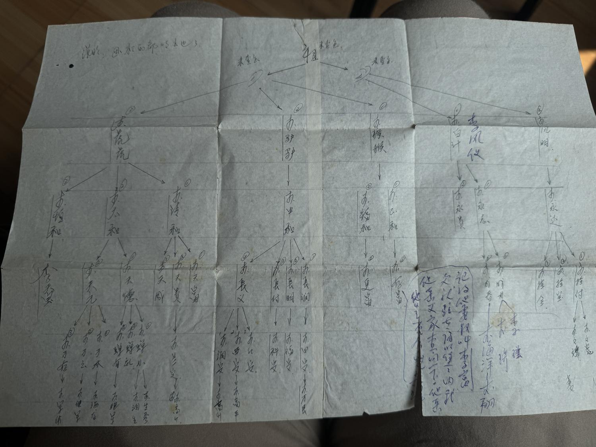<figcaption>The Dai County Lis’ hand-drawn family tree | Full sheet, photographed on our visit</figcaption></figure>

<figure>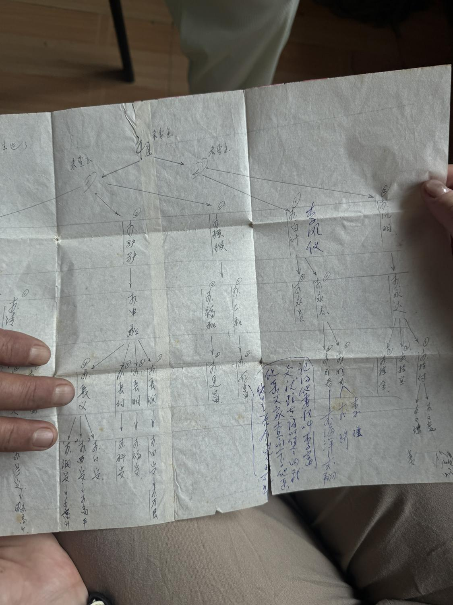<figcaption>The Dai County Lis’ hand-drawn family tree | Right-hand side, showing the later additions in blue</figcaption></figure>

### My Grandparents in Taiyuan {#taiyuan-grandparents}

My grandfather and grandmother met at Taizhong. Both had been married before and had children in their earlier households. They stayed together on the west side of Taiyuan, where they had my uncle Mei Qiang and my father Mei Liang.

When I heard this story growing up, it always began with their meeting at the factory. As I got older, I wondered where the children from those earlier households would begin if they were telling it.

When my uncle was little, Li Chengchun visited Taiyuan and was received by provincial officials. My uncle went along. It was the first time he had been inside a provincial guesthouse, perhaps the Shanxi Hotel or perhaps the Yingze Hotel. He still remembers how pretty and soft the toilet paper was. He had never seen paper like it. All those years later, it was still the first thing he told me about the visit.

### My Mother’s Parents {#maternal-grandparents}

When I think of the children my grandparents left in their earlier households, I think of <em>The Joy Luck Club</em>. In the film, a woman is separated from two daughters in the war. Many years later, the daughter she brought up in America meets her two older sisters. I saw the film as a child and thought that kind of thing was a long way from my life. <a class="reference" href="#note-16">[16]</a>

My mother would cry watching <em>The Joy Luck Club</em>. I was small then. Only later did I begin to think about how early she had lost her own mother.

My maternal grandfather, Li Buyu, was born in 1940 in Xugou, in Qingxu County south of Taiyuan. I asked about his grandfather. He remembered the old man’s name and said he had farmed. My grandfather’s own childhood name was Yuchun. He went on signing his calligraphy with it.

As a young man he attended Taigu Normal School, which trained teachers in Taigu, Jinzhong. One of his classmates told him, late in life, that she had liked him when they were young. She did not want to die wishing she had said it. Later I thought that the man she remembered was still the young man I had never known. <a class="reference" href="#note-15">[15]</a>

My grandfather went from Taigu Normal School into the military. In Wuwei, Gansu, he became the political commissar of an air force ground-support regiment. His unit kept the aircraft operating from the ground. It was there that the organization introduced him to my grandmother.

My maternal grandmother came from Qi County, Shanxi. She did a great deal of work with women and with neighborhood offices. My mother, Li Xuelian, and her elder sister, Li Xuemei, lived in Gansu for years. I call my mother’s sister <em>Yimama</em>. Sometimes I want them to start with their childhood, tell me what street they lived on and who the neighbors were. Their memories would still have something of my grandmother as she was then.

My grandmother died young. My grandfather was lonely for a time and later remarried. My cousin and I called her Grandma Guo. She was also from Qingxu and was very kind to both of us. In her last years she suffered badly from illness. When I think of her, I think of someone who is sick enough to need help with most things. What would they like to eat today? Do they want visitors? It takes somebody willing to stop and ask.

After leaving the military, my grandfather became an assistant to the director of the Shanxi Provincial Bureau of Coal Geology. It surveyed the province’s coal resources. At home we always called it the Coalfield Geology Bureau. Whenever he talked about leaving the service, he would say nobody wanted an officer coming out of the military then. <a class="reference" href="#note-15">[15]</a>

My mother later became an accountant at the bureau. My father first worked at the Tiantai nightclub it ran, then became the lobby manager of the Jinquan Hotel. Both were part of the bureau’s service businesses, what we called its “tertiary sector.” My father later moved to the finance office.

In 2011 my father went to Beijing to head the finance department at China Coal Geological Engineering Corporation. In 2017 he became chief accountant at the Coal Geology and Hydrology Bureau, and later its deputy Party secretary. My mother went to the China National Administration of Coal Geology in 2015 and in 2025 became chief accountant at Dadi Engineering Rescue and Exploration.

I grew up in the family housing compound of the Shanxi Coalfield Geology Bureau. Many of its employees and their families lived there. When I said I was going home from school, it was to that compound. My maternal grandfather lived there, too.

My grandfather went to bed early and got up early all his life. He still had a flat stomach in old age. He ate lunch a little after eleven. My cousin and I were always hungry then and were delighted to eat early with him. By the afternoon we were hungry early, too.

In the economics department now, my classmates can all wait until twelve sharp for lunch. At eleven I am already ravenous. By a little after eleven, I am done.

When I played basketball alone downstairs as a boy, my grandfather often watched from his balcony. Sometimes I would look up and catch his eye. I was too shy to call to him. I still regret that.

His health is poor now. If I looked up today and saw him on the balcony, I would be so happy to call to him and ask him to watch me make a shot.

### My Grandfather’s Calligraphy {#calligraphy}

I grew up watching my grandfather write. He had fallen in love with calligraphy as a child, seeing his teacher write out the <em>Outline Land Law</em>, the 1947 land reform document, on a brick wall. Through all his years in the military, he kept the thought of writing with him. <a class="reference" href="#note-10">[10]</a>

He served as executive vice president of Shanxi’s Calligraphy and Painting Academy for Retired Geology Workers, and his work won prizes, including at the first Wang Duo Cup. His way of putting it was simply that he “filled a sheet with scribbles when the mood came over him.”

<figure>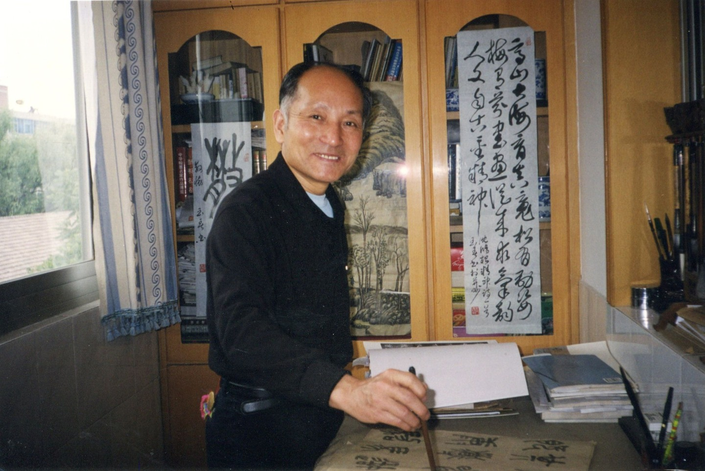<figcaption>My grandfather writing | Family photograph</figcaption></figure>

I was class monitor in high school and asked my grandfather to make two pieces to hang on our classroom wall. As I recall, one said, “Heaven rewards diligence.” The other was, “The plum blossom’s fragrance comes from bitter cold.” I had always liked plum blossoms, so that was the one I especially liked.

In the fall of 2019, in my dorm room, I was looking at a poem by Cao Zhi that my grandfather had written out for me. I felt like trying to copy it. I used a cheap brush dipped in water, and I wrote clumsily. I copied it over and over and cried again and again.

That winter, back in Taiyuan, I turned up nearly everything he had written since 2000 and spread it across the living-room floor. Some of the paper had yellowed. I went through it sheet by sheet. Later I lay down on the bed where my grandfather usually slept and realized I had not been that quiet in a long time.

In January 2021, in Beijing, I wrote a preface to his collected work, <em>Traces of Ink: The Calligraphy of Yuchun</em>. I felt as though I was “filling in my grandfather’s own diary for him.” I do not know calligraphy, so I followed the strokes and tried to picture his hand making them. He told me writing was the practice he had kept up most faithfully in his life. <a class="reference" href="#note-10">[10]</a>

My grandfather wrote a piece called <em>Still a Soldier at Heart</em> and also copied Mao Zedong’s poem <em>The Long March</em>. Seeing those pieces, I think of his years in the military in Wuwei. My mother and Yimama were both little then.

<figure>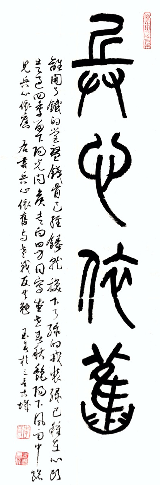<figcaption>My grandfather’s calligraphy | <em>Still a Soldier at Heart</em></figcaption></figure>

<figure>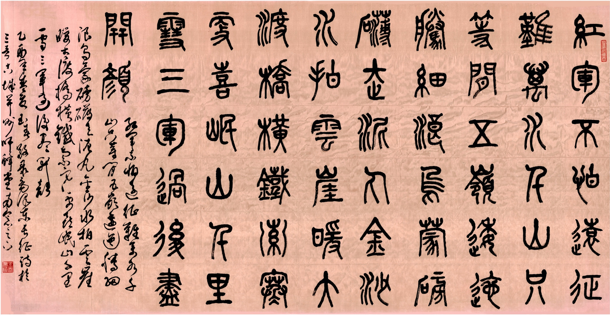<figcaption>My grandfather’s calligraphy | Mao Zedong’s <em>The Long March</em></figcaption></figure>

The first piece in the book reads <em>Run a Household with Virtue and Wisdom</em>. Those four characters matter in our family. He also wrote <em>Keep a Child’s Heart and Long Life Will Follow</em>. The grandfather I knew was the man in Taiyuan who had dinner ready for us. My cousin and I could go back to his place after basketball and eat.

<figure>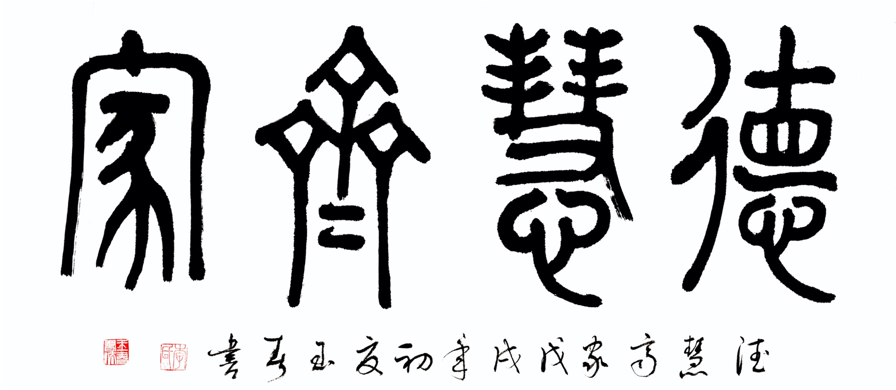<figcaption>My grandfather’s calligraphy | <em>Run a Household with Virtue and Wisdom</em></figcaption></figure>

<figure>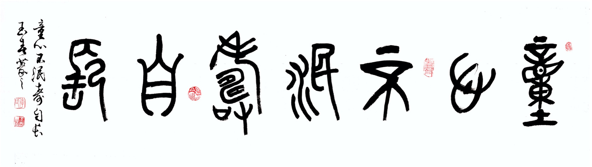<figcaption>My grandfather’s calligraphy | <em>Keep a Child’s Heart and Long Life Will Follow</em></figcaption></figure>

I grew up in the Coalfield Geology Bureau’s family compound. My father grew up at Taizhong, and my grandfather grew up in Yuanying. On my return to Yuanying, I met many people with my surname and could not always understand what they were saying. How had the earlier generations of my family made their home in this village? First I had to find out who had governed Yuanying.

## IV. How Yuanying Led Me to Mei Zhi {#finding-mei-zhi}

I started looking for Yuanying under its present place name. In its account of changes after 1922, the eleventh year of the Republic, the <em>Shanyin County Gazetteer</em> lists villages incorporated into the county over time. Yuanying is among them. Some came from Pinglu, others from Shuo County or Dai County. The list did not tell me which had governed Yuanying. <a class="reference" href="#note-1">[1]</a>

In the <em>Shanyin County Gazetteer</em> from the Chongzhen reign, I could find traces of Dongshatan, Xishatan, and Zhangtoupu. Farther west, the <em>Shuozhou Gazetteer</em> had Xiashui and the <em>Mayi County Gazetteer</em> had Huojiaying. I could recognize the villages around it. Nowhere could I find the name Yuanying.

The Huangshui was still there. I followed its course on the old maps and put a star or an arrow where I thought the village would be today.

The <em>Dai County Gazetteer</em> gave me a direction. The town of Dai was once called Daizhou. In the Republican period, the office of the county’s Fifth District was in Xingangwu beyond the pass. Pangjiabao lay to the north and Xiyanchi to the northeast, both close to the Yuanying I was looking for. <a class="reference" href="#note-12">[12]</a> <a class="reference" href="#note-15">[15]</a>

I looked at the map of the northern townships in the Guangxu-era <em>Daizhou Gazetteer</em>. Its distances in <em>li</em> were measured from the prefectural town. Ninety <em>li</em> out were Housuo and Wanjiazhuang. Five more and there they were, Shuangzhai and Yuanying. I found Yuanying again among the sixty-six northern villages in the Qianlong-era <em>Gazetteer of Daizhou Directly Administered Prefecture</em>. The two gazetteers had led the village back to Daizhou.

My grandmother’s Yangmingbao is in the Qianlong gazetteer, too, west of the prefectural town. My grandfather’s home was beyond the pass and my grandmother’s inside it. At that time you could travel north from inside the pass, cross it, and still be in Daizhou. <a class="reference" href="#note-12">[12]</a>

<figure>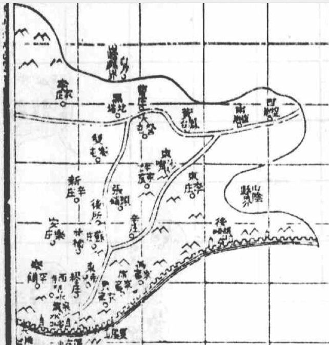<figcaption>Map of the northern townships in the Guangxu <em>Daizhou Gazetteer</em> | Yuanying, Shuangzhai, and Housuo</figcaption></figure>

<figure>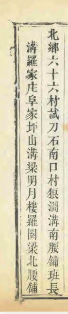<figcaption>Villages of the northern townships in the Qianlong <em>Gazetteer of Daizhou Directly Administered Prefecture</em> | The list includes Yuanying</figcaption></figure>

When did the village get its name? In its chronicle under 1219, the fourteenth year of Chinggis Khan’s reign, the <em>Shanyin County Gazetteer</em> explains Yuanying as a Yuan army encampment. Locating the camp would take earlier garrison records. The oldest place I have actually found the name Yuanying written out is still that Qianlong list of villages. <a class="reference" href="#note-1">[1]</a>

Once I knew it had belonged to Daizhou, I looked to see whom its gazetteer recorded. There was a list of <em>baihu</em>, commanders of hundred-household units, in the Zhenwu Guard, a Ming garrison at Daizhou. The first names were Zhao Jizu and Cheng Ji. The third was Mei Zhi. <a class="reference" href="#note-4">[4]</a> <a class="reference" href="#note-12">[12]</a>

Seeing the name Mei, I thought of Mei Yonglu in the village genealogy. When it was compiled, the elders still remembered a stone inscription bearing his name. The stone was gone, but the genealogy remembered him as the first ancestor of the family to settle in Yuanying. It put the move in the Hongwu reign, early in the Ming. I wanted to know if Mei Zhi had anything to do with the Mei Yonglu the village remembered.

<figure>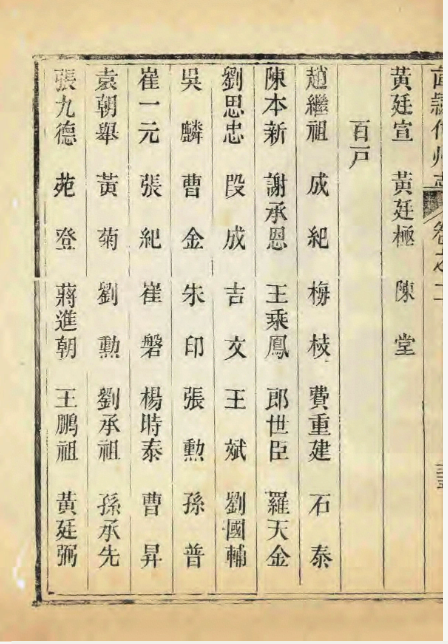<figcaption>List of Zhenwu Guard <em>baihu</em> in the Daizhou gazetteer | Mei Zhi</figcaption></figure>

I turned to volume 71 of the <em>Collected Archives of the Ming Dynasty</em>. The contents listed the Zhenwu Guard, then its Left Division, one of the units named for directions. Under the Left Division there really was a household recorded under Mei Yonglu’s name. The eleventh entry named Mei Zhi as his eldest son by his principal wife. It was the first time I had seen the two names in a record for the same household.

## V. Fourteen Names in the Appointment Register {#appointment-register}

All I had wanted was to find out how Mei Zhi and Mei Yonglu were related. Reading on, I learned that this was a military appointment register. The Ming Ministry of War used such books to check an officer’s record and decide who could succeed him. To establish who should be a <em>baihu</em>, it also had to look up the previous holder and their ancestors. The entries cite the <em>neihuang</em> register and older appointment books.

The Zhenwu Guard answered to the Shanxi Regional Military Commission, which in turn answered to the Chief Military Commission of the Rear. Under the early Ming establishment, a hundred-household unit had 112 enlisted men. Its <em>baihu</em> held the senior sixth rank, with general-banner and small-banner officers below him. Candidates for succession had to have their backgrounds and kinship checked and sit a military examination. <a class="reference" href="#note-4">[4]</a>

The names below come from volume 71, pages 46 and 47, or pages 62 and 63 of the PDF. I began with the household recorded under Mei Yonglu and followed the entries back.

I went through the entries numbered one to fourteen. At first I took them for fourteen generations. Reading more closely, I found that brothers and cousins could succeed to the same post. To trace fathers and sons in a genealogy, I still had to look at whose son or younger brother each man was.

A “substantive appointment” meant that the post had been formally conferred. If someone in the holder’s branch could not serve, a close relative could fill in under a temporary appointment, literally “borrowing the office.” That is the wording to keep in mind as the register moves from Mei Yongchang to Mei Yonglu.

<figure>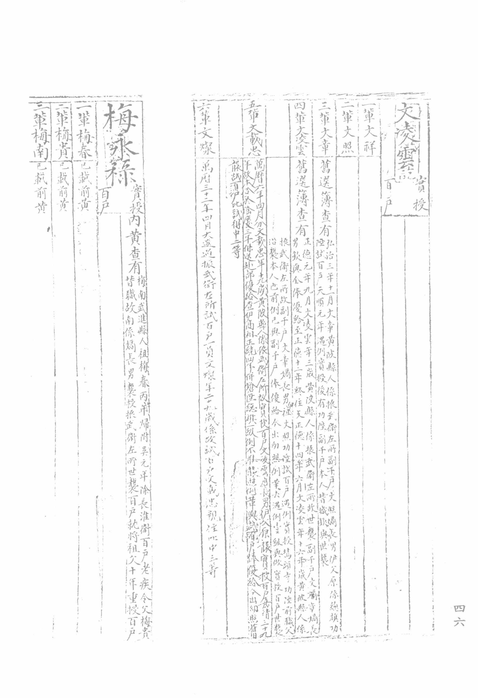<figcaption><em>Collected Archives of the Ming Dynasty</em>, vol. 71, p. 46 (PDF p. 62) | The left column shows the Mei Yonglu heading, the earlier register, and entries one through three</figcaption></figure>

<table>
<thead>
<tr>
<th>Entry and name</th>
<th>What the register says</th>
</tr>
</thead>
<tbody>
<tr>
<td>1 · Mei Chun</td>
<td>“Already listed in the earlier yellow register.” The entry that consults the <em>neihuang</em> register names Mei Chun as Mei Nan’s grandfather and records his submission in the <em>bingshen</em> year, 1356. It then says he was appointed a <em>baihu</em> in the Changhuai Guard in the first year of Wu, 1367.</td>
</tr>
<tr>
<td>2 · Mei Gui</td>
<td>“Already listed in the earlier yellow register.” Mei Nan’s entry can be read as saying that Mei Chun had grown old and ill, and Mei Gui, Mei Nan’s father, took his place. Mei Gui links the two holders of the post. No separate date is given for him.</td>
</tr>
<tr>
<td>3 · Mei Nan</td>
<td>“Already listed in the earlier yellow register.” Mei Nan was from Wujin County and was the eldest son by the principal wife. He succeeded to the hereditary <em>baihu</em> post in the Left Division of the Zhenwu Guard. The words “reappointed <em>baihu</em> in the tenth year” appear at the end. The reign era still needs corroboration.</td>
</tr>
<tr>
<td>4 · Mei Song</td>
<td>Twelfth lunar month of the first Hongxi year (1425). Left Division of the Zhenwu Guard. Mei Nan’s younger brother. The wording also includes “lost” or “fell” (<em>shixian</em>) in the account of the predecessor’s office. The circumstances still need to be established.</td>
</tr>
<tr>
<td>5 · Mei Yong</td>
<td>Fifth lunar month of the second Zhengtong year (1437). Hereditary <em>baihu</em>, Left Division of the Zhenwu Guard. Mei Song’s eldest son by his principal wife.</td>
</tr>
<tr>
<td>6 · Mei Zi</td>
<td>Tenth lunar month of the third Jingtai year (1452). From Wujin County and the eldest son of Mei Yong by his principal wife. Succeeded to the hereditary <em>baihu</em> post. Here the original reads “Front Left Division of the Zhenwu Guard.”</td>
</tr>
<tr>
<td>7 · Mei Jing</td>
<td>Second lunar month of the sixteenth Chenghua year (1480). From Wujin County and the eldest son of Mei Zi by his principal wife. Succeeded to the hereditary <em>baihu</em> post in the Left Division of the Zhenwu Guard.</td>
</tr>
<tr>
<td>8 · Mei Qin</td>
<td>Fourth lunar month of the sixteenth Zhengde year (1521). From Wujin County, the eldest son by the principal wife of Mei Jing, hereditary <em>baihu</em> in the Left Division of the Zhenwu Guard. The words “advanced in age” appear with the office and the predecessor’s name. Following the register’s usage, they are most likely to describe Mei Jing.</td>
</tr>
<tr>
<td>9 · Mei Yongchang</td>
<td>Second lunar month of the twenty-first Jiajing year (1542). From Wujin County, the eldest son by the principal wife of Mei Qin, hereditary <em>baihu</em> in the Left Division of the Zhenwu Guard. Again, “advanced in age” most likely refers to his predecessor. An entry in the first Longqing year lists Yongchang as a substantive <em>baihu</em>, aged forty-six.</td>
</tr>
</tbody>
</table>

<strong>From the Longqing to the Tianqi reign, the post passed between branches of the family</strong>

<table>
<thead>
<tr>
<th>Entry and name</th>
<th>What the register says</th>
</tr>
</thead>
<tbody>
<tr>
<td>10 · Mei Yonglu</td>
<td>Fourth lunar month of the first Longqing year (1567). Mei Yongchang, the substantive <em>baihu</em> in the Left Division, was forty-six, from Wujin County, and ill at his post. The register names Mei Yonglu, aged thirty-eight, as a close younger kinsman and grants him a temporary appointment. The original here reads “Left Division.” I have retained the kinship phrase <em>boshu qindi</em> (伯叔親弟), which appears to refer to a close relative of the same generation. The exact branch is uncertain. Counting back from his age puts Mei Yonglu’s birth around 1529–1530.</td>
</tr>
<tr>
<td>11 · Mei Zhi</td>
<td>Eighth lunar month of the ninth Wanli year (1581). Aged twenty-five, from Wujin County, in the Left Division of the Zhenwu Guard, and Mei Yonglu’s eldest son by his principal wife. He passed the military examination at third grade. An earlier transcription reads “ill” near the office title. A seal covers this part and it is unclear whom the word describes.</td>
</tr>
<tr>
<td>12 · Mei Song</td>
<td>Tenth lunar month of the seventeenth Wanli year (1589). Aged twenty-eight, from Wujin County, in the Left Division of the Zhenwu Guard. He was the younger brother of the deceased substantive <em>baihu</em> Mei Zhi. The entry recalls that Mei Zhi had temporarily served in place of his older uncle Mei Yongchang. In the fourteenth Wanli year (1586), it records <em>gujue</em> (故絕), death without a surviving line. Yongchang was then a monk and still at home. Mei Song was allowed to fill in. If Yongchang returned to lay life and had a son eligible to succeed, the temporary holder was to give back the post. The ending was formerly read as “passed at first grade.” The characters beneath the seal still need checking.</td>
</tr>
<tr>
<td>13 · Mei Youzhu</td>
<td>General appointments in the tenth lunar month of the fortieth Wanli year (1612). Aged twenty-seven, substantive <em>baihu</em> of the Left Division of the Zhenwu Guard, and eldest son by the principal wife of the deceased substantive <em>baihu</em> Mei Song. The end reads “passed at first grade.”</td>
</tr>
<tr>
<td>14 · Mei Shouzhu</td>
<td>First lunar month of the second Tianqi year (1622), filling out an entry from the general appointments of the twelfth month of the first Tianqi year. Aged thirty, substantive <em>baihu</em> in the Left Division of the Zhenwu Guard, and younger paternal cousin of the deceased Mei Youzhu. Passed at third grade. This is where the register stops for now. His father’s name is still missing.</td>
</tr>
</tbody>
</table>

<figure>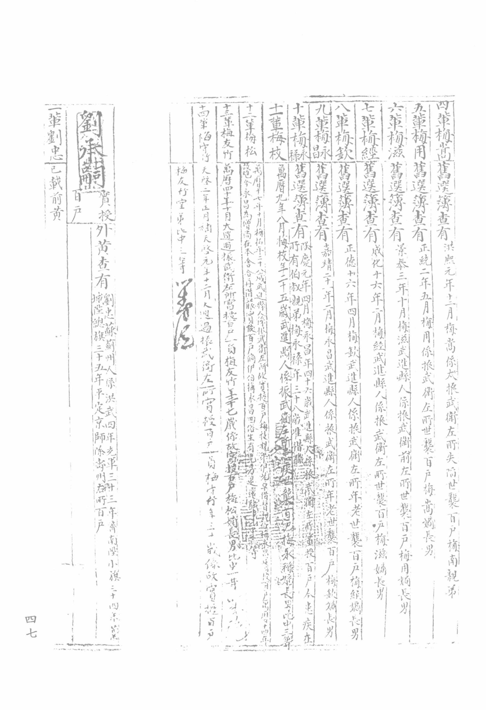<figcaption><em>Collected Archives of the Ming Dynasty</em>, vol. 71, p. 47 (PDF p. 63) | Entries four to fourteen, read from right to left. A seal covers some of the small characters</figcaption></figure>

<em>The months are lunar, as in the register. The years in parentheses correspond to the reign years. Around the turn of the year, the original dating takes precedence. “Passed” refers to the grades on the examination for succession. Officers of different ranks could all pass at third grade.</em>

The entries I most like to read are those for Yongchang, Yonglu, Mei Zhi, and Mei Song. When Yongchang fell ill, Yonglu filled in. In Mei Song’s entry, Yongchang had become a monk and was still living at home. If he ever returned to lay life and had a son who could succeed, Mei Song’s branch would have to give the office back. The register is so particular about who could hold it and when it had to be returned. Other families’ records often show men rising from small-banner or general-banner command by merit in battle. In this family I can read all the way back to a man’s submission in 1356, and forward to a monk who might one day return and ask for his office back.

### How the Meis Got from Wujin to Yuanying {#from-wujin-to-yuanying}

The first person I find when I read back is Mei Chun. In the register he “submitted in the <em>bingshen</em> year,” 1356. Here “submitted” means that he went over to Zhu Yuanzhang before the dynasty was founded. After all that time, I could still read the year somebody had done something. For a moment that old loneliness of being alive felt a little lighter.

Jiqing is present-day Nanjing. In the spring of 1356, Zhu Yuanzhang took in surrendered troops under Chen Zhaoxian near Jiqing. He then captured the city and renamed it Yingtian. In the latter half of the year, Xu Da began to besiege Changzhou. It was held by Zhang Shicheng and did not fall until 1357. <a class="reference" href="#note-5">[5]</a>

Whom had Mei Chun been following before he came over? He might have been with the Yuan army, with Zhang Shicheng, or in a local force from Wujin. He may have joined near Jiqing. All the register gives me is “submitted in the <em>bingshen</em> year.” If I could find others who came over at the same time, their commander, or even a month and day, I could set that act back among the events of the year. <a class="reference" href="#note-5">[5]</a>

The register gives the family’s ancestral home as Wujin, in what is now the Changzhou area of Jiangsu. Reading north from Wujin to Daizhou, I come to the Changhuai Guard by the Huai River. “Appointed <em>baihu</em> of the Changhuai Guard in the first year of Wu” dates the appointment to 1367.

I looked at the geography chapters of the <em>History of the Ming</em> and the <em>Gazetteer of the Southern Metropolitan Region</em>. Both date the establishment of the Changhuai Guard to the sixth Hongwu year, 1373, with its post at Changhuai Pass, Fengyang, east of today’s Bengbu. The dates differ by six years. Perhaps the man was appointed <em>baihu</em> before he was assigned to the Changhuai Guard, and the two events were combined when his record was copied. An older register may also have lost part of the date. <a class="reference" href="#note-6">[6]</a>

By Mei Nan’s time the ancestral home still reads Wujin, but the posting has become the Left Division of the Zhenwu Guard in Daizhou. Mei Song’s entry in the first Hongxi year, 1425, still says Left Division. To date the family’s move north, I need to find out which reign Mei Nan’s “reappointed in the tenth year” refers to. <a class="reference" href="#note-4">[4]</a> <a class="reference" href="#note-6">[6]</a>

Once beyond the pass, which generation made a home in Yuanying? My first thought was Guangwu. It sits at the foot of the mountains north of Yanmen, on the road out of Daizhou. Its garrison was moved around while Mei Yonglu was still young. <a class="reference" href="#note-15">[15]</a>

The <em>Shanyin County Gazetteer</em> dates the relocation of the defense commander of Daizhou to Guangwu to 1540. The Qianlong <em>Daizhou Gazetteer</em> says the defense commander of Yanmen Pass moved into Guangwu in 1544. A defense commander was a military officer responsible for a garrison. The two different titles may point to two moves. <a class="reference" href="#note-1">[1]</a> <a class="reference" href="#note-6">[6]</a>

The <em>Veritable Records of the Jiajing Emperor</em> record another change. In 1543, Guangwu’s relay station, which had carried dispatches and provided men and horses, became a military station under the Zhenwu Guard. Mei Yongchang was already listed in its Left Division the year before. He would have been in his early twenties when the station changed hands. Mei Yonglu was only thirteen or fourteen. The Shanyin area also records frontier incursions in 1552 and 1569. <a class="reference" href="#note-1">[1]</a> <a class="reference" href="#note-6">[6]</a>

My guess is that the Meis were already on the military rolls of the Zhenwu Guard. One branch may have come beyond the pass with a reassignment in the Jiajing or Longqing reign and moved into Yuanying by Mei Yonglu’s time. Yuanying is close to Housuo, just one interval farther out in the gazetteer’s distances. At first I wondered if Yuanying could have been the Left Division, given that Housuo kept the word for “division” in its name. The <em>Shanyin County Gazetteer</em> puts Housuo’s beginnings under the Shuozhou Guard. Men of the Left Division may have lived or farmed in Yuanying. Locating its office will take another record. <a class="reference" href="#note-1">[1]</a>

The Mei Yonglu in the village’s memory and the man in the register are very likely the same person. The genealogy places him at the time of the Hongwu migration associated with the Great Sophora Tree. The register makes him thirty-eight in the first Longqing year, when he came to fill in for the ailing Mei Yongchang. Seeing that age, I went back to the genealogy. The stone was gone, but the elders had given his name to the compilers. More than four centuries earlier, the people checking the succession to the office had written it down, too. Both had come down to me.

I thought of the epilogue to <em>The Man Awakened from Dreams</em>. People in Chiqiao spoke of a place that had farmed for generations. When Henrietta Harrison asked the elders about people in the diary, she heard “farmer” or “landlord” first. Ask in more detail and someone turned out to be the village cobbler. Someone without land made paper. Someone else ran several coal mines. <a class="reference" href="#note-11">[11]</a>

My relatives in Yuanying often say the family came from the Great Sophora Tree in Hongtong. The tree, in southern Shanxi, has long been associated with the migrations of the early Ming. Many families in northern China trace their origins to it. <a class="reference" href="#note-15">[15]</a>

Counting back from Mei Yonglu’s age, he was born more than a century after the migration under Hongwu. The route of this household in the register runs through Wujin, the Changhuai Guard, and Daizhou. People still knew Mei Yonglu’s name. None of the relatives I asked had heard that their ancestors had held a hereditary military post.

The last Mei Shouzhu entry I read is in the second Tianqi year. Twenty-two years later, Qing troops entered through the passes. According to the <em>Shanyin County Gazetteer</em>, a defense command was set up in Shanyin in the eighth Shunzhi year. Five years later it became the Shanyin Circuit Defense Commission. There was still a garrison around Yanmen, and the gazetteer now named offices of the new dynasty. <a class="reference" href="#note-1">[1]</a>

The Ming register carefully says who fell ill, who filled in, which branch had a son, and to whom the office had to go back. A single post could matter that much to a family. After Mei Shouzhu I lose the names as the Qing begins. Who kept serving at the pass? Who began to make a living from the land? With the years of the Qing between us, nobody in the village could say.

### What Can I Find Before Wujin? {#before-wujin}

Where had the Wujin Meis come from before Mei Chun? The Changzhou gazetteer archive catalogues a genealogy that starts in Xuancheng, Anhui. Piling is an old name for Changzhou. The <em>Genealogy of the Meis of Hengshan, Piling</em> says Mei Kun came from Xuancheng and moved to Liangxin Township, Jiangyin, in the Yuan. His grandson Mei Shi moved to Xixiang, Hengshan, in Wujin early in the Ming. The catalogue entry for the <em>Fangqian Mei Genealogy</em> gives Mei Kun’s destination more briefly as Wujin. <a class="reference" href="#note-7">[7]</a>

Mei Chun of our branch was already active in 1356. By Mei Nan’s time the family was connected to the guards in the north. To know if the lines meet, I need to read the genealogies themselves and find names and dates that match. Xuancheng and Wujin are both south of the Yangtze, some distance apart overland. I have wondered whether somebody moved during the disorders at the end of the Yuan. To work that out, I would have to know which branch moved and in what year. As for the Shang-era Lord of Mei, the lineage I have in hand does not take me nearly that far.

## VI. My Father’s DNA, My Grandfather’s, and Mine {#dna}

The appointment register points to Wujin. To think about anything earlier, I also looked at my father’s and my maternal grandfather’s Y-chromosome tests. The Y usually passes from father to son. Its markers give a single line back through a father’s father and the fathers before him. My grandfather’s test follows his own paternal line. <a class="reference" href="#note-8">[8]</a>

Here are the markers listed in the reports. Across each row, the branches get progressively smaller. Two neighboring labels in the report can be separated by branches that the full genetic tree shows and the report leaves out.

<table>
<thead>
<tr>
<th>Line</th>
<th>Markers listed in the report</th>
</tr>
</thead>
<tbody>
<tr>
<td>Shared upstream branches</td>
<td>A-P305 → CT-M168 → F-M89 → K2 → O-F175</td>
</tr>
<tr>
<td>My father · Below O1</td>
<td>O-F265 → O-M268 → O-PK4 → O-M95 → O-F1803 → O-F1252 → O-F4229 → O-F809 → O-Z23795 → O-MV378661</td>
</tr>
<tr>
<td>My maternal grandfather · Below O2</td>
<td>O-M122 → O-P201 → O-P164 → O-M134 → O-M117 → O-F8 → O-F438 → O-MV402380</td>
</tr>
</tbody>
</table>

Both lines are in the large branch called O. The next level puts my father in O1 and my grandfather in O2. O alone is too broad to bring them close together. Each of their lines has to be followed farther down.

For their terminal branches, the reports give “within about 1,420 years” and “within about 2,830 years,” respectively. I wanted to know how the company arrived at these estimates. They depend on its tree and the samples available. To date a family ancestor from one of those numbers, I would need to know how the interval was estimated, which nearby branches were sampled, and which variants were used for the classification.

An AI-generated note in my father’s report gives a longer chain of markers. <strong>O-MF61630 → O-MF63562 → O-MF59345 → O-MF194665 → O-MF260683 → O-MV348868 → O-MV378661</strong>. To see how the chain joins O-Z23795 on the formal results page, I would need the tree or the underlying data. The AI note calls the same terminal branch “about 50 years,” while the formal page says “within about 1,420 years.” It is unclear what the numbers refer to. For dates in Wujin, Guangwu, or Xugou, I still have the documents and the family’s memory.

### The Mei Paternal Line and the Country South of the Yangtze {#mei-paternal-line}

The markers that most interest me on my father’s line are M95 and F1252 below it. They appear in studies of populations in southwestern China and mainland Southeast Asia. The paper calls M95 “O2a-M95,” using a different naming scheme from “O2-M122” on the present report. Keeping track of M95 and M122 makes them easier to tell apart. Farther down the tree, the testing platform shows many present-day samples of F809 and Z23795 in Guangxi, Guizhou, Hunan, and Yunnan. Z23795 also appears in Hainan and Zhejiang. Where samples appear today depends on who took a test and which collateral branches grew most numerous over time. <a class="reference" href="#note-8">[8]</a>

At first I wondered if a line had lived in the south long ago, gradually reached the lower Yangtze, and already had a branch near Wujin in the Yuan. The paternal line might also have been spread across the Yangtze basin and neighboring areas quite early, with its branches taking their present form later. I thought about both the “Jing Man” and the “Hundred Yue.” The markers in my father’s report reach further back than either of those names. To give the people then a name, I would need evidence from the right place and period.

The register says Mei Nan was from Wujin and records service in the Changhuai and Zhenwu Guards. My father’s result is consistent with an origin south of the Yangtze. If paternal lines from several branches of the Yuanying genealogy share more recent mutations, it might be possible to learn something about the generations after Mei Yonglu. If a closer match comes up in Wujin or Xuancheng, we could read the genealogies side by side. I once wondered if the Yuanying branch had adopted the surname in the Qing. If the village’s Mei Yonglu is the man in the register, the Ming record already gives his surname as Mei.

### Might the Lis of Xugou Have Come from Farther West? {#xugou}

On my grandfather’s side, the place we can name for sure is Xugou, Qingxu. His grandfather farmed there. I have thought they might have been in central Shanxi a long time. I have also wondered whether they moved between what are now Shanxi, Shaanxi, and Gansu before settling in Xugou.

At Mogou in Lintan, Gansu, there is a cemetery of the Bronze Age Qijia culture. Three males, numbered 4, 5, and 7 in tomb M80, were found to have O-F8. F8 also appears upstream in my grandfather’s tree. The Mogou paper places O-F5 between M117 and F8. The tomb shows that somebody in Bronze Age Gansu already carried that paternal branch. <a class="reference" href="#note-8">[8]</a>

To connect it to the family in Xugou would take closer branches, such as F438 or MV402380, or records that say when and from where the family moved. The journey to Gansu the family actually remembers is my grandfather’s move to Wuwei with the military. I do not know if anyone made the trip the other way, into Shanxi, at an earlier date.

I have also thought about the Xianbei and the Shatuo. Ancient DNA has been studied from Yuwen Yong, Emperor Wu of Northern Zhou, who came from the Xianbei Yuwen clan, and from Li Keyong, the late Tang Shatuo commander. The former’s paternal line was C2 and the latter’s was downstream of R1a-Z93. If my grandfather’s O classification is right, he does not share a direct father-to-son line with either man. A historical people contains many families and origins. The samples we have tell us about a few people within it. I would still rather find out how long the Lis of Xugou had been farming there. <a class="reference" href="#note-8">[8]</a>

### My Own Autosomal DNA {#autosomal-dna}

I also took a MyHeritage test. The file I kept says low-coverage whole-genome sequencing. “Build 37” is the version of the human reference genome used for comparison. The file lists my genotypes locus by locus.

I kept three plots of my autosomal DNA. Autosomes are the chromosomes other than the sex chromosomes. I inherited them from both parents. The plots use principal component analysis, or PCA, to turn genetic differences at many sites into a few coordinates, so that my sample and the reference samples can be plotted together. <a class="reference" href="#note-8">[8]</a>

On the enlarged East Asia plot, my point falls where the Han and Manchu reference ranges overlap, toward the side with the Korean reference samples. On the steppe and Central Asia plot, it lies outside the clusters shown for Mongol, Buryat, and Central Asian samples. The choice of reference samples affects what the plot looks like.

I do not have enough of the data or method to reproduce the analysis. I once saw a result saying I resembled someone from a tomb in the Yellow River basin, but I did not keep the sample number. What I can see now is where my point landed in the plots I used at the time. To estimate ancestry proportions or identify a particular branch of the family would take other evidence.

<figure>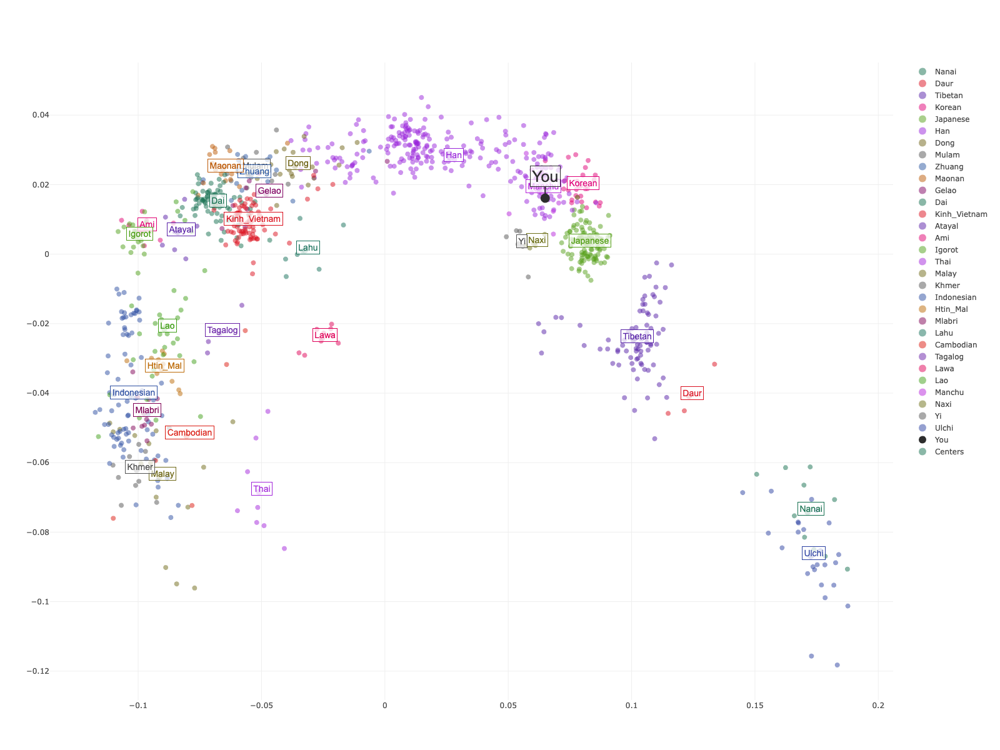<figcaption>Autosomal PCA | East Asian reference samples, full plot</figcaption></figure>

<figure>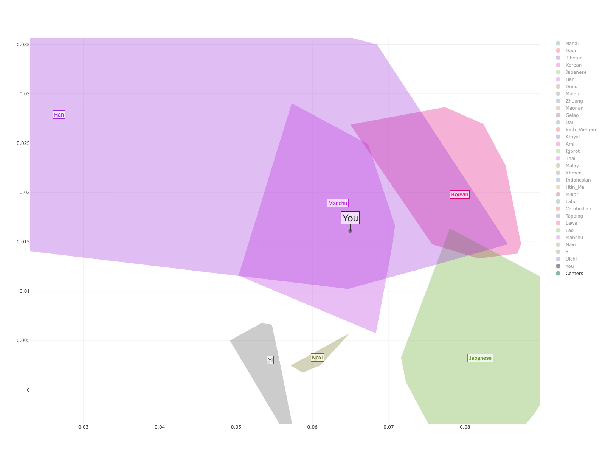<figcaption>Autosomal PCA | East Asian detail where the Han and Manchu reference ranges overlap</figcaption></figure>

<figure>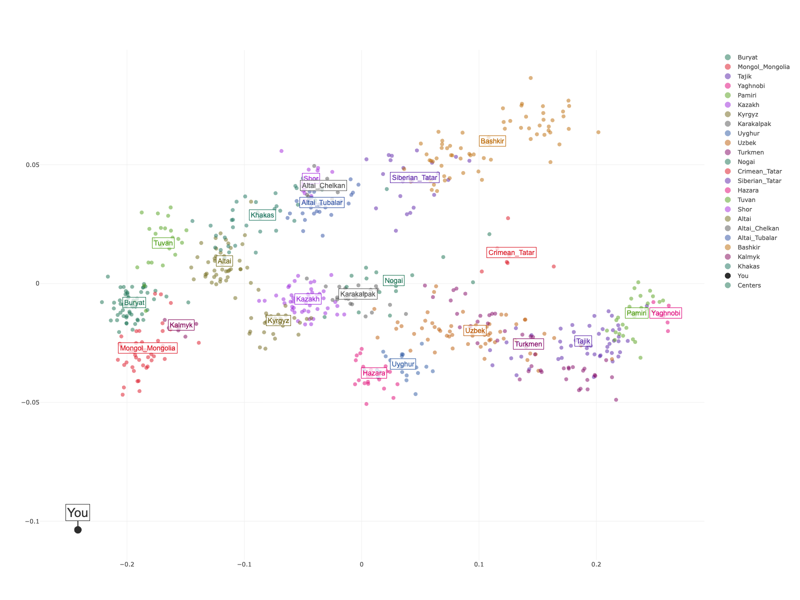<figcaption>Autosomal PCA | Steppe and Central Asian reference samples</figcaption></figure>

I inherited a Y chromosome from my father and, through my mother, some of my maternal grandfather’s autosomal DNA. My paternal grandmother was born in the Daqing Mountains. My maternal grandmother was from Qi County. My great-grandmother took my grandfather to market in Xuejiakulüe. I learned the names of those places from my family, a little at a time.

It has been almost three years since I first told a close friend I wanted to write about my family’s memories. I have worked at it on and off. Sometimes I would put it down for a long time. Then I would read a page of an old gazetteer or hear a relative say one more thing, and want to do a little more.

Along the way I had some help from AI tools. I could ask where to find a book or a volume, or what a few hard-to-read characters might say. To match a person to a date, I still went back page by page to see whether the two records met.

The village committee that put together the genealogy kept the name Mei Yonglu alive. At first I only wanted to know a little more about him. I had no idea that following that name into the appointment register would turn up several earlier generations, farther back than the compilers had been able to go. Then I read that Mei Chun “submitted in the <em>bingshen</em> year.” Suddenly there was a year in front of me. 1356, nearly seven hundred years ago.

Maybe someday, when someone wants to know about their family, AI will find records centuries apart in a matter of moments. I imagine how many people might learn about relatives they never met, where they were and something they did in a particular year. Would people feel a little less alone?

I also want to write about the people I did know. Some of what they left me I am already close to forgetting.

## VII. In Time, I Too Had a Place to Call Home {#hometown}

Once in primary school, a teacher asked us to write about our ancestral hometown. What came to me was a little road in the countryside. My cousin and I were in the car drinking yogurt. There was no keeping out the smell of cow dung. We were headed to Qingxu, to my maternal grandfather’s village. I envied him for having a place to call his own. In my composition I made the village we passed through my hometown.

The teacher said a hometown should make you want to praise it and told me to pick something good to write about. I very earnestly wrote a sentence in my diary that day, “Your hometown is a place you praise from the heart.” Writing it down, I thought I had come a step closer to the truth of the world. Long afterward, if someone asked me where my hometown was, I still could not tell them.

There were two places in Taiyuan I knew especially well as a child. One was the bureau compound where I went after school. The other was where my father’s parents lived. To get there, we crossed the Fen River to the west side, which we called Hexi. Sometimes we took the No. 39 bus. All I wanted on the bus was to get there sooner. Then I could go downstairs and play.

Only after my grandfather died did it gradually occur to me that he knew none of those compounds and streets as a boy. He had to leave Yuanying and travel a long way before he got to the place we went to see him on holidays.

### The Bookcase on the West Side {#bookcase}

In my grandfather’s bookcase were photographs of my uncle Mei Qiang and my father Mei Liang as boys. A few years ago my uncle told me that my father had been such a good-looking boy that foreigners visiting the factory would ask to take his picture.

Hearing about the photograph, I thought of a trip Ake and I took to Mexico. We were in Cholula, near Puebla, when a little girl ran up and asked to take a picture with Ake. I do not remember whether I ever saw the photograph my uncle was talking about in the bookcase. <a class="reference" href="#note-15">[15]</a>

I love Orhan Pamuk’s <em>Istanbul: Memories and the City</em>. As a boy he would play in his grandmother’s sitting room. When he tired of playing, he would look at the photographs on the tables and walls. He also writes that some things from childhood are told to us by our family. Hear them often enough, and it is as if we remember them ourselves. Sometimes when I think of Taiyuan, the first thing I see is a room in my grandfather’s home. <a class="reference" href="#note-17">[17]</a>

At Lunar New Year, once everyone had gathered at my grandfather’s, we would lean out on the balcony to watch the fireworks. My uncle bought most of them. My father, the younger brother, hardly ever did. As a child I was busy watching. Thinking about it now, my uncle probably considered it his job at New Year.

I still like to stand by a window for a while when it is cold. Sometimes, standing there, I remember leaning on that balcony with my family all those years.

When I think of that room, I always see my grandmother on the sofa. In her last years she could no longer speak. I remember her watching <em>Blood-Colored Romance</em>, a series that begins in Beijing in the sixties. As a child I found the title frightening. Two people were walking along the railway tracks on the screen. That was when she cried. <a class="reference" href="#note-16">[16]</a>

I watched the series myself later. It did not move me much. I have never liked stories that make all of society into a <em>jianghu</em>, a world where talking about loyalty and obligation is supposed to explain everything between people. I still do not know what my grandmother was thinking about that day.

After my grandmother died, my grandfather would still sit down and write to her in a diary. I do not know what he wrote. I just remember that he did this. She was gone, and there were still things he wanted to tell her.

### The Low Wall in the Back Yard {#low-wall}

At my grandfather’s I most often played with my cousin Mei Yifan, my uncle’s daughter. I always called her my sister. Her favorite dog, Chouchou, was a little Pomeranian. Chouchou lived a long time and eventually died, too.

Before my grandfather’s home was demolished, there was no park out front. There was a low wall in the back yard. I watched my sister climb it and tried to do what she did. The wall was not that high. I could get down on my own, but she always had to take my hand and pull me up.

When we were tired, we would go back inside and play Aeroplane Chess. It was a cheap set that had come free with something, and I still remember it. We could sit there a long time. Once we stayed on the wall until late. My father called, “Come on, time to go.” I got down by myself and followed him with my head lowered.

My sister got busy with school. While she was away, I learned to climb up on my own. When she came back, I was so happy to tell her.

“I can climb up by myself now! Let’s go downstairs and play.”

“Which one? Oh, that. I’m not going.”

Afterward, I still climbed it by myself. From there I could watch the park in front of my grandfather’s home take shape bit by bit. However nice that park became, it would never belong to me. I had made up my mind about that when I was very small.

The little brother who used to need her to pull him onto that low wall eventually got to be old enough for college. On my first day, I went to school in a T-shirt my sister had given me.

By the last time I saw her, our grandparents were gone. We sat down at home to play again, this time five-in-a-row. We may only have played a few games. I did not want to lose to her, and I did not want her to lose. Once she beat me easily, I settled into playing. For a little while, it felt like the days when we used to sit and play had come back.

The last time I had been that happy with her was her birthday. I remember eating a lot of the chocolate that was meant for the guests.

At Lunar New Year in 2021, my sister was studying oil painting at Musashino Art University in Japan and was close to graduating. She sent me a message.

“Happy New Year, little brother! Be happy every day in the Year of the Ox. Do the things you want to do.”

She died that same year. The day I heard, Beijing was bright and clear. I stood at the door to my room and saw my father smoking in the living room, with my mother beside him. I looked out the window behind them.

Back in my room, I looked out my own window. It was still just as clear. The game was still running on my computer. I had forgotten to pause it.

One year I reached the age she had been then. When I read “little brother” in that message, I can still hear the way she said it. What year is it now? For me it is still the Year of the Ox. <a class="reference" href="#note-9">[9]</a>

### Weekends When Yimama Came Back {#weekends}

Some weekends I stayed in our own compound. My grandfather on my mother’s side lived there, too. Every week my mother and Yimama would come back to see him. My older cousin is Yimama’s son. As soon as he got there, we usually took a ball downstairs.

First we practiced dribbling in the courtyard and tried to work out how to get past somebody. When we thought we had it, we would walk to Shanxi University on Wucheng Road, which we called Shanda. On the university courts, we found people to play with and saw if the moves we had spent all that time on could actually work. <a class="reference" href="#note-14">[14]</a>

Another place we went was over near Changfeng Street. There was a big bookstore building called Deyi Cultural Plaza that sold books wholesale and retail. We just called it Deyi. To buy a few books, we would take the bus or walk all the way from the compound. <a class="reference" href="#note-14">[14]</a>

There was a shop in Deyi that sold comics, quite ahead of its time then. My cousin and I also went to the used-book shops near the Shanda library. I bought so many <em>Mickey Mouse</em> comics there. Now I cannot remember one story.

It was usually getting dark by the time we walked back from basketball. At home, my grandfather had dinner ready. He would put red dates in the millet porridge. No matter how hungry I was, I did not like the dates in that bowl.

What we could agree on was the cooked beef and egg rolls from Liuweizhai, a longtime Taiyuan shop known for its seasoned meats and prepared foods. <a class="reference" href="#note-14">[14]</a>

At New Year my aunt’s husband cooked, too. He liked making hairtail. My favorite was his pan-blistered green peppers, and he liked making them for me.

My uncle was from the countryside near Xinzhou. Around my cousin’s twelfth birthday I went along to his village. I lost fifty yuan at the unlicensed internet cafe there. That I still remember.

In the compound, after dinner I usually ran upstairs to get a little more time on the computer. Sometimes my cousin and I played at home. We once set up a tent in the study.

The boiler room in the compound still burned coal then. A man went around sharpening kitchen knives, a service we called <em>qiang caidao</em>. A van sold flour, its loudspeaker calling, “Factory Number Two is here to deliver flour.” I thought for a long time that “deliver” meant they were giving it away. My mother explained that you still had to pay.

My cousin’s children are growing up. Sometimes, when I think of him, the first thing I see is the two of us setting off for Shanda with the ball.

After I left home, I would sometimes smell Chinese cooking from my balcony and remember that walk back from the courts. It was nearly dark. We had just finished playing and were headed to the compound. I wrote to my mother about the smell. I told her, “You know I haven’t played basketball in a long time.”

### After Thirteen {#after-thirteen}

I went to boarding school at thirteen. I lived at home much less after that. Later I went to Beijing and then to the United States. Sometimes I feel that my ties to my parents and my family were fated to be slight.

I remember talking to my father about what counts as a blessing. Is it a blessing to have your children and grandchildren nearby and be able to eat together every few days? Is it also a blessing for them to go far away and do well, even when you hardly get to see them? I still have not worked that out for myself.

When I think back to when we all lived together, I often see our tiny dining room. On the floor next to the radiator was a box of chocolate milk. Whenever I felt like some, I would take a pouch out of the box like a little cat. Nobody else in the family drank milk.

My mother carried every one of those boxes upstairs for me. As a child all I knew was that when I wanted some, there it was.

### Are We Having Big Fat Noodles Today? {#big-fat-noodles}

I still remember how different people in the family cooked. My grandfather’s best dish was lamb stir-fried with scallions. My father loves making lamb, too. I always think he cannot make it taste quite like Grandpa’s.

I hated carrots as a child. One time my father cut them into shreds and put them in lamb soup with glass noodles. I bent over the bowl and ate in big mouthfuls, noodles and carrots together. It was the first time it occurred to me that a carrot could taste that good.

Of all the things my mother made, I think most often of <em>tijian</em>. For these Shanxi noodles, you put soft dough on a plate and use chopsticks to flick strands from the rim into boiling water. They come out pointed at both ends and fat in the middle. We called them big fat noodles. <a class="reference" href="#note-14">[14]</a>

My mother loved to hear me say that. When I came home from Taiyuan No. 91 Primary School, I would often get through the door and ask her right away.

“Are we having big fat noodles today?”

I do not know when they became my favorite noodles. Later in Beijing a close friend came to love them, and Ake does, too. I still call them big fat noodles.

## Epilogue {#epilogue}

My name is Yangsheng. My uncle, my aunt, and my grandfather often said it as “yangserr.” Ake thinks it is a lovely sound.

I can no longer remember what my grandfather’s voice sounded like when he called me.

If I could see him in a dream one day and he said my name again, I think I would still answer.

Then I wake. Alone in the west wind, counting the departing crows.

::: {.source-notes}

## Illustrations and Sources {#illustrations-and-sources}

<strong>[1] Yuanying and the country beyond the pass.</strong> Li Zhibin and Huang Ji, eds., <em>Shanyin County Gazetteer</em>, China Overseas Chinese Publishing House, 1999. Administrative history and Yanbei, pp. 7–9 and 34. Terrain, the Huangshui, and climate, pp. 44–45 and 48–54. Enrollment, p. 87. Pastures, grasses, and fodder, pp. 171–172. Community and primary schools, pp. 283–284. Housuo and the defenses at Guangwu, p. 400. Yuanying’s name and Ming events, pp. 609–610. The village figures are from the 1997 table on p. 34. <a href="https://ci.nii.ac.jp/ncid/BA75342713">Library catalogue</a>

<strong>[2] The Daqing Mountains and Zhou Dai’s residence.</strong> The depot and its location in the Wuchuan area are from family accounts and a family manuscript, <em>Ancestors of the Mei Family</em>. For Wuchuan’s Republican-era jurisdiction, see <a href="https://www.nmgqq.com.cn/quqinggailan/jianzhiyange/huhehaote/2021-04-26/21676.html">the gazetteer entry on Wuchuan County, Hohhot (I)</a>. For Zhou Dai’s birthplace, career, and residence, see <a href="https://www.xzrbw.com/info/3078/412397.htm">the <em>Xinzhou Daily</em> article on Zhou Dai’s residence</a>. For his artillery command in the Shanxi military, see <a href="https://m.fx361.com/news/2017/0714/2041497.html">the biographical account</a>. Ake and I learned about Li Jinyuan’s marriage to Zhou Tao from the Zhou descendants. My grandmother’s childhood comes from family memory. The Lis in Dai County showed us the hand-drawn genealogy. <a href="https://www.wuchuan.gov.cn/sywc/qywc/lsyg/">Wuchuan County government, administrative history</a>

<strong>[3] Li Chengchun.</strong> <a href="https://m1.rw.ttdm.cn/history/9/lichengchun.html">Biographical profile of Li Chengchun</a>. For the Ximenghui and the Dare-to-Die Corps, see <a href="https://dangshi.people.com.cn/n/2015/0114/c85037-26383785.html">the People’s Daily Party history article on the Shanxi Provincial Normal School memorial</a>. Membership in the league, persuading the household to contribute its property and educate the girls, becoming head of the family, and its move to Guangzhou are from family memory. His school in Taiyuan remains to be verified. <a href="https://cn.govopendata.com/renminribao/1985/09/16/5/">A <em>People’s Daily</em> retrospective on the Ximenghui and the Shanxi corps</a>

<strong>[4] The Mei Yonglu entry.</strong> First Historical Archives of China and Liaoning Provincial Archives, eds., <em>Collected Archives of the Ming Dynasty</em>, vol. 71, Guangxi Normal University Press, 2001, printed pp. 46–47 (PDF pp. 62–63 in this scan). I consulted my earlier transcriptions in <em>Ancestors of the Mei Family</em> and <em>From Jiangnan to Yuanying, North of Yanmen</em>. For the <em>baihu</em> establishment see <a href="https://m.cidianwang.com/wenxue/guoxue/shibu/182777.htm">the <em>History of the Ming</em>, vol. 76, “Official Offices”</a>. For review, examination, and appointment registers see <a href="https://www11.ihp.sinica.edu.tw/storage/w2_file/3157ztxEQpA.pdf">Yu Zhijia’s study of Ming military appointments</a>. See also pp. 1, 3, and 18 of the family genealogy, its account of the ancestral graves, and its account of Mei Yonglu as first settler. I have kept the numbering used by the genealogy and the official register.

<strong>[5] The submission in 1356.</strong> <a href="https://zh.wikisource.org/zh-hans/%E6%98%8E%E5%8F%B2/%E5%8D%B7125"><em>History of the Ming</em>, vol. 125, biography of Xu Da</a>, <a href="https://www.shidianguji.com/book/HY2451/chapter/1kp9f2kvaiejf"><em>Words and Deeds of Eminent Ming Officials</em>, vol. 2</a>, and <a href="https://zh.wikisource.org/zh-hans/%E5%A4%A7%E6%98%8E%E5%A4%AA%E7%A5%96%E9%AB%98%E7%9A%87%E5%B8%9D%E5%AE%9E%E5%BD%95/%E5%8D%B7046"><em>Veritable Records of the Hongwu Emperor</em>, vol. 46</a>. <a href="https://dfz.nanjing.gov.cn/gzdt/202403/t20240326_4195220.html">Nanjing Gazetteer Office, article on Xu Da</a>

<strong>[6] The Changhuai Guard and Guangwu.</strong> For Changhuai see <a href="https://zh.wikisource.org/zh-hans/%E6%98%8E%E5%8F%B2_(%E5%9B%9B%E5%BA%93%E5%85%A8%E4%B9%A6%E6%9C%AC)/%E5%8D%B7040">the geography chapters of the <em>History of the Ming</em>, vol. 40</a>, and <a href="https://www.shidianguji.com/book/CADAL02037188/chapter/1l7m65ewv9nvm">the <em>Gazetteer of the Southern Metropolitan Region</em>, vol. 9</a>. For the Guangwu military station see <a href="https://ctext.org/wiki.pl?chapter=453441&amp;if=en&amp;remap=gb">the <em>Veritable Records of the Jiajing Emperor</em>, vol. 276</a>. For the relocation of the defense commander see <a href="https://www.shidianguji.com/book/NLG312001067645/chapter/1la712ido2qt0">the Qianlong <em>Gazetteer of Daizhou Directly Administered Prefecture</em></a>. The stars and arrows on the maps are mine, marking possible locations of Yuanying.

<strong>[7] The Meis of Wujin.</strong> <a href="https://fzg.changzhou.gov.cn/html/fzg/2014/KHPNMFLI_0823/204.html">Changzhou gazetteer archive, its listing of the <em>Genealogy of the Meis of Hengshan, Piling</em></a> and <a href="https://www.guoxuedashi.com/shumu/1997992lt.html">the catalogue record for the <em>Fangqian Mei Genealogy</em></a>. Both are catalogue descriptions. <a href="https://www.changzhou.gov.cn/ns_class/zjcz_01_01">Changzhou municipal government, historical overview</a>

<strong>[8] Paternal lines and population comparisons.</strong> Two family snapshots from 23Mofang’s marker-history reports, plus the platform’s AI note for my father. For M95 and F1252 see <a href="https://doi.org/10.1371/journal.pone.0101020">Zhang et al. (2014)</a> and for the O-F8 samples from Mogou, Lintan, see <a href="https://doi.org/10.15184/aqy.2022.157">Ren et al. (2023)</a>. Ancient DNA for Emperor Wu of Northern Zhou and Li Keyong is reported in <a href="https://pubmed.ncbi.nlm.nih.gov/38552628/">Du et al. (2024)</a> and <a href="https://www.sciencedirect.com/science/article/pii/S1673852726001475">Yu et al. (2026)</a>, respectively. The autosomal section draws on the header of my MyHeritage genotype file and my three earlier PCA plots. <a href="https://www.genome.gov/about-genomics/fact-sheets/Y-Chromosome-facts">National Human Genome Research Institute, Y chromosome fact sheet</a> · <a href="https://pmc.ncbi.nlm.nih.gov/articles/PMC6007879/">Principal component analysis in genetic studies</a>

<strong>[9] Family accounts and writings.</strong> Everyday details are from conversations with my father, Mei Liang, my eldest uncle, and other family members, as well as my own diaries, essays, and letters. For Liu Dapeng’s life and diaries see <a href="https://rccsh.sxu.edu.cn/zxdt/7a2c48fb097e4184bb0ab3853ef38254.htm">the Centre for Chinese Social History at Shanxi University</a>.

<strong>[10] My grandfather’s calligraphy.</strong> Family copy of <em>Traces of Ink: The Calligraphy of Yuchun</em>. His life is described in the opening biography. My preface (Beijing, January 2021) describes copying and sorting his work in 2019. See pp. 2–3 for <em>Run a Household with Virtue and Wisdom</em>, pp. 40–41 for Mao’s <em>The Long March</em>, p. 44 for <em>Still a Soldier at Heart</em>, and pp. 46–47 for <em>Keep a Child’s Heart and Long Life Will Follow</em>. The photographs are from the family calligraphy collection. <a href="https://www.chnmuseum.cn/zp/zpml/gmww/202112/t20211214_253215.shtml"><em>Outline Land Law</em>, National Museum of China</a>

<strong>[11] Chiqiao’s past.</strong> Henrietta Harrison, <em>Mengxingzi</em>, Chinese translation by Zhao Yanjie, Peking University Press, 2013, epilogue. English original: <em>The Man Awakened from Dreams</em>, Stanford University Press, 2005, pp. 165–167. <a href="https://books.google.com/books/about/The_Man_Awakened_from_Dreams.html?id=Mgr_cD_Y9zcC">English edition catalogue entry</a>

<strong>[12] Inside and beyond Yanmen Pass.</strong> Yuan Haowen’s complete poem “Beyond Yanmen Pass.” The Qianlong <em>Daizhou Gazetteer</em> lists Yangmingbao west of the seat and Yuanying among the northern villages. <a href="https://www.gushiwen.cn/shiwenv_2e90c6e5d2aa.aspx">The poem in Chinese</a> · <a href="https://www.shidianguji.com/book/NLG312001067645/chapter/1la712ido2qt0">The Daizhou gazetteer</a> · <a href="https://sjfw.mct.gov.cn/site/dataservice/culdetails?curId=10&amp;id=34809">Ministry of Culture and Tourism information on Yanmen Pass</a> · <a href="https://sx.people.com.cn/n2/2024/0805/c189134-40933864.html"><em>People’s Daily</em> on Daizhou and the Zhenwu Guard</a>

<strong>[13] Accounts of the Mei surname and family genealogies.</strong> <a href="https://fzg.changzhou.gov.cn/html/fzg/2014/OQHCOHAJ_1027/253.html">Changzhou gazetteer, surname origins citing Zheng Qiao’s <em>Comprehensive Treatise</em></a> · <a href="https://www.guoxuedashi.com/jiapu/58397yddo.html">Catalogue entry for the Xuancheng genealogy</a> · <a href="https://fzg.changzhou.gov.cn/html/fzg/2014/KHPNMFLI_0823/204.html">Changzhou gazetteer archive, family genealogies</a>

<strong>[14] Everyday places and food in Taiyuan.</strong> <a href="https://finance.people.com.cn/n/2014/0421/c1004-24920187.html">2014 report on Deyi Cultural Plaza</a> · <a href="https://goldcorn.cn/html/gouwuchangsuo/201301/22-50003.html">Changfeng Street book market in a 2013 directory</a> · <a href="https://jjc.sxu.edu.cn/xyjs/wcxq/xqgk1/index.htm">Shanxi University’s Wucheng campus</a> · <a href="https://www.ihchina.cn/art/detail/id/14666.html">Traditional preparation of Liuweizhai seasoned meats</a> · <a href="https://www.tygxc.com/site/tygxc_cn/wzgc/mstj/detail2021-10-26-101.html">Taiyuan’s old city, <em>tijian</em> noodles with seasoned meat</a>

<strong>[15] Places, factories, and schools.</strong> <a href="https://www.ndrc.gov.cn/fggz/cxhgjsfz/dfjz/200611/t20061106_1155404.html">National Development and Reform Commission, Taiyuan Heavy Machinery Group</a> · <a href="https://cn.govopendata.com/renminribao/1959/09/22/12/">1959 <em>People’s Daily</em> account of the plant on the west bank of the Fen</a> · <a href="https://www.mtdzfh.com/Home/Index/show_news/nid/356/cid/16.html">Coal industry association profile of the Shanxi Provincial Bureau of Coal Geology</a> · <a href="https://www.moe.gov.cn/srcsite/A03/s181/201004/t20100408_91742.html">Ministry of Education on Taigu Normal School</a> · <a href="https://www.mva.gov.cn/xinwen/dfdt/202409/t20240929_446119.html">Ministry of Veterans Affairs on Guangwu</a> · <a href="https://www.zhoukou.gov.cn/page_pc/zjzk/zkyx/zkwh/article41fb42f6948c400290bdfeda55907067.html">Local history on Hongtong as an ancestral home</a> · <a href="https://lugares.inah.gob.mx/es/node/4336">Mexico’s National Institute of Anthropology and History on Cholula</a>

<strong>[16] Reading, schooling, and the screen.</strong> <a href="https://www.cambridge.org/core/journals/annales-histoire-sciences-sociales">About the <em>Annales</em> journal</a> · <a href="https://www.gdwsw.gov.cn/shsy/content/post_21971.html">Republican-era primary schools and kindergartens</a> · <a href="https://catalog.afi.com/Catalog/moviedetails/59573">American Film Institute entry for <em>The Joy Luck Club</em></a> · <a href="https://www.iqiyi.com/a_12z3ly177jt.html">Synopsis of <em>Blood-Colored Romance</em></a>

<strong>[17] Pamuk’s family memories.</strong> Orhan Pamuk, <em>Istanbul: Memories and the City</em>. <a href="https://www.ecampus.com/istanbul-memories-city-reprint-orhan-pamuk/bk/9781400033881">Excerpt from the first two chapters in English</a> · <a href="https://www.penguinrandomhouse.com/books/126387/istanbul-by-orhan-pamuk/9781400033881/readers-guide">Publisher’s reading guide</a>

### Gazetteers I Looked Through for the Village {#gazetteer-plates}

<figure>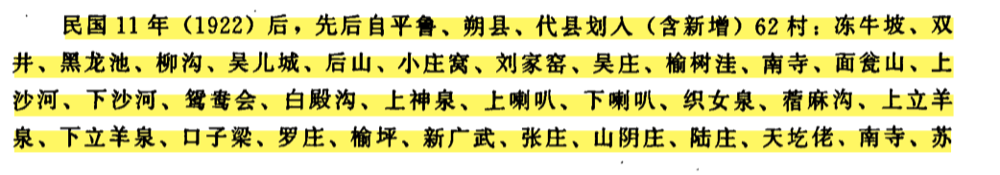<figcaption><em>Shanyin County Gazetteer</em> | Administrative history</figcaption></figure>

<figure>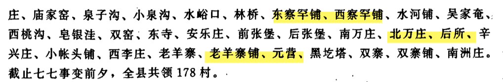<figcaption><em>Shanyin County Gazetteer</em> | Administrative history</figcaption></figure>

<figure>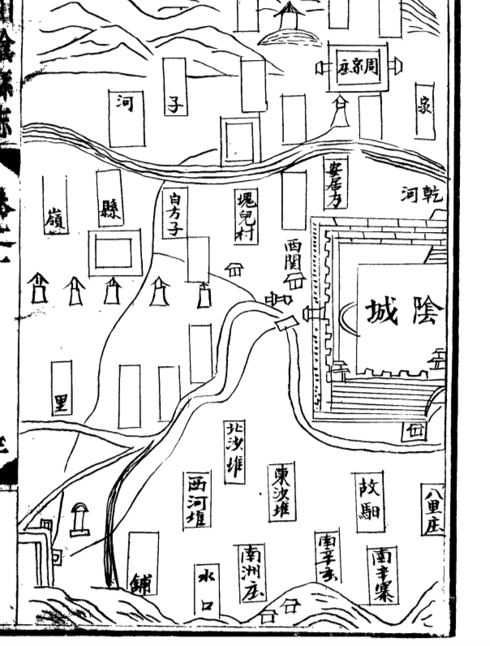<figcaption>Chongzhen <em>Shanyin County Gazetteer</em> | Clues from neighboring villages</figcaption></figure>

<figure>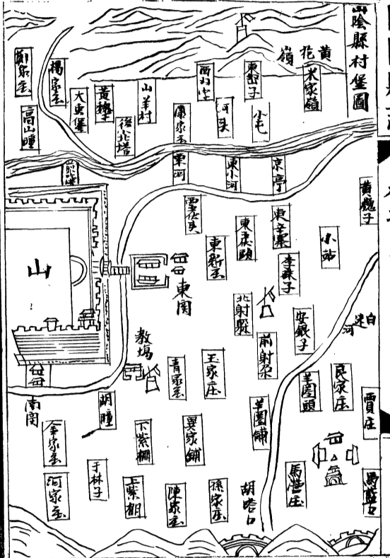<figcaption>Chongzhen <em>Shanyin County Gazetteer</em> | Clues from neighboring villages</figcaption></figure>

<figure>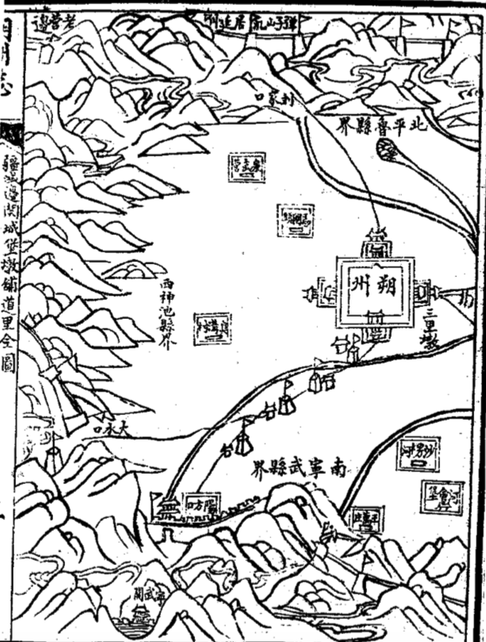<figcaption>Yongzheng <em>Shuozhou Gazetteer</em> | Clues from neighboring villages</figcaption></figure>

<figure>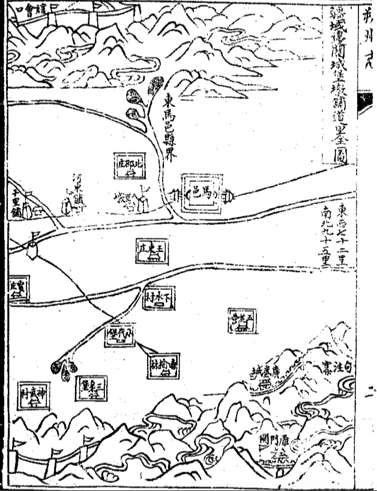<figcaption>Yongzheng <em>Shuozhou Gazetteer</em> | Clues from neighboring villages</figcaption></figure>

<figure>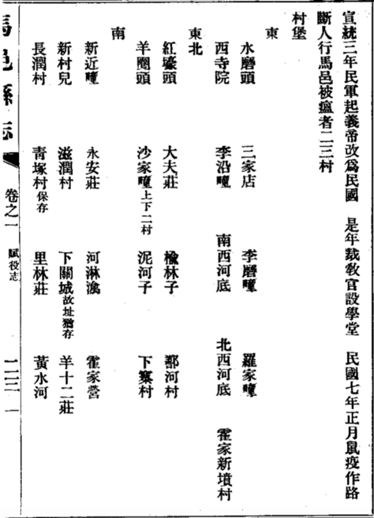<figcaption><em>Mayi County Gazetteer</em> | Neighboring villages</figcaption></figure>

<figure>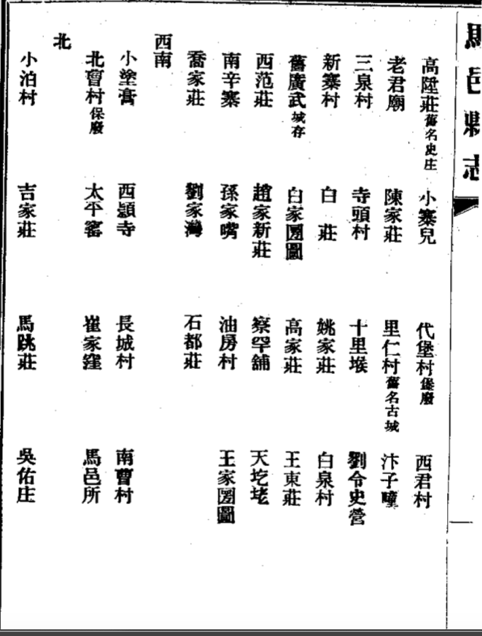<figcaption><em>Mayi County Gazetteer</em> | Neighboring villages</figcaption></figure>

<figure>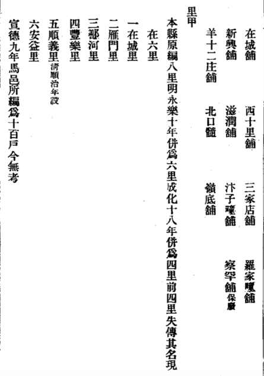<figcaption><em>Mayi County Gazetteer</em> | Neighboring villages</figcaption></figure>

<figure>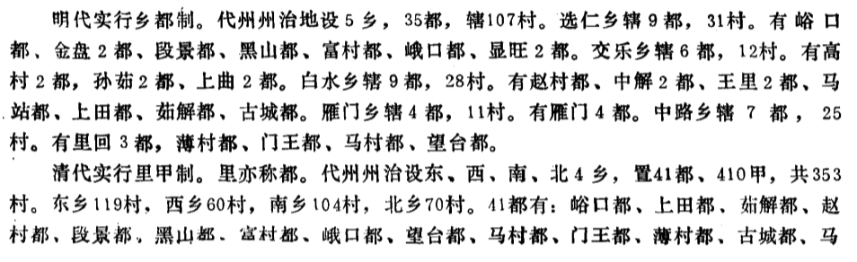<figcaption><em>Dai County Gazetteer</em> | Northern townships and the Republican-era Fifth District</figcaption></figure>

<figure>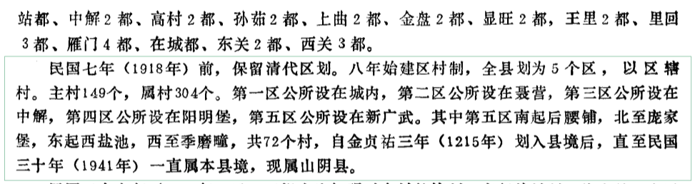<figcaption><em>Dai County Gazetteer</em> | Northern townships and the Republican-era Fifth District</figcaption></figure>

<figure>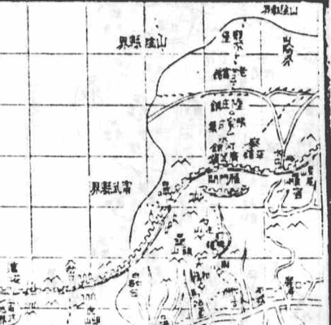<figcaption>Guangxu <em>Daizhou Gazetteer</em> | Jurisdiction</figcaption></figure>

<figure>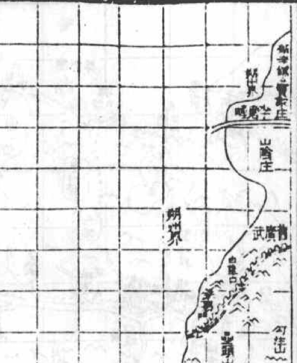<figcaption>Guangxu <em>Daizhou Gazetteer</em> | Jurisdiction</figcaption></figure>

<figure>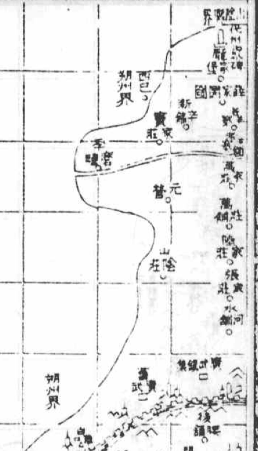<figcaption>Guangxu <em>Daizhou Gazetteer</em> | Northern townships map and distances</figcaption></figure>

<figure>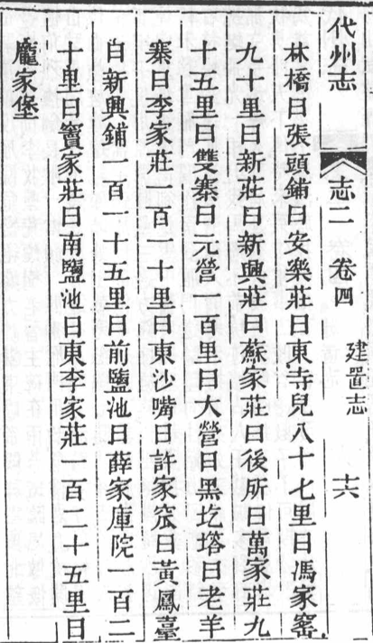<figcaption>Guangxu <em>Daizhou Gazetteer</em> | Northern townships map and distances</figcaption></figure>

<figure>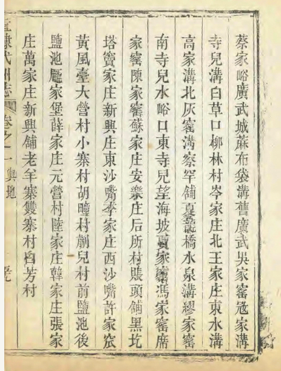<figcaption>Qianlong <em>Gazetteer of Daizhou Directly Administered Prefecture</em> | Villages of the northern townships</figcaption></figure>

### Plates from the Appointment Register and Genealogy {#register-plates}

<figure>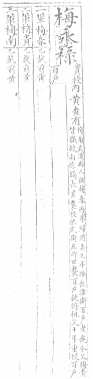<figcaption>Detail from the Mei Yonglu entry | Earlier register and entries one through three</figcaption></figure>

<figure>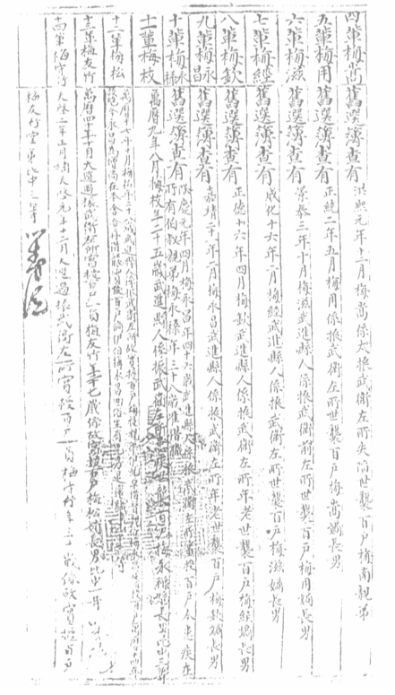<figcaption>Detail from the Mei Yonglu entry | Entries four through fourteen</figcaption></figure>

<figure>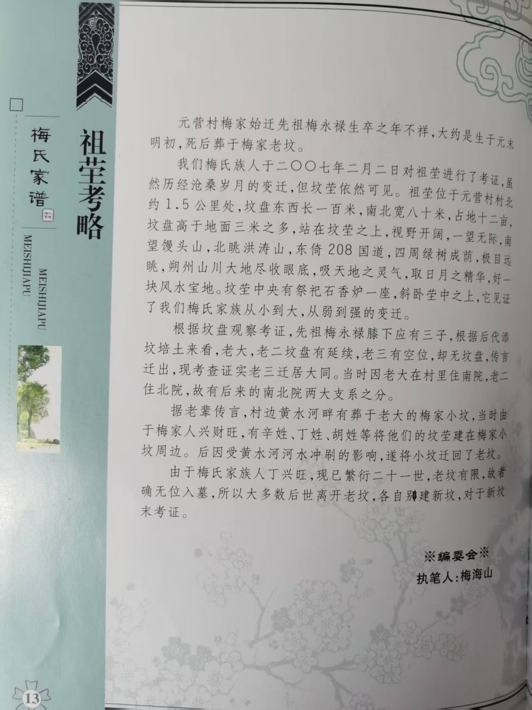<figcaption>Mei family genealogy | Account of the ancestral graves</figcaption></figure>

<figure>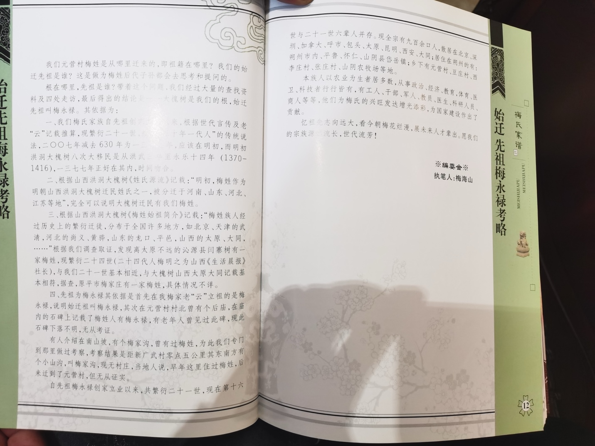<figcaption>Mei family genealogy | Two-page spread from its historical account</figcaption></figure>

<figure>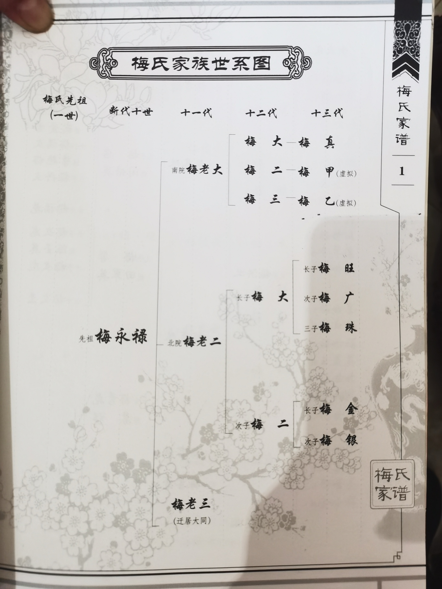<figcaption>First page of the Mei family tree | Family photograph</figcaption></figure>

:::

::::
